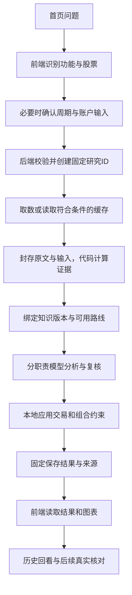

# 当前知识库与问题处理全过程

> 后续开发补充：新发起的明日预测、投资研究已接入动态方法选择、受控研究工具和按角色推理，详见[首批增强交付与验收](alphaagent-model-research-acceptance-2026-10-18.md)。下文原始轨迹保留；旧固定流程与历史继续按原协议读取。

> 2026-10-19补充：首页复杂问句、持仓与账户连续追问已接入现有DeepSeek的匿名语义理解。模型先识别任务、证券指代和研究重点，再进入统一知识体系与原有计算/复核流程；私人数字和原始私人问句留在本地。详见[真实页面与历史验收](alphaagent-semantic-understanding-acceptance-2026-10-19.md)。

> 本文记录2026-10-18书单补充前的架构与数据快照。随后完成[首批书单补充](alphaagent-douyin-booklist-intake-2026-10-18.md)与[财报知识补充](alphaagent-tang-financial-intake-2026-10-18.md)：当前正式参考规则30条、不同原文资料19份、资料版本38个。本文中的原始数量与研究轨迹保留用于追溯；主链绑定8条固定规则的行为未因补充改变。

核对时间：2026-10-18。依据正在使用的`alpha-history-real-02`数据库、CAS原文、实际源码和已完成研究记录。本轮只读取、解释和输出说明，没有修改正式知识、研究结果或模型配置，没有发起新的模型研究。

## 一、知识库现在有哪些部分

### 1. 原文资料库：14份不同资料，33个历史版本，8个来源族

“33条记录”是不同版本的总数，不能当作33份不同资料。当前不同资料共14份，每份都有正文、抓取时间、内容哈希和段落字符定位。

| 来源族 | 不同资料数 | 已保存的内容范围 |
| --- | ---: | --- |
| Berkshire / 巴菲特 | 4 | 1989、1992、2000、2001年度股东信中的经营质量、资本回报、安全边际、风险和资本配置主题 |
| Expectations Investing / Mauboussin、Rappaport | 1 | 作者公开的预期投资三步方法 |
| Fama–French | 2 | 三因子、五因子的原始构造定义 |
| O’Neil / IBD | 1 | 成长、市场环境、突破与入场清单的公开图文资料 |
| Damodaran / NYU | 1 | 《Investment Valuation》公开第二章中的估值方法 |
| Morgan Housel / Collaborative Fund | 3 | 风险管理、合理且可坚持的行为、持有期限与承受能力 |
| AQR / Asness等 | 1 | 价值与动量跨市场研究公开资料 |
| Oaktree / Howard Marks | 1 | 2006年Risk备忘录的定位段落 |

这是公开原信、公开章节、作者方法介绍、论文资料与备忘录的定位摘录库。没有把整本书“读完”的声明，也没有一套已系统收录并验证的中文财经博主库。

### 2. 结构化规则库：24条正式发布参考规则

已发布24条，没有撤回版本。分为筛选6、持有3、入场2、估值3、退出1、市场环境2、风险4、容量3，共8类。

每条规则不是一段随意摘要，而是一个固定JSON版本，包含作者主张、系统改写、A股适配、必需数据、适用条件、操作步骤、反例、禁止推断、参数出处和原文引用。双职责审核核查来源支持与规则完整性，不证明收益或预测效果；当前24条均为`UNVALIDATED`、`REFERENCE_ONLY`。

按实际规则类型列出完整标题：

- 筛选：先看企业经济特征，再看便宜程度；现金流难以解释时缩小结论范围；用竞争变化核查预期修正机制；增长清单保留原始市场与阈值出处；盈利因子是组合定义，不能直接变成单股保证；投资因子需区分资本扩张与实际价值创造。
- 入场：估值略高于价格仍不构成安全边际；突破入场需要量价证据并防止追高。
- 持有：增长要与增量资本回报一起判断；价值与动量互补只作为待验证组合假说；持有期限必须有现金流和承受能力支撑。
- 退出：退出理由同时考虑价值、替代机会和成本。
- 估值：先反推价格隐含的经营预期；现金流、期限与风险共同决定折现估值；同一行业并不自动构成估值可比样本。
- 市场环境：趋势入场先检查整体市场环境；跨市场因子表现仍可能暴露共同流动性风险。
- 风险：困境与周期企业需要调整持续经营假设；更高预期回报不等于实际收益更高；风险还包括亏损和个人目标失败；先排除难以恢复和难以逆转的损失。
- 容量：用现金需求日期约束可承受的流动性；给未知事件保留调整空间；选择能够持续执行的风险配置。

下面是已发布`KR-QUALITY-ECONOMICS`的真实字段节选，省略部分数组和原文长引文：

```json
{
  "rule_id": "KR-QUALITY-ECONOMICS",
  "title": "先看企业经济特征，再看便宜程度",
  "kind": "筛选",
  "horizons": ["MEDIUM", "LONG"],
  "system_rule": "研究低估值股票时同时检查业务回报、竞争优势与资本消耗，不能只凭低价格判定便宜。",
  "required_inputs": ["业务披露", "盈利与资本投入", "估值口径"],
  "conditions": ["必须有支持业务经济特征的具体披露，而非只引用管理层口号。"],
  "counterexamples": ["行业经济特征持续恶化时，即使管理者优秀且估值低，也可能形成价值陷阱。"],
  "forbidden_inferences": ["不得据此推出下一交易日涨跌、保证收益或生成未经工具核算的交易数量。"],
  "citations": [{
    "document_id": "KS-BUFFETT-1989",
    "version": "bfc0b19e51fb7ce0952ef34c221ce5801bdc79b1809f18d239316a443fa0ec66",
    "start": 72874,
    "end": 73844
  }],
  "execution_status": "REFERENCE_ONLY",
  "validation_status": "UNVALIDATED"
}
```

完整规则还保存原始引文及自身版本SHA。引用对象是原文的固定版本和位置，后来重新抓取或发布新规则不能改写旧报告的引用。

### 3. 路线与执行逻辑：4条路线目录，2条有计算实现

- **趋势波段**：已实现行情条件、市场环境、突破、相对强弱、成交额强度、入场参考及失效参考。
- **质量成长**：已实现非金融企业的增长、现金回收及趋势条件；银行等金融企业没有套用非金融财报口径，当前回落到可适配的趋势路线。
- **价值与预期差**：已有参考知识与路线定义，尚未形成同等完整的执行路线。
- **政策与事件**：已有政策证据与传导假设分析，尚未形成同等完整的事件交易路线。

目前均线窗口、突破窗口等执行阈值是系统研究设定，不冒充作者原始阈值。MACD、RSI、ATR等由代码根据封存的复权行情计算，作为辅助证据，不由大模型凭空计算。因子知识已经收录，但不等于已经具备经验证的A股多因子选股、组合收益和成本评估体系。

这些“技能”在当前项目中主要是Python工作流、工具函数、数据合同、提示词和校验器；没有一个自动读取SKILL.md的技能调度系统。项目开发时Codex使用的skills与AlphaAgent产品内部能力是两回事。

### 4. 政策、交易规则与当次市场证据

投资研究的政策入口当前固定为4组官方来源：国内集成电路／软件政策、美国EAR相关出口管制条款、设备更新与以旧换新行动方案、家电等购新补贴通知。按公司行业及主营业务选择来源，保存本次取得的原文、时间和适用边界。

它不是覆盖全部国家政策的自动政策数据库；政策条文、公司资格、经营传导假设和股价反应分开处理，不能因业务相关就断言公司已获得补贴或必然受益。

行情、财报、公司业务、行业归属、资金代理和交易规则构成本次研究的事实层。主要通过Tushare、公开报价／分钟数据及交易所官方资料取得。它们按来源时间封存，不直接变成永不过期的投资常识。

资金证据区分日频大单／特大单代理和分钟估算，不识别机构身份。T+1、交易单位、可卖数量、流动性、行业集中度和收益相关性等由本地工具约束建议。账户相关性使用共同窗口的复权日收益，不使用价格水平直接相关。

### 5. 候选补充与复盘层

当前候选表有1条候选、0条追加评估；候选不进入正式检索。另有21份登记的投资前瞻研究、101条后续观察记录。观察记录包含不同检查与状态，不能解释成101个已到期成功样本。

新的博主想法、书籍或政策材料走：候选归档 → 出处核查 → 提炼条件、必要数据、反例 → 双职责审核 → 固定版本发布。短期市场观点需有效期。实际研究复盘可以形成新候选，不能自动修改或发布正式规则。

### 6. 仍然保留的较早研究分支

较早中期／市场／行业研究另有8张方法卡与3篇原文绑定笔记。8张卡覆盖经营质量、估值预期、市场趋势、资金核查、半导体周期、事件、行业候选、前瞻情景。3篇笔记来自巴菲特、预期投资与French因子定义。

它们与新知识库24条参考规则不是同一份清单，当前共存于不同研究分支；不能把“8张旧方法卡”“投资主链的8条规则”和“24条完整规则目录”混为一谈。

## 二、它实际存在哪里，RAG做到哪一步

```text
D:\deepsearch\
├─ .phase3-quant-o\alpha-history-real-02\          正式活动库
│  ├─ metadata.sqlite
│  │  ├─ inv_quant_knowledge_document            原文版本索引
│  │  ├─ inv_quant_knowledge_search              FTS5全文检索索引
│  │  ├─ inv_quant_knowledge_rule                结构化规则版本
│  │  ├─ inv_quant_knowledge_review/publication  审核与发布事件
│  │  ├─ inv_quant_knowledge_supplement          待核候选
│  │  └─ inv_quant_investment_study/observation  前瞻登记与核对
│  ├─ blobs\sha256\…                            固定原文、JSON、快照、报告
│  └─ knowledge-release.json                    知识交付记录指针
└─ src\marketpulse\quant\knowledge\             检索、规则、路线、研究工作流
```

当前没有独立外部知识数据库、Embedding模型、向量库或神经重排器：

1. 原文搜索将中文拆为相邻双字词、英文拆词，通过本地FTS5召回资料；有界关键词搜索作为回退。这是原文文档搜索，不是向量段落检索。
2. 正式规则搜索有同义词扩展、周期过滤、词法打分和来源族去重，最多返回12条；相关度不是收益或方向概率。
3. **当前投资主链并不调用这套自由规则搜索。**`knowledge_snapshot()`从当时已发布规则中固定选择8条，封存版本和原文片段后交给Planner，再选择适配路线。
4. 8条分别为避免不可逆损失、容量流动性、困境估值边界、趋势入场纪律、市场环境、预期变化退出、增长与资本回报、企业经济特征。账户分组研究还会按选中路线收窄送入Analyst的方法子集。
5. 盘前行业关注使用其中3条：市场环境、入场纪律、避免不可逆损失。明日预测使用独立短期快照及职责提示，当前不把这24条中期方法自由检索进来。

因此当前更准确的表述是：**有来源检索和规则检索能力，也有固定知识增强的研究链；还没有统一覆盖全部功能的动态语义RAG路由。**

## 三、用户输入到输出的共同骨架



首页目前首先通过关键词和已选择功能识别意图，不是先让一个通用LLM理解所有问题。投资计划先进入股票、周期与可选资金确认页；持仓与账户顾问先确认其所需字段。确认后才POST创建研究。

投资计划传入模型的是整理后的结构化任务，而不是将首页问题逐字追加进长期聊天。持仓／账户追问保存前后轮绑定，并通过结构化输入与本地问题主题处理；当前没有一个跨全部页面、自动召回所有历史对话的长期会话记忆系统。

同一请求标识对应同一输入，避免回执丢失后重复创建；新输入或追问另建记录。用户页轮询任务状态，投资计划、持仓顾问和账户调仓当前正常轮询间隔约2.5秒，并不是模型逐token流式输出。

大模型负责公开证据下的方向、理由、反证与检查项；指标、价格参考、股数、仓位和交易约束由代码计算。公开研究上下文不含资金、持仓、成本、股数或Token。原始私人问题也不直接发送给持仓／账户公开研究模型。

## 四、真实研究时序：美的集团＋招商银行

样例：`RUN-IR-2f793ab3badc42639eed2470edc7523e`，2026-10-17 18:18:09.898北京时间创建。它是已有成功验收样例，资金输入是验收假设；下面只展示公开研究与编排，不构成今天的新观点。

时间以后台研究创建为t=0，前端打字、表单确认、HTTP往返及页面轮询等待不在其中。取数与模型时间来自已保存的调用起止记录；最终15,282ms是服务累计执行时间口径。

```text
前端阶段（没有记录到本样例的毫秒链）
  用户提问 → 识别投资计划 → 解析股票 → 确认中期与资料 → 提交
  POST /api/quant/investment-research/runs
  后端返回202及固定run_id；后台继续执行，页面开始轮询
  │
t=0ms  后端创建研究记录
  ├─ 校验股票、周期、请求标识和并发容量
  └─ 保存任务、输入和预算，绑定实际实现版本
  │
t=37～1830ms  来源工具调用窗口
  ├─ 共27次有记录的来源调用，其中19次命中来源缓存
  ├─ 股票目录、交易日历、沪深300、个股日线与复权因子
  ├─ 行业归属、非金融财报、交易规则与后续核对日历
  ├─ 公司业务、日频资金、分钟资金及对应官方政策
  └─ 缓存仍有原来源和时间；27次调用不等于27次新联网请求
  │
t=1830～4978ms  本地整理与封存窗口
  ├─ 保存原文／输入快照，计算财报、行情与技术指标
  ├─ 形成37项证据，绑定8条固定版本方法
  ├─ 判定可用路线：美的可选趋势／质量，招行仅适配趋势
  └─ 这段是相邻记录之间的窗口，没有更细span，不能精确拆分耗时
  │
t=4978ms  Planner调用开始
  ├─ 输入：股票类型、周期、准入路线、8条方法及限制
  ├─ 输出：美的选QUALITY_GROWTH，招行选TREND_SWING
  └─ t=6551ms完成；input_tokens=2644，output_tokens=169
  │
t=6577ms  Analyst调用开始
  ├─ 后端把公开证据、方法和Planner结果放入新的user JSON
  ├─ 首轮review_feedback=[]；以后失败修正才带具体反馈
  ├─ 输出方向、summary、claims、opposing、引用、失效与下步检查
  └─ t=11128ms完成；input_tokens=5994，output_tokens=1002
  │
t=11148ms  Verifier调用开始
  ├─ 输入封存证据、方法、路线选择和完整proposal
  ├─ 逐项核对引用、正负、单位、窗口、方向与入场条件
  ├─ 本条首轮通过；总评由程序按子项计算
  └─ t=14197ms完成；input_tokens=5007，output_tokens=644
  │
t=14218ms  Writer调用开始
  ├─ 仅输入approved_hash与已获准的证券／方向／摘要
  ├─ 逐字确认，不能重新自由创作理由或更改交易数字
  └─ t=15258ms完成；input_tokens=868，output_tokens=119
  │
累计执行约15282ms
  ├─ 本地把批准观点与证据卡、图表、交易条件、组合预算合成报告
  ├─ 固定保存result_ref、result_sha256与COMPLETED状态
  ├─ 本样例4次模型调用，合计16447令牌，无复核返工
  └─ 前端下次轮询读取完成结果；刷新／历史入口继续读取同一ID
```

本例的短耗时受到缓存影响，不是所有股票首次研究的耗时承诺。调用时间已包含模型等待与本地调用记录开销，不代表精确的首token时刻或纯推理耗时。

## 五、实际messages如何组装

当前这条链使用Python职责编排与OpenAI兼容Chat Completions客户端，不经过“LLM Gateway MCP”，也没有向模型开放tools让模型自行发出tool_calls。取数由后端的固定工具代码执行，然后将结果封装为JSON上下文。

每个职责分别发起一次请求，不是把此前所有角色原文连续追加为聊天记录。以本例Analyst为例，以下是字段形状与节选，注释和省略号用于解释，不是完整线上JSON：

```javascript
messages = [
  {
    role: "system",
    content: ANALYST_PROMPT
    // 固定版本职责提示：只用封存事实、明确方向、列理由和反证、引用证据。
  },
  {
    role: "user",
    content: JSON.stringify({
      protocol: "public-investment-context-v1",
      cutoff: "2026-10-17T10:18:09.898176+00:00",
      market_date: "20261016",
      horizon: "MEDIUM",
      horizon_sessions: 60,
      stocks: [/* 两只证券、行业、适配路线和条件 */],
      evidence: [/* 37项F基本面／行情、X业务／政策／资金、T技术证据 */],
      windows: {/* 抽取重复窗口，证据用W编号引用完整窗口 */},
      methods: [/* 8条固定规则及出处，非全部知识库 */],
      plan: {/* Planner已经给出的逐股路线选择 */},
      review_feedback: [],
      review_round: 0,
      limitations: [/* 本次真实缺项与方法边界 */],
      technical_guidance: [/* 技术指标不独立投票等约束 */]
    })
  },
  {
    role: "system",
    content: "Return only one JSON object matching this schema: " + ANALYSIS_SCHEMA
    // 模型适配器在调用前追加，落盘request.messages中前两项之外的第三项。
  }
];

response = await client.chat.completions.create({
  model: "deepseek-flash",            // 本历史样例的实际模型
  messages,
  response_format: {type: "json_object"},
  temperature: 0,
  max_tokens: 4300,                   // 当前两股Analyst代码设定的输出上限
  extra_body: {thinking: {type: "disabled"}}
  // 未传tools、tool_choice或stream；默认非流式。
});
```

Analyst本例返回的美的摘要为“倾向看多，但市场下行且价格未站上均线，宜等待入场条件。”理由引用收入、利润、现金回收、相对表现、技术和政策；反证包括市场／入场条件以及日频资金代理的局限。每项主张保存自己的证据ID，之后Verifier逐项核查。

Verifier的user JSON使用`proposal`携带候选分析；Writer的user JSON只包含`approved_hash`和`items`。它们同样由`system + user + schema system`组成各自请求。本例四个职责调用同一模型，并非四家模型相互独立投票，也不保存模型隐藏思考链。

当前可审计的是call_index、role、时间、request_ref、response_ref、provider response_id与令牌；没有凭空补写你例子中的span_id或首token时间。

## 六、其他问题分支有何不同

- **明日预测**：服务端Planner阶段核对证券、交易日与签发窗口；真实模型职责通常为Analyst → Verifier → Writer。它有独立的短期输入和固定实验协议，不能拿中期书籍方法直接证明明日方向。到期后按真实收盘核对准确率和基线。
- **投资计划**：上面的四职责公开研究，再在本地结合用户资金与风险约束计算仓位。没有资金时仍可输出公开方向与条件，不杜撰账户。
- **单股持仓顾问**：取得或复用上述公开研究，再本地结合成本、股数、可卖数量、当前／假设价和T+1规则形成条件性建议。追问主题目前是规则识别，非把整段私有聊天送入LLM自由回答。
- **账户调仓**：按周期对股票分组做公开研究，再本地计算总仓位、现金、行业集中度、共同日收益相关性、风险及可卖限制，形成整体安排。私人账户和原问题不进入公开模型上下文。
- **中期／市场／行业候选**：使用较早的对应研究分支与方法卡，不应假定与投资计划的24规则检索完全统一。
- **盘前关注**：后台按交易日运行，使用上个完整交易日资料和固定3条规则，四职责形成4–6个行业关注项；与用户现场提问是不同入口。

所有分支结果固定保存，新一轮另存；刷新只是读取历史，不自动重新取数或修改原观点。后续观察追加实际行情与核对记录，正式知识只能经过审核后发布新版本。

## 七、最值得下一步打磨的内容

优先把“问题／周期／行业类型 → 方法检索 → 路线准入 → 证据要求”统一起来，让完整24条规则在适用时真正参与，而不是只扩大资料数量。随后补足行业专用口径、价值与预期差执行路线、政策生效与公司资格核查，以及每条方法的前瞻验证。

是否引入向量检索应根据语义召回漏项的实际评测决定；它不能替代规则准入、出处、期限、反例和组合约束。新博主材料也先进入候选，不直接覆盖现有体系。

核对入口：`src/marketpulse/quant/knowledge/{rules.py,store.py,rule_retrieval.py,research_context.py,routing.py,research_service.py}`、`src/marketpulse/investigation/adapters/model.py`、`frontend/src/App.vue`及`frontend/src/alpha/useInvestmentPlan.js`。

本轮机器证据：`D:\deepsearch\.phase3-quant-o\knowledge-explained-20261018\inventory.json`与`trace.json`。所有时间和计数来自已有数据；本轮没有修改或重新发布知识。

2026-10-18 后续更新：新投资研究、明日预测、持仓顾问与账户调仓已分批接入增强公开研究。新顾问咨询按知识选择、假设／反证、受控工具、分析复核、本地账户计算的顺序执行；旧轮次仍按封存协议恢复。日常追问复用原研究，更新公开资料才新建研究。具体实页证据、兼容与预算边界见 [增强顾问验收记录](alphaagent-enhanced-advisors-acceptance-2026-10-18.md)。本文此前的四职责示例描述的是原历史记录，不能视为新任务的实时调用轨迹。

2026-10-18 市场任务更新：新市场观察和行业候选也使用创建时已发布的知识。Researcher 选择方法、假设和反证，并提出有界的封存事实检索；市场再经 Planner、Analyst、Verifier。行业候选从规划反证生成核查重点，按原固定名单逐股执行 Analyst、Verifier，单股反馈只修正该股，全部批准后按原顺序合并；整次请求共享累计预算。数据计算、候选排序和同业范围仍由原程序核定，全部调用、原文节选位置和方法版本可回放。具体范围、实页结果及限制见 [市场增强验收记录](alphaagent-enhanced-markets-acceptance-2026-10-18.md)。
