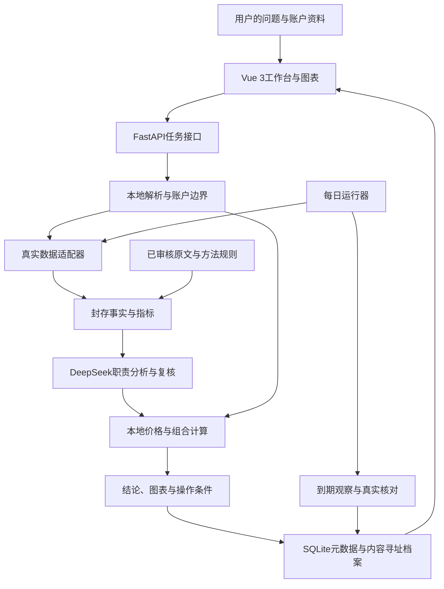

# AlphaAgent 项目介绍、技术复盘与面试问答

> 整理日期：2026年10月19日。根据当前源码、正式知识库和已有实源验收记录编写。
>
> 2026年10月20日补充：新增“十二、沿着界面逐项解释功能与数据来源”，并在第七部分追加界面功能追问。效果数字仍引用原验收时点，不表示本次重新运行了预测或效果评测。
>
> 同日追加：首页意图理解与完整输出链路见2.3.1—2.3.3，逐步区分前端、后端程序和真实模型调用，并说明直接表单入口、旧记录与失败回退的区别。原介绍、案例和问答保留；本次只补文档，没有新增付费模型调用。
>
> 这是一份可以开口讲的稿子。先读“一、开场”和“二、完整介绍”；被问到技术细节时，再从后面的案例和问答中展开。案例、测试数和耗时都限定了对应验收范围，不代表本次重新执行了全部测试，也不代表系统已经证明投资收益。
>
> 文中使用第一人称方便演练。正式面试时，请按自己实际参与的设计、开发、验证范围调整“我”和“我们”，如实说明AI协作；不要把稿子当作个人独立完成全部代码的证明。

## 一、先用一分多钟把项目讲清楚

我介绍的项目叫AlphaAgent，是一个面向A股的AI投资研究和持仓决策辅助系统。

最初我关注的其实是一个很具体的问题：用户看股票时，信息很多，但很难把信息串成一个可以持续跟踪的判断。行情软件告诉你价格，财经文章给你观点，大模型也能写分析，可是你往往不知道它用了什么资料、为什么得出这个结论，以及过几天以后，这个判断到底对不对。

所以我们把整个过程接了起来。用户可以问一只股票明天倾向涨还是跌，也可以研究未来几个月、生成投资计划，或者结合自己的成本和持仓，咨询减仓、加仓和账户调仓。系统会先取得真实数据，再结合内置投资方法分析，给出明确方向、理由、反证和失效条件。价格、股数、仓位这些需要精确核算的部分，由本地程序计算。

它比较有特点的地方是，每次研究都保留当时的数据、知识版本、模型调用和最终结果。刷新页面能找回原报告，新问题会另存，后续还能用真实行情核对原判断。

目前已经能够在本地持续运行，有日常行情更新、盘前行业关注、到期核对和自动备份。不过我会把两个结果分开说：工程链路已经做了真实页面验收，大模型和知识库是否提高了预测准确率，还在做前瞻验证，不能提前下结论。

## 二、面向第一次接触项目的人，完整介绍一遍

### 2.1 用户打开它以后，实际能做什么

我先从用户的使用过程讲，而不是先介绍技术名词。

用户打开首页，可以看到市场指数、活跃板块、行业涨跌、代表股和资金信息。不同信息会显示自己的数据时间。用户不需要先认识什么Agent，也不需要理解内部模型调用，就可以直接提出问题。

最核心的使用场景有四个。

第一个是明日预测。用户输入能够核实的沪深A股名称或代码，系统给出下一交易日的涨跌倾向、理由和反证，保存原始预测，等真实目标交易日结束后再核对。

第二个是投资研究和投资计划。用户问未来几个月怎么看，系统会结合期限和股票类型选择适配路线，再给方向、依据、观察条件和失效条件。有资金资料时，才进一步做条件性的金额和股数试算。

第三个是单股持仓顾问。比如用户说：“我已经持有这只股票了，我更关心什么条件下减仓，先别讨论补仓。”系统要理解这次问题的重点，再结合原研究、最新可得报价和本地持仓计算回答。

第四个是账户调仓。单只股票都看起来有道理，不代表放在一起以后风险合理。所以这一块会看整个账户的总仓位、行业集中度、股票之间的历史收益相关性，以及现金、可卖数量和风险预算。

这几项功能共用统一入口和历史库。用户不需要知道我们现在开发到了P几或者K几，也不需要每次换一个验收链接。

这里也有能力范围：现有持仓顾问和账户能力主要围绕普通现金账户的沪深A股，首版研究周期侧重波段和中期；并没有覆盖所有资产、所有账户类型或所有投资路线。首页行情覆盖与深度行业候选覆盖也是两件事，当前主动行业深研主要落在半导体设备和集成电路制造等已经实现的范围。[使用说明](../README.md) · [账户范围](alphaagent-portfolio-advisor.md) · [行业增强边界](alphaagent-enhanced-markets-acceptance-2026-10-18.md)

### 2.2 我会怎样用简单语言解释架构

如果把系统拆开，我会分成五层。

最上面是Vue 3前端，用Vite构建，用ECharts展示价格、行业、仓位、集中度和相关性。普通用户先看结论和操作条件，想看依据可以展开。模型调用、知识版本和核验信息放在开发者入口。

第二层是Python和FastAPI服务。它负责接收问题、校验输入、建立任务、调度模型和工具，以及向页面返回进度和结果。

第三层是数据与知识。行情和财报回答“现在发生了什么”，知识库回答“遇到这类问题应该怎么分析”。这两种东西不能混在一起：一本书里的方法不能替代今天公司的财报，今天的行情也不会自动成为一条长期方法。

第四层是分析与执行。模型负责方法选择、证据综合、方向判断和反证核查；本地计算负责指标、价位条件、仓位、股数、费用和组合约束。

最后一层是存储与运行保障。SQLite保存任务、版本和引用关系，内容寻址存储保存原文、快照和结果。后台运行器负责每日更新和核对，Windows任务负责本地自启和备份。



这张图表达的是业务关系，不代表所有任务同时并行，也不代表每条业务使用完全相同的角色和预算。当前本地版的投研主链主要是Python状态与职责编排，不应把它描述成已经使用了分布式Agent集群、统一LangGraph图运行时，或者任意工具都能自主调用的开放式Agent。

### 2.3 一个新问题从输入到结果，具体经过什么

我用“研究两只股票未来几个月，并重点看现金回收”这个例子讲。它只是流程示意，不是在这里提供新的股票判断。

第一步，系统先理解问题，确认用户要做的是中期研究还是明日预测，要研究哪些证券，重点是现金回收、反证，还是入场条件。复杂问题和连续追问会使用模型辅助理解，但股票身份和任务范围还要由程序核实。需要补充或确认的结构化资料，会回到表单里让用户确认。

**当前实现补充：**这里提到复杂问题和连续追问，是在说明语义理解能力，不表示只有复杂问句才调用模型。当前从首页输入框正常提交的新问题，简单问句也会先进入后端语义模型；前端所选模式只是上下文提示。直接进入业务表单、读取历史和失败回退，属于下面另行说明的路径。

第二步，去取真实数据。这里会涉及证券目录、交易日历、日线、复权因子、适用财报、行业、资金和政策。我们保留来源时间和数据期间，不能把“刚刚读取了一份旧数据”说成“这是刚刚发生的行情”。

第三步，程序计算指标，并把原始响应、指标和本次能使用的知识版本封存下来。后续分析都要说清楚是基于哪一天、哪一组事实。

第四步，按照研究深度进入模型分析。现在默认是标准研究，它仍然使用模型、知识和复核；深入研究再增加Researcher，让模型选择适配方法，提出待验证假设和可以推翻假设的条件，并请求有边界的工具。

第五步，Planner从已准入路线中选择适配路线，Analyst给方向、支持、反证和失效条件。程序先检查结构、证券和引用，Verifier再检查事实是否支持判断，以及有没有混淆时间、因果和交易条件。

第六步，如果有具体错误，就把对应的上一版分析和反馈一起交回去修正。这个循环受原累计预算约束，并不是一直重试到通过。

第七步，通过后固定批准内容，再在本地结合账户计算仓位、股数和费用。页面最后看到的是公开研究判断与本地计算的组合结果。

第八步，结果另存成独立任务。刷新时读原结果，不重新收费生成。后续观察追加进来，原判断继续保留。

实现上，各职责通常分别发起模型请求，通过结构化上下文交接；受控工具由后端执行并回填结果。页面主要通过轮询获得任务状态。它不是一个模型拿到全部私人聊天以后自由生成到底的过程，也没有把供应商原生`tool_calls`当作所有业务统一的运行方式。[主链实现](../src/marketpulse/quant/knowledge/research_service.py) · [主动研究](../src/marketpulse/quant/knowledge/active_research.py) · [语义理解验收](alphaagent-semantic-understanding-acceptance-2026-10-19.md)

#### 2.3.1 从首页输入到投资计划输出，哪些步骤由谁完成

我会先说明：前端负责交互与任务分发，后端程序负责身份、结构、数据和边界校验，模型负责语义理解与研究判断。模型在Planner之前已经参与，不能把整个过程说成“前端关键词分类以后，才第一次调用Planner”。

下面以“给美的集团和招商银行生成未来三个月投资计划，重点看现金回收”为流程示例。它不是本轮实际执行的新研究，也没有附带真实账户数据。表中的“调用模型”表示该阶段在新任务中会发起模型请求；读取已完成记录或复用匹配检查点时，不一定再次调用。

| 步骤 | 前端处理 | 后端程序、数据或本地计算 | 实际大模型调用 |
| --- | --- | --- | --- |
| 1. 输入与选择模式 | 保存输入；“投资计划”等按钮改变当前模式，作为提示传入 | 此时尚未发起问题理解或研究 | 无，点击模式按钮本身不调用 |
| 2. 提交首页问题 | `ask()`调用问题理解客户端，携带请求标识、所选模式及上一轮理解ID | `/api/quant/questions/understand`检查本机写入边界、请求格式、任务容量和幂等身份，建立问题理解任务 | 无，这一步是创建任务 |
| 3. 核实可用证券 | 等待理解进度 | 从股票目录匹配当前提及的证券，并结合已有上下文形成注册表；模型只能使用这些证券对应的匿名槽位 | 无，证券目录取数与匹配是程序工作 |
| 4. 准备语义上下文 | 原问句提交给本机后端，不直接从浏览器发送给模型供应商 | 按白名单生成去敏投影，以匿名槽位替代证券，遮蔽私人片段和数值；最多组织近期三轮成功语义上下文 | 无，投影和上下文组装是程序工作 |
| 5. 理解意图 | 显示“正在理解问题、条件与前文指代” | 准备固定提示与输出结构 | **有：DeepSeek语义理解调用**，判断任务、目标、期限、关注点、否定和指代；最多保留四项任务 |
| 6. 校验与还原理解结果 | 继续轮询理解任务 | 检查JSON结构、模式、目标范围与数量；将模型返回的匿名槽位映射回已核实证券，并生成业务任务字段 | 无，这一步检查上一步的模型输出 |
| 7. 分发到投资计划表单 | 保存任务选项和草稿，打开`#/investment-research`；预填股票、周期、期限及关注点 | 问题理解结果已经留档 | 无，页面导航和预填不是一次投资研究 |
| 8. 用户确认研究资料 | 用户核对股票和周期，可填写资金与持仓，再点“生成投资计划”；前端做基础表单检查 | `/api/quant/investment-research/runs`按合同校验请求、幂等与容量，建立独立研究任务；服务端检查不能由前端校验替代 | 无，这一步是提交研究任务 |
| 9. 真实取数、计算与封存 | 轮询研究进度 | 读取适用行情、财报、资金及政策资料，核对口径和时间，计算指标、路线准入与参考条件；固定输入及知识版本，构建不含账户原始资料的公开模型上下文 | 无，调用数据API不等于调用大模型 |
| 10. 主动研究，仅深入模式 | 选择研究深度，展示阶段状态 | 提供已发布候选方法，校验并执行允许的工具请求，封存返回材料，再交回模型 | **有：Researcher**选择方法、提出假设和反证、按需请求工具；标准模式跳过本阶段 |
| 11. 路线规划 | 展示研究进度 | 按证券提供已准入路线，检查模型选项是否合法 | **有：Planner**选择适配路线与核查重点；标准投资研究的首个研究模型步骤通常在这里 |
| 12. 分析与复核 | 尚不把未批准意见当正式结论展示 | 检查结构、证券、引用和正文边界；需要时绑定上一版分析与反馈，在原累计预算内纠错；按合同汇总复核结果 | **有：Analyst、Verifier**分别形成判断和检查证据；纠错可能增加调用 |
| 13. 发布、试算与保存 | 等待完成状态 | 当前新结构化投资研究由程序固定批准内容，结合本地账户计算仓位、股数和费用，组装报告并写入历史；旧协议按自身Writer约定恢复 | **当前结构化发布与本地计算不新增Writer调用**；旧协议可能调用Writer，不能按角色名称一概计算 |
| 14. 展示与后续读取 | 读取完成结果，用图表、结论和条件呈现；按任务ID恢复页面 | 读取并核验已保存资料；后续到期核对另追加观察 | 正常读取和行情核对不因此重新生成研究；重新提问或明确新建研究另算 |

其中步骤3的证券匹配、步骤4的白名单投影、步骤6的槽位校验都是规则或确定性程序；步骤5才是理解任务里的真实模型请求。它们并存，不能简单归类成“全靠关键词”或“完全交给模型”。

#### 2.3.2 三个容易误讲的分支：入口、深度与旧记录

**首页自然语言入口：**正常提交会先调用语义理解，即使问题很简单，或用户已经选了“投资计划”模式。模式是模型上下文中的提示，明确语义优先；无法确认时可以要求澄清。识别为投资计划后，当前实现先打开预填表单，需要用户再次确认并提交，不能把“已理解并跳页”当成“研究已经生成”。

**直接业务表单入口：**用户直接打开`#/investment-research`填写股票与周期，任务类型已明确，可以跳过首页语义理解。标准投资研究此时通常从Planner开始研究模型调用；深入研究先执行Researcher，再进入Planner。旧的`#/investment`条件计划路径保留，不能把它与当前模型投资研究接口混为一谈。

**不同业务分流：**这张表以投资计划的研究链路为主。首页识别为明日预测、市场观察或行业候选后，可以直接建立对应任务，不必都先进入投资计划表单；这些业务各有角色和协议。特别是明日预测，标准研究模型阶段主要是方向分析与复核，不能套用“所有任务都从Planner开始”的说法。持仓顾问和账户调仓先进入对应资料表单，公开研究与本地账户计算仍按各自边界执行。

**失败与历史读取：**语义理解失败时，页面明确提示本次未使用模型理解，并提供原功能入口；持仓、账户的有限本地规则回退用于打开确认表单，不把私人原问句伪装成已通过模型的公开研究。前端旧关键词函数仍在，但不是当前首页正常提交时的主要意图识别链路。重新读取已完成的理解或研究、复用匹配检查点，均应与新发起模型调用区分。

#### 2.3.3 面试时怎么说清“模型究竟从哪里开始”

我会这样讲：

“从首页提问时，大模型在研究之前就已经参与了。前端先把问题交给本机后端，程序核实证券、生成去敏上下文，再调用DeepSeek理解任务、期限、关注点和连续追问。程序校验结果，前端再打开对应页面。投资计划会先预填表单，等用户确认后才取数、封存并开始研究。标准研究主要走Planner、Analyst和Verifier；深入研究在前面增加Researcher。通过后由本地程序计算仓位和股数、保存历史，前端负责图表与展示。直接进表单可以省掉意图理解，所以是否从Planner开始，要看入口和研究深度。”

源码核对入口：

- [首页提交与任务分发：`ask()`、`runTask()`](../frontend/src/App.vue) · [模式按钮与输入框](../frontend/src/alpha/Workbench.vue)。
- [问题理解客户端、轮询与草稿映射](../frontend/src/alpha/questionUnderstanding.js) · [问题理解API](../src/marketpulse/quant/knowledge/question_api.py)。
- [证券注册、白名单投影、模型调用与输出校验](../src/marketpulse/quant/knowledge/question_understanding.py)：`collect_registry()`、`projection()`、`run()`、`guard()`、`resolved()`；内部复用名为Analyst的调用角色，但本次职责是问题理解，不是股票研究Analyst。
- [投资计划表单的确认与提交](../frontend/src/alpha/InvestmentPlan.vue) · [研究提交、轮询和恢复](../frontend/src/alpha/useInvestmentPlan.js)。
- [研究API与容量校验](../src/marketpulse/quant/knowledge/research_api.py) · [Researcher、Planner、分析复核与本地发布](../src/marketpulse/quant/knowledge/research_service.py)。

意图理解有独立的`RUN-QU-…`任务和调用、Token记录，投资研究则建立`RUN-IR-…`任务。核对一次用户操作的用量时，要分别查看两类记录；不能只数研究报告里的Planner和Analyst就断言此前没有调用。上述顺序也不等于每次固定调用次数，缓存复用、受控补查、纠错和旧协议都会影响实际记录。

### 2.4 为什么要分多个模型职责

这里的Multi-agent，主要体现为职责和状态的拆分。

Researcher关注“缺什么、应该看什么、什么情况会推翻假设”；Planner关注“当前股票和期限适合哪条已实现路线”；Analyst负责形成判断；Verifier检查判断有没有越过证据。旧流程里还有Writer，部分新结构化研究已经把只做逐字发布的工作改成程序完成。

我认为这样拆的价值，是把每个阶段的输入、输出和失败原因显式化。比如研究失败时，我们能区分到底是没有取到数据、选错了方法、引用不成立，还是方向与入场条件混淆了。

不过我不会说“有多个角色就等于多个专家”。当前这些角色主要仍使用同一DeepSeek模型，会有共同盲点。拆角色可以改善流程组织和定位问题，是否改善最终预测，需要单独实验。

推理强度也不是越高越好。早期尝试过更多职责开启推理，实际遇到过推理和JSON正文争用输出额度的问题。当前新结构化投资研究中，深入模式主要让Researcher保留低强度推理，其他职责按已经核定的结构化输出配置执行；旧任务继续按旧配置恢复。具体业务分支各有固定版本，不能概括成所有角色一直开最高强度。[当前推理配置](../src/marketpulse/quant/knowledge/structured_contract.py) · [历史取舍与修复](alphaagent-contract-budget-acceptance-2026-10-19.md)

### 2.5 知识库现在长什么样

知识库现在不是“把几本书拼成一个大提示词”，我会分四部分介绍。

第一部分是原文资料。当前有19份不同资料，保留38个版本，来自11个来源族。包括巴菲特股东信、Marks备忘录、Fama–French因子定义、AQR研究、预期投资方法、公开估值章节、Housel文章、Bogle成本思想、唐朝公开财报书摘和财政部会计准则等。

第二部分是结构化规则，目前正式发布30条。每条不仅有观点，还保存适用周期、必需数据、适用条件、操作步骤、反例、禁止推断，以及原文的固定版本和位置。比如“利润和现金流不一致”并不能直接推出造假，还要看主体、期间、附注和业务背景。

第三部分是执行路线。目录中有趋势波段、质量成长、价值与预期差、政策与事件四条，但只有前两条已有计算实现。后两条目前仍是参考路线，金融企业也不能直接套用非金融财报口径。

第四部分是候选和复盘。用户给我们的博主观点、书摘或者真实复盘发现，可以先归档候选，再核查出处、适用性和反例，经过审核发布新版本。候选不会直接污染正式检索，也不会因为某次预测碰巧命中就变成“有效策略”。

这30条规则目前的状态仍是`REFERENCE_ONLY / UNVALIDATED`。意思是它们作为有出处的方法参考已经准入，但没有因此获得“提高收益”的证明。

还有一个容易误解的地方：库里有30条，不代表每次都用30条。标准投资研究主链绑定8条基础规则，再按路线投影；深入研究从创建时已发布、适配期限的方法中动态选择。

检索方面，原文资料使用中文双字切分和SQLite FTS5，规则检索使用词法匹配、别名、周期过滤和来源族去重。当前投研知识库尚未接入Embedding、向量召回和统一重排序。项目的通用调查底座另有BM25片段检索，不能把它与投研知识规则检索混称成一套已经统一的现代化RAG。

Skills这个词也要讲准确：当前投资能力主要由Python职责、工具、路由、规则合同和提示实现，没有把每本书都做成一个`SKILL.md`，也没有把这些知识微调进模型权重。[知识说明](alphaagent-knowledge-and-request-flow.md) · [规则合同](../src/marketpulse/quant/knowledge/rules.py) · [规则检索](../src/marketpulse/quant/knowledge/rule_retrieval.py) · [执行路线](../src/marketpulse/quant/knowledge/routing.py)

### 2.6 模型与程序怎么分工，数字又怎样控制

这部分我会先纠正一句容易说过头的话：不能说我们的模型“完全不生成数字”。它本来就要读价格和指标，也会返回证券代码、引用ID，模型的错误响应里也可能出现不允许的数字。

真正的设计目标，是不让正式报告里的交易数值由模型自由决定。

比如模型可以说“基本面提供支持，但技术条件还没满足”，同时引用真实证据。入场参考、风险参考、股数和费用，则由本地程序根据数据、路线和账户约束计算。

控制手段有几层：提示词明确边界；Pydantic禁止额外字段；程序检查正文数字、部分中文数量和引用；模型复核语义；最后按批准内容和本地结果组装报告。

但这里不是百分之百的语义证明。实际用当前校验函数做过探测，阿拉伯数字股数和“三成仓位”会被字面检查拦截，“半仓”这种隐含数量不会被这一层单独拦住。它还需要经过交易条件和语义复核。这是现有边界，不能包装成已经彻底解决。

另外，程序计算也不等于金融结论一定正确。公式可能实现错，输入可能口径不一致，参数也可能只是研究假设。所以我们还要求人工固定样本、适用的外部披露口径和同输入复算检查；旧5.2回测准入不能因为研究完成而放宽。[正文校验](../src/marketpulse/quant/knowledge/research_agents.py) · [本地资金计算](../src/marketpulse/quant/knowledge/playbook.py) · [量化验收边界](evaluation.md)

### 2.7 为什么特别重视历史与恢复

投资研究有一个特殊问题：如果预测记录能被今天的新观点覆盖，事后准确率就没有意义了。

所以我们给每次任务独立的标识，并固定它用过的输入、知识、提示和模型配置。SQLite保存元数据和引用，原文与结果放进按SHA-256寻址的档案。任务执行期间可以推进状态、增加调用和检查点；完成后的报告固定保存，新咨询和后续观察另建记录。

因此要区分“任务状态可推进”和“已完成观点不可被静默改写”，不能说整个数据库从来没有更新语句。

提交端还有`request_key`幂等。网络断开、回执丢失或者页面刷新时，先找原请求，不直接再新建一轮昂贵研究。恢复会优先复用已落盘且身份一致的步骤，预算继续累计。

我们还保留了一个重要现实：没有供应商幂等和结果查询能力时，不能承诺模型调用在所有网络故障下都只收费一次。应用任务幂等和外部收费严格一次，是两个不同的问题。

哈希也不是加密。它帮助检测内容变化和绑定引用，不防止有权限的人读取本地资料，也不能单靠哈希抵抗攻击者同时重写数据库和档案。权限、备份和部署边界仍然重要。[研究存储](../src/marketpulse/quant/knowledge/research_store.py) · [恢复边界](model-call-recovery.md) · [配套备份](paired-backup.md)

### 2.8 如何把它从验收页面变成日常可用的系统

开发中用户有一个很直接的要求：不要每开发一轮，就只剩这一轮的结果。

对应的工程处理是统一数据目录、统一入口和统一历史。现在本地服务在一个端口同时提供构建好的Vue前端和后端API，用户不需要每天开两个开发终端。

Windows登录后会启动后台服务，每天还有启动检查。应用运行期间更新行情和资金，交易日盘前准备行业关注清单，收盘后核对到期记录。用户按需生成的新预测、计划和追问继续保留历史。

自动化是有边界的：电脑关机、休眠或服务未运行时，本地任务无法执行；错过盘前窗口，不能补写一个看起来准时发布的推荐。当前盘前主要给4–6个重点行业关注项，使用上一个完整交易日的资料，不冒充已经分析了当日全部集合竞价和新闻。

备份必须把SQLite和它引用的档案一起保存。现在有每天21点备份和错过补做，但备份仍主要放在同一台机器、同一块D盘，这不等于异地容灾。未来迁移服务器时，可以沿用业务接口和档案结构，但还需要补运行环境、鉴权、调度归属和恢复演练。[日常运行](alphaagent-daily-operation.md)

### 2.9 我们怎样判断系统是否有用

我会把验收分成三层。

第一层是机制正确。比如公式、引用、时间窗口、身份校验、预算和恢复是否按约定运行。这主要靠单元测试、集成测试和固定样本。

第二层是用户流程完成。真的从首页输入新问题，真的调用数据和模型，然后检查结果生成、刷新恢复、历史不丢失。测试账户明确标成假设账户，公开数据和模型调用可以是真实的，但不能把假设账户当作真实资产经历。

第三层是投资效果。包括方向准确率、相对简单基线的表现、不同市场环境下是否稳定。工程测试通过、模型审核通过，甚至文字写得更完整，都不能替代这一层。

最近一次对照试验把流程分为标准、动态方法、增加工具、完整增强四组。它们共用封存的基础输入，轮换顺序运行，保留失败和未知用量。结果并没有支持“全面默认增强”：完整增强更耗时，已知Token也更多，方向表现还没有成熟样本可以证明改善。

所以我们保留标准研究为默认，让用户按需选择深入研究，并另外登记连续交易日的前瞻配对。我的判断是，复杂程度应该由证据支持，而不是靠Agent数量和输出篇幅来证明。

## 三、我会重点讲的技术亮点

### 3.1 把模型职责与确定性职责接成了完整链路

如果只说“接了一个模型API”，讲不出这个项目的难点。我更愿意讲，我们把需要语义判断的部分和需要精确核算的部分接在了一起。

模型可以选择方法、提出反证、综合证据；程序验证身份、引用和输出结构，计算交易数量及组合约束。模型的观点能影响是否预留新增仓位，但不能随意改写财务事实、交易单位和账户余额。

这个亮点的价值是职责清晰、错误可定位，代价是需要维护更多合同和版本边界。它不代表把所有主观判断都消除了。

### 3.2 知识有出处，也有使用边界

我们没有只保存一条“某位投资大师认为应该怎样”。规则还要带着它依赖哪些数据、适用什么环境、有什么反例和不能推出什么结论。

这是为了避免“找到一句名言，就把它当成这只股票的买入证据”。方法负责组织研究，股票事实仍然需要当天可得的证据。

### 3.3 把未通过和不知道的部分留在系统里

实际模型响应可能格式不对、引用不对、复核不通过，也可能超时以后拿不到完整用量。我们会保存这些记录，不把失败成本删除，也不把未知用量填成零。

有了这些记录，才知道一次成功背后用了多少纠错，增强到底贵在哪里。它也让后面的效果评测更可信。

以独立公开投资研究为例，当前固定上限是24次模型调用、60000 Token和900秒；这不是每个业务都相同的全局额度。账户研究按期限分组，每组最多四只股票、沿用组内模型额度，同时还有账户整体约束。匿名语义理解也有自己独立的调用、Token和时间上限。

### 3.4 让研究可以恢复和重放

任务绑定原输入、方法版本、角色配置和检查点。服务重启后，能在规则允许的范围内接着原任务做，而不是把全部研究从头再跑一遍。

这种设计尤其适合成本较高、等待较长的模型工作流。不过外部调用结果不明时仍存在重复收费风险，所以恢复必须检查状态，不能只写一个通用的“失败重试三次”。

### 3.5 对组合问题做累计计算

账户调仓并不是把几份单股建议拼起来。卖出一只股票以后，费用、现金和账户净资产的分母会变化，下一步约束要重新算。

我们还用共同连续交易日计算相关性，缺失和零方差不能当成零相关。相关群采用阈值连接形成的连通群，存在传递关系，不代表群里每一对股票都高度相关。这些细节直接影响建议是不是自洽。[组合实现与边界](alphaagent-portfolio-advisor.md)

### 3.6 能对自己的增强方案做否定性判断

我觉得另一个值得讲的点，是没有把增强版上线当成结论。我们做了同输入对照、组件拆分和前瞻登记，发现成本增加、效果证据还不足以后，把默认方式收回到标准流程。

这不是说增强没有价值，而是把“可能有价值”和“应该默认付出成本”分开处理。

## 四、技术上有哪些取舍，我会怎样解释

### 4.1 为什么先使用Python显式编排，而不是先引入更重的Agent框架

我当时优先考虑的是能不能把步骤、预算、输入和失败状态记录清楚。现有Python服务已经具备这些底座，用显式状态和合同扩展，比较容易与旧记录兼容。

代价是版本分支逐渐变多，状态转移与业务服务之间也会有重复。后续如果流程分支、协作人员和观测需求继续增加，可以评估统一图运行时，但要先证明迁移能减少维护成本，并保留旧协议的重放能力。

项目依赖中存在Agents SDK等能力，不代表当前投研主链所有调用都由该框架驱动。面试时应按实际调用链描述。

### 4.2 为什么还没有直接换成向量数据库

当前正式知识规模还比较小，我们先做原文版本、规则合同和可追溯检索。这样容易确认到底给模型提供了什么。

不过这不是永久拒绝向量检索的理由。词法匹配对改写和隐含语义的召回确实有限。下一步更合理的是，用真实问题做相关性标注，比较词法、向量和混合检索，再决定是否需要独立服务。向量索引可以作为原档案上的可重建索引，而不是替换事实存储。

### 4.3 为什么默认标准研究，而不是默认最强推理

因为我们已经见到更高的实际耗时和用量，却还没有见到成熟样本上的预测增益。默认路径要对日常体验和成本负责。

标准研究本身也有大模型、知识和复核；深入模式增加研究动作。后续可以用评测证明哪些问题需要升级，但现在还没有部署一个被验证有效的自动升级器。

### 4.4 为什么同一模型分角色，而不直接让多个厂商交叉审核

同一供应商的结构化接口、预算和恢复比较容易统一，首版工程复杂度较低。代价是共同盲点，所以我不会把它叫外部专家认证。

不同模型复核可以作为后续对照项，但不能假设“厂商更多，结果就一定正确”。仍然需要人工检查和真实结果。

### 4.5 为什么对交易数字管得比较严

金额、股数、费用和约束需要可复算，错误还会在组合里累积。当前让程序负责这些内容，可以让来源和算法更清楚。

代价是模型正文比较定性，有时会显得不够具体。我们通过把真实数字放在引用卡、图表和本地操作条件里补上，而不是要求模型自由写一个看起来精确的价格。以后也可以评估让模型提出“需要计算什么”，由受控工具返回数字；这不等于开放模型自由决定仓位。

### 4.6 为什么账户资料留在本地

公开研究本身并不需要知道用户买了多少股、成本多少。把公开研究和私人计算分开，可以减少外发信息，也方便同一份公开研究被后续咨询复用。

代价是自然语言理解需要去敏投影和明确的结构化输入，未知表达可能被遮蔽，不能像直接发送全部聊天那样随意理解。当前本地仍然保存完整历史，所以数据权限和备份也要保护。

### 4.7 为什么用异步任务和轮询，而不急着逐字流式输出

一个原因是结果要经过校验和复核。模型刚生成的话还可能被拒绝，太早把它当正式结论展示，容易让用户误以为已经批准。

所以当前先展示进度，再显示通过版本。代价是等待感更明显。后续可以优化阶段进度、工具状态和已核实事实的展示，不必把未经审核的投资意见直接流出去。

### 4.8 为什么先做本地常驻服务与轻量调度

现阶段首先服务本机日常使用，用Windows启动任务加应用内每日运行器，部署和数据管理相对直接。

这套方式没有声称能承担多用户高并发。当前研究容量是有意限制的，后台任务还要给用户研究让出容量。以后上服务器，需要持久任务队列、单一调度归属或租约、多用户隔离、鉴权和故障恢复，而不是简单把进程复制几份。

### 4.9 为什么保留严格核验，即使读取会慢

历史报告不只是读一段缓存文本，还要核对来源和版本绑定。我们遇到过这部分过慢，所以优化了同一请求内的重复工作。

取舍是：复用一次GET里已经校验过的原文字节，下次GET仍重新读取和核对。这样降低重复成本，也没有把一次通过的结论永久当成可信缓存。

## 五、开发中真实遇到的问题，以及怎样解决

### 案例一：银行中期研究反复待核，用户点了却没有最终结果

**我会这样讲：**

有一次银行中期样例一直过不了复核，连带账户分析也没有完整结果。如果只看页面，很容易以为是模型不稳定。

我沿着已保存的模型记录查，发现有三层问题。首先，复核把“市场下行、还没突破”直接当成不能看多，把方向判断与允许买入混在了一起。其次，模型逐项都给通过，方向和条件也通过，最后却仍写总评拒绝。原校验没有排除这个反向矛盾。最后，纠错时只有反馈，没有绑定它正在纠正的上一版分析，导致模型反复换措辞。

修复分两部分。语义上，明确看多可以同时等待入场，反证需要权衡，但不能替代方向判断。合同上，让模型只返回各项事实、方向和条件检查，总评由程序汇总；同时将上一版分析与反馈固定绑定。

旧任务的恢复也有前提，必须事实和交易条件已经全部通过，才能单独补核方向，不能借恢复放过真实事实错误。

最后原银行任务在原预算内恢复，新建银行样例也从真实页面自动完成。新样例记录约21.73秒、4次模型调用，这是一个具体样例，不是所有银行研究的耗时承诺。银行的非金融质量成长路线仍没有放开。

**这件事体现的能力：**沿着证据定位问题，识别“业务语义错误”和“输出合同不自洽”，再把可确定的汇总交回程序。

**证据：**[银行复核闭环修复](superpowers/plans/2026-10-17-alphaagent-bank-review-recovery-results.md)。

### 案例二：模型已经在思考，但JSON还没完整输出，预算先耗尽了

**我会这样讲：**

增强研究上线时遇到过一种情况：模型不是完全没做事，而是在推理和格式纠错上消耗了很多额度，最后正文输出被截断。

这里有两个原因。一个是供应商的总生成额度要同时容纳推理和可见正文，我们不能把它理解成“推理之外还能再写这么多JSON”。另一个是中文输入按UTF-8字节做最坏Token预留，会过于保守，在实际仍有空间时把调用挡住。

我们没有简单把预算加大，而是调整角色推理分配、减少重复上下文、给结构输出留足空间，并固定官方分词器、词表哈希和模板做输入预留。已有608条真实请求做过校准，记录中的本地计数与供应商输入用量相差24到50个Token，再加固定余量。

但本地计数仍是预估，最终按供应商usage累计；如果测得超出保留余量，就停止。拿不到用量的调用保留预留，不填零，失败也继续占用原预算。

**这件事体现的能力：**把模型额度当成工程资源处理，而不是只会调大`max_tokens`。

**证据：**[输出合同与预算修复](alphaagent-contract-budget-acceptance-2026-10-19.md)。

### 案例三：模型自己生成判断ID，支持和反证出现了身份冲突

**我会这样讲：**

有些失败不是观点内容本身有问题，而是模型给支持、反证和方向支持项分配的ID不一致。ID一旦重了，后面的审核就不知道它具体在批准哪句话。

我把机械编号从模型职责里拿出来。模型只返回支持项、反证项、引用和方向支持位置，比如指向第一条支持；程序按固定顺序分配判断ID，再把位置映射成对应ID。

程序只分配身份，不改写观点。不存在的位置、重复支持索引、同一句话同时列为支持和反证，仍然拒绝。

**这件事体现的能力：**区分哪些错误应该靠提示纠正，哪些工作根本就不该让模型做。

**证据：**[结构化合同](../src/marketpulse/quant/knowledge/structured_contract.py)及[修复验收](alphaagent-contract-budget-acceptance-2026-10-19.md)。

### 案例四：页面加载超时，根因是同一份原文被重复核验

**我会这样讲：**

一次评测报告读取实测超过31秒，而前端超时是30秒。表面上看是页面没有结果，实际结果早就存在了，时间主要花在重复读取和校验同一批档案。

我们保留了完整性校验，在单次GET里加入受限复用：一份原文第一次读取后已经检查哈希，同一请求中再次用到就复用；下一请求重新读取和校验。还补了新请求能够识别篡改的回归检查。

同一份报告的单次测量从31.063秒降到9.386秒。这个结果证明该请求减少了重复核验成本，不代表全站P95下降，也不代表9秒已经是理想交互体验。

另外一条市场路径还遇到过后台自动观察在异步主线程里做完整复算，拖住其他接口的问题。那次把完整读取与复算移到后台线程，保留容量和核验边界。它与这里的请求内重复读取是两种不同瓶颈，不能把“用了async”当成所有阻塞都已经消失。

**这件事体现的能力：**在可靠性约束里优化性能，先找重复工作，而不是删掉校验。

**证据：**[效果验收中的读取优化](alphaagent-effectiveness-acceptance-2026-10-19.md)及[市场路径的主线程阻塞修复](alphaagent-enhanced-markets-acceptance-2026-10-18.md)。

### 案例五：免费接口取不全，实时榜单还可能越刷新越少

**我会这样讲：**

早期行业目录和成分不完整，行业候选的全量能力就不能实源验收。后来补上了Tushare数据接入，但我们也没有把它理解成“买了权限以后就永远有数据”。

实际还遇到过板块接口403、成员接口单页最多返回一百条，以及批量报价某一批失败造成行业榜缩小。

对应处理是把目录、成员和报价分开，明确每个来源负责什么；成员逐页读取，检查总数和重复页；报价缺股、跨日或覆盖不足时，不允许新快照替换上一份完整榜单。上一份仍然是真实快照，但必须显示原数据时间和刷新异常。

2026年10月15日那次验收取得31个行业、5226只当时的上市股票，并完成多轮刷新。这个数字只描述那次覆盖，不是永久的股票总数。行情榜单和研究所需的完整历史窗口也必须分别声明。

**这件事体现的能力：**把“有响应”提升到“数据覆盖和口径足以支持这个结果”。

**证据：**[首页真实市场榜单](superpowers/plans/2026-10-15-alphaagent-live-market-home-results.md)及[每日数据边界](alphaagent-daily-operation.md)。

### 案例六：关键词分流理解不了否定句和连续追问

**我会这样讲：**

最初用关键词路由，简单句可以工作，但用户说“不要做明日预测，先研究未来三个月”，或者问“那后者呢”，就容易选错任务或丢掉目标。

我们增加了模型语义理解，但没有直接把私人聊天全部外发。系统先在本地识别证券和私人片段，形成匿名槽位及去敏投影。模型返回任务、目标、期限和关注点，程序再核实并还原到对应证券。

连续追问最多利用最近三轮成功的语义上下文，完整历史仍在本地。理解结果可以改变这次回答的重点，但不能修改成本、股数和风控参数。必要时还是需要用户确认准确股票或表单。

实际页面验证过否定明日预测、联合中期研究，以及“第二只”对应账户股票等情况。去敏会损失一些语义，这是隐私与理解能力之间的真实取舍。

**这件事体现的能力：**让模型补足规则解析的弱点，同时保留确定性输入与隐私边界。

**证据：**[复杂问题与连续追问验收](alphaagent-semantic-understanding-acceptance-2026-10-19.md)。

### 案例七：增强版成本上升，评分方法本身还评错了对象

**我会这样讲：**

我们做过一次增强流程的真实对照。结果是增强更慢，Token更多，但当时没有成熟方向结果可以证明更准。如果只汇报“分析更丰富”，实际上回避了最关键的问题。

后来做隐藏流程身份的文字质量评阅，又发现评分因为模型正文没有具体价位而扣分。但是项目的具体价位本来就在本地条件里，这等于评阅只看了半份产品输出。

我们保留原评分，追加完整公开输出的复评，把本地生成的公开价位、状态和条件加进去，并要求不能把两组共享的本地条件算成增强独有的收益。

复评里增强得分更高，但仍是同模型评阅、同一批输出，不是新的独立预测样本，也不是投资收益证据。因此默认仍是标准研究，深入模式按需使用，再等前瞻结果。

**这件事体现的能力：**不仅评系统，也检查评测本身有没有偏差，并保留修正前的记录。

**证据：**[四组对照、评分修正与前瞻登记](alphaagent-effectiveness-acceptance-2026-10-19.md)。

### 案例八：功能都做过验收，但用户仍觉得不像一个完整产品

**我会这样讲：**

用户曾经反馈，看不到该看哪里，也担心每一轮开发只保留当轮内容。这个问题说明，“一组接口能跑通”和“一个人能每天使用”之间还有距离。

我们统一了工作台和历史入口，把普通页面改成结论、图表和条件优先，技术核验放进开发者入口。数据绑定到持续使用的同一目录，新功能继续追加历史，旧协议也保持读取。

随后不是只点开旧样例，而是从首页输入新问题，把明日预测、投资计划、持仓顾问和账户调仓走一遍，再刷新、回看历史和重启验证。

自启还有一个很具体的问题：后台已经启动成功，却弹出了常驻Windows Terminal。仅加隐藏窗口参数并不够，所以后面改成GUI子系统入口配合`CREATE_NO_WINDOW`调用原启动脚本，诊断保留到日志，没有去修改用户的全局终端设置。

**这件事体现的能力：**把开发验收视角转成真实使用视角，并补齐本地运行的最后一段。

**证据：**[日常新问题全流程](superpowers/plans/2026-10-17-alphaagent-daily-use-e2e-results.md) · [自启窗口修复](superpowers/plans/2026-10-18-alphaagent-windowless-startup-results.md)。

## 六、汇报时可以引用的真实数字，以及怎么解释

### 6.1 知识规模

截至本次只读核对，正式库是19份不同资料、38个资料版本、11个来源族、30条已发布参考规则。路线目录有4条，其中2条有计算实现。

不要说“38本书”或者“30条已验证策略”。资料版本、参考规则和盈利策略是不同概念。

### 6.2 2026年10月19日的一轮组件对照

三组案例覆盖六只证券，每组案例运行四个流程，共登记12份研究任务。每个任务包含两只股票。结果如下：

| 流程 | 完成任务 | 模型调用 | 已知Token | 累计研究耗时 |
| --- | ---: | ---: | ---: | ---: |
| 标准研究 | 3/3 | 12 | 59,713 | 82.980秒 |
| 动态方法 | 3/3 | 12 | 75,404 | 64.886秒 |
| 增加工具 | 2/3 | 18 | 122,679 | 105.688秒 |
| 完整增强 | 3/3 | 13 | 82,919 | 107.559秒 |

口头可以这样说：

“这次增强研究阶段的累计耗时比标准多了约三成，已知Token多了约四成。工具组还有一份任务没完成，我们保留了失败。样本很小，而且有用量未知，不能拿这轮结果证明某个组件稳定有效。”

这些是每组多份研究的累计耗时，不是单次查询延迟，也不是全站平均响应时间。增加工具组与完整增强组各有一次用量未知，已知Token不是完整账单。实验中的费用按固定供应商价格区间估算，没有完成平台实扣对账。

完整公开输出复评里，标准平均8.83分、增强10分，每组6份回答。这是同模型隐藏流程身份后的评分，不是独立人工真值；满分不能说成“质量百分百”，更不能说预测准确率百分百。两次评阅用了同一批研究输出，不能算两轮独立样本。

研究和两次评阅一共61次真实模型调用，其中59次有完整用量，两次未知。失败和评阅成本都保留。

**依据：**[本轮完整验收](alphaagent-effectiveness-acceptance-2026-10-19.md)。

### 6.3 接下来怎样验证预测增益

已登记一个单独的下一交易日前瞻协议：2026年10月19日至10月30日，10个交易日，每天两只股票，循环覆盖六证券，共20个标准／增强配对，最后目标日为11月2日。

这里的20个配对不能理解成20个完全独立市场环境，同一日期和反复出现的证券都存在相关性。它只适合作为小规模前瞻试点。

两组共享封存基础输入，增强材料另记；模型和预算固定；缺数、失败、平盘、停牌、错过窗口和来源冲突分别保留，不补签或换样本。只在目标日真实收盘并满足计分条件后比较，同时看始终涨、始终跌和前日方向延续等基线。

最近验收时没有成熟配对，因此还没有准确率差可以报告。日程登记和调度自测通过，也不等于未来每晚都已经签发成功。

### 6.4 测试与历史保留证据

最近效果优化这轮的验收记录是后端123项、前端181项通过，构建通过。更早批次也有范围不同的回归记录，不能简单相加成一个去重后的总测试数。

同一轮对开发前371条载荷做SHA-256对比，原载荷保持；SQLite完整性检查为ok。新增观察和研究继续追加。

这能支持“对应范围没有破坏历史和机制”的结论，不能支持“全库没有任何Bug”。项目README还明确保留了全库类型检查和容器量化运行的未完成边界。最新评测导出API和导出内容已核对，但实际浏览器下载事件没有返回确认，不能把该轮浏览器下载确认算通过。[证据与局限](alphaagent-effectiveness-acceptance-2026-10-19.md) · [全库边界](../README.md)

## 七、对方可能怎样追问，我会怎样回答

### A. 产品定位与实际价值

#### 1. 这个系统和直接问DeepSeek有什么区别？

我会说，差别主要在外围工程：核实证券和期限，取得并封存真实资料，按固定知识和工具分析，对引用和条件做检查，再结合本地账户计算，最后保留原判断并做后续核对。直接问模型也可以得到一段分析，但通常没有这条可追溯、可恢复、可验证的链路。至于哪种方式预测更准，我们还需要用匹配实验回答。

#### 2. 和普通行情软件相比，新增价值在哪里？

行情软件擅长展示数据。我们希望在数据之上组织研究过程，并把它和用户自己的持仓问题、组合约束以及历史复盘接起来。目前比较明确的交付是工作流和条件性建议，不能用它替代券商交易系统或宣称已经超过专业终端。

#### 3. 系统能自动买卖吗？

当前没有。交易由用户在券商端决定和执行，成交后需要更新账户资料。系统给的是研究判断、条件和本地试算。自动交易要额外处理券商接口、授权、成交回报、风控和交易审计，当前不在已交付范围。

#### 4. 能分析所有股票、所有行业吗？

明日预测和投资研究支持能够核实、数据满足要求的沪深A股，不限于演示股票，但也不是任意证券都保证完整取数。金融行业有专门口径缺口。首页行业行情覆盖与行业深研范围分开，当前不能把两个已实现的深研行业说成全行业研究都完成。

#### 5. 用户输入不完整，为什么不直接让模型猜？

因为猜股票、成本和持仓会让后续数字都失去基础。我们让模型辅助理解意图，程序核实身份；账户数字来自明确表单，缺项时请用户补充或只提供公开研究。聊天不会自动改写账户余额。

### B. 模型、Agent与工作流

#### 6. 为什么叫Multi-agent？是不是只是多个提示词？

模型层面确实包含角色提示，但工程上还给不同职责定义了结构合同、可见输入、检查点、预算和审核关系。价值是把任务拆成可定位的步骤。它不是多个有独立知识来源和账户的真人专家，也不能仅凭角色数量证明智能更强。

#### 7. 模型到底有没有主动调用工具？

深入研究中，Researcher会输出结构化的工具请求，后端检查范围、日期、重复和预算后执行，再把结果交回模型。投资研究的主要工具是指定日估值快照和已封存证据搜索。它没有任意URL访问和任意代码执行权限，也没有把所有流程都做成供应商原生函数调用循环。

#### 8. 为什么不让模型直接上网研究？

当前先控制取证范围和数据可得时间，便于追溯、限费和复核。任意浏览会增加来源质量、提示注入、隐私、版权和时间泄漏等复杂度。通用调查底座有更广的研究能力，但尚未作为所有日常投研的统一自主研究入口。后续扩展应从具体证据缺口和受控来源开始。

当前原文与工具结果按资料处理，不授予指令权限；模型只能请求枚举中的受控工具，证券、日期和预算由程序检查。这些措施减少攻击面，但不能据此宣称彻底免疫提示注入。

#### 9. 为什么不能把复核失败的结果先展示给用户？

我们可以展示进度和明确的错误状态，但不能把未批准投资观点展示成正式结论。失败会保留已取得的材料并允许受限恢复。用户要求点击有结果，工程上应该提升完成率和错误恢复，不能靠取消审核来实现。

#### 10. 同一个模型复核自己，真的有用吗？

它能把核查任务单独组织，实际发现过错引、时间比较和条件问题，但没有独立性保证。我们用确定性检查减少一部分错误，再保留人工核查和前瞻结果。同模型评分尤其不能直接作为效果证明。

#### 11. 为什么不把所有角色的推理都打开？

我们实际遇到过总输出额度先被推理消耗、JSON被截断的问题，也见到了成本上升。当前按角色保留必要推理，把结构化生成和机械发布分开。是否增加某个角色的推理，要靠对应任务的完成率和效果实验决定。

#### 12. 模型不是不输出数字吗，怎么还能分析数据？

模型能看数字、比较数字并形成判断。限制的是自由生成正式交易数值。原始数值进证据卡，计算值由程序给出，模型引用证据解释。字面门禁也有中文隐含数量等覆盖缺口，所以我不会承诺模型的所有响应都绝无数字。

### C. 知识库与RAG

#### 13. 这算不算RAG？有没有向量数据库？

它有知识检索、证据进入模型上下文再生成判断的机制，但当前投研知识库没有向量召回。原文用FTS5，规则用词法和适用性过滤；标准主链还绑定基础规则。我的表述会是“已有可追溯的知识增强底座，统一混合RAG仍待建设”，不包装成已经接入完整向量检索架构。

#### 14. 向量化是不是一定比关键词好？

不能一概而论。语义检索有助于找到改写表达，关键词对精确证券、指标和政策编号也有价值。更合理的是固定语料和测试问题，比较召回、相关性、引用、延迟和成本，再评估混合与重排。找到语义相似片段后，仍要过周期、主体和版本过滤。

#### 15. 知识审核通过，为什么还是UNVALIDATED？

审核主要确认原文支持、适用条件、反例和参数出处。它证明不了A股上照这条规则操作就会赚钱。方法参考准入、计算实现和投资效果验证是三层不同状态，所以没有把审核直接升级为盈利认证。

#### 16. 你怎样避免名人观点互相矛盾？

当前规则保存适用周期、条件、冲突分组和反例，使用时还要看股票类型与证据。它不是按名气投票，也不是谁说过就采用。完整自动冲突裁决和跨路线协调知识还需要补齐，不能宣称所有矛盾都被系统解决。

#### 17. 用户给一条财经博主视频，怎么进入知识库？

先取得可核查内容并保存候选，区分长期方法、短期观点和政策。再看原出处、适用前提、必要数据、反例和禁止推断。有用的思想经过结构化和审核，固定发布新版本。点赞量和一次命中都不能代替证据；没有视频转录或原文时，也不会假装看完了内容。

#### 18. 新知识会不会改变以前的报告？

不会静默改变。旧报告固定引用当时的规则版本和原文位置；新知识发布后，新研究才按新版本选用。如果需要用新知识重新研究，就生成新的记录。撤回知识也应保留历史和撤回事件，不抹掉以前发生过什么。

#### 19. 接下来最应该补什么知识？

我会优先补行业财务口径、退出与仓位纪律、市场环境和资金解释，再推进估值预期差、政策兑现、因子和不同资金规模适配。现在“退出”类正式规则只有一条，单纯再多收几本书，不一定补上用户最关心的卖出和组合问题。

### D. 数值、数据与组合正确性

#### 20. 数据来自Tushare，是不是就一定正确？

不是。我们还要核对证券、日期、字段、单位、复权、财报主体和期间，缺失、冲突和口径差异要分开处理。供应商有数据不等于具备严格历史可得性，也不等于自动通过权威基准核对。

#### 21. 怎样避免未来数据泄漏？

研究固定创建和封存时点，财报需要考虑披露日期，预测按目标交易日和签发窗口登记，额外工具材料单独记录。迟签和未到期不混入正常成绩。但我不会因此宣称已经有全市场严格Point-in-Time数据仓库，旧5.2回测仍有独立准入。

#### 22. 实时资金流就是机构资金吗？

不能这么说。当前日频资金主要是供应商的大单、特大单净额代理，分钟资金也是特定来源的估算口径。它们不能直接识别机构身份，日频与分钟也不能随便合并。页面和研究都要保留口径与时间。

#### 23. 多只股票的相关性怎么计算？

按对齐的复权收盘价，在61个共同连续交易日上形成60个共同日收益，再算样本Pearson相关性和协方差。缺数不直接删日凑窗口，零方差不填零。历史相关性只是风险参考，不是未来相关性的保证。

#### 24. 为什么相关群不等于每两只股票都高相关？

当前实现按阈值连边再取连通群。A和B相关、B和C相关，就可能把三只放在同一个群里，A与C未必也超过阈值。这个定义必须告诉使用者，否则会误读集中风险和热图。

#### 25. 程序计算的仓位是不是最优组合？

当前主要是条件分配和风险约束核算，没有宣称求解了全局最优投资组合。它会累计检查现金、单股、行业、相关群、路线与风险预算，并考虑费用和交易限制。参数也属于用户或系统的执行假设，需要验证。

#### 26. 如果股价跌破风险参考，就一定能按这个价格卖掉吗？

不能。参考价是触发复核和条件计算的依据，不是成交保证。T+1、可卖数量、跳空、跌停和流动性都会影响实际执行。系统需要保留这些限制，不能把风险参考包装成最大损失承诺。

### E. 存储、恢复、隐私与运维

#### 27. 为什么同时用SQLite和内容寻址文件？

SQLite适合本地结构化索引和任务状态，较大的原文和快照按内容哈希保存，引用更稳定，也方便重复内容复用。代价是备份和迁移必须保持两者一致，不能只复制一个数据库文件。

#### 28. 哈希是不是就能保证不可篡改？

哈希能检测与已保存身份不一致的内容变化，但不是加密，也不是外部公证。攻击者如果有权限同时重写全部记录，单靠本地哈希不能解决。我们还依赖权限、固定引用、追加事件、独立备份和读取核验。

#### 29. 刷新页面、重复点击，会不会多扣模型费用？

正常读取不会重做研究；提交用同一`request_key`查回原任务，恢复也复用匹配的检查点。但外部模型结果不明时，不能保证严格只收费一次。这个风险与应用接口幂等要分别说明。

#### 30. 恢复任务为什么不直接重新给它一份预算？

那样会把失败成本藏起来，也可能形成无限重试。我们保留原任务的累计调用、Token和时间边界，已完成步骤继续用。需要新研究时另建任务，并明确它与原失败的关系，不覆盖原失败。

#### 31. 账户隐私真的不会发出去吗？

公开研究上下文不含资金、成本、股数和完整私人问句。复杂追问由本地生成匿名、去敏投影，再交给语义模型。验收对真实载荷做过检查，但这不意味着去敏绝对无漏洞；规则、白名单、回归测试和本地权限仍需维护。

#### 32. `developer=1`是不是管理员权限？

不是，它只是展示开关。读写权限要由服务端控制，不能靠前端隐藏按钮保护。当前关键写接口有本机同源边界，未来面向多用户部署时还需要完整鉴权和租户隔离。

#### 33. 不开浏览器，后台还会跑吗？电脑关了呢？

服务已经运行时，后台任务不依赖浏览器；关闭网页不等于停止服务。但电脑关机、休眠或服务不运行，本地任务不能执行。错过的盘前工作按实际时间处理，不能事后伪造准点发布。

#### 34. 如果要迁移到服务器，你会先改什么？

我会先处理鉴权、用户与账户隔离、任务持久队列、调度归属、密钥管理和数据库／档案备份恢复，再做容量压测。业务分析和档案结构可以沿用，但当前本地运行方式不等于已经完成服务器生产部署。

### F. 效果、成本与项目复盘

#### 35. 最后到底证明大模型有提升了吗？

目前能证明真实数据和模型链路能完成，一些论证在同模型复评中更完整；还不能证明准确率或收益增益。当前前瞻样本还没有成熟结果时，准确率差就应该为空。标准流程也使用模型，所以标准与增强对照不能被解释成“有模型一定优于无模型”。

#### 36. 为什么没有证明更准，还要保留增强功能？

因为它有方法选择、补查和反证组织上的潜在价值，用户也可能愿意为复杂问题承担额外等待。但潜在价值不等于应该默认开启，所以现在标准默认、深入可选，并用前瞻评测继续判断。后续证据不支持的动作应该精简。

#### 37. 这次组件实验能证明工具没价值吗？

不能。只有三个案例，每组运行还受超时、纠错和模型随机性影响，组件之间也有交互。工具组2/3完成说明这一轮有失败，不能据此得出普遍因果结论。下一步要在更多独立问题和日期上验证。

#### 38. 怎样设计更有说服力的评测？

先固定问题、数据截止、样本和预算，再运行；失败不替换，未知费用不填零。分别衡量工程完成率、人工证据质量、到期方向表现、基线差异、耗时和实际费用。还要注意同日股票和重复证券的相关性，不把每条回答都当独立样本。

#### 39. 为什么不用历史数据立即测出准确率？

历史可以检验公式和流程，但模型可能已经在训练数据里见过后来的事件，当前取得的财报和政策也不一定代表当时可得。若没有严格时点数据和防泄漏设计，不能把历史生成的观点当真实事前预测。所以我们保留回放测试，同时登记未来真实窗口。

#### 40. 你怎样控制成本，又不损失必要审核？

优先减少低价值工作：程序分配ID、程序发布批准文本、只给角色发送必要的证据投影、复用已批准步骤、按需深入。失败和计量调用仍算成本，未知用量继续保留预算。不能为了省钱，把必要反证、事实核验和交易条件删掉。

#### 41. 这个项目现在还有哪些明显不足？

我会直接说：预测收益尚未证明，行业专用知识和可执行路线还有限；各分支检索没有完全统一，向量与重排尚未接入；同模型复核有共同盲点，中文数量检查也有覆盖缺口；读取和长任务体验仍有优化空间；本地版没有高并发和多租户生产验证。全库类型检查、容器量化运行也不能说已全部通过。

#### 42. 如果再做一轮，你会优先做什么？

我会先让已经登记的前瞻验证产生真实结果，并人工检查成功与失败样本。同时补关键知识缺口、数字语义边界和任务可观测性。检索升级先做小规模相关性实验，确定收益以后再引入组件。不会第一步就增加更多Agent、更多推理或者直接上复杂分布式架构。

#### 43. 你个人的贡献是什么？用了AI还怎么说明能力？

这道题必须按真实情况回答。可以说明自己在需求澄清、架构取舍、验收标准、错误定位、代码审核或实现中实际负责了什么，也要说明AI参与了哪些编码和整理。

我会用能复盘的具体决策说明贡献，例如为什么将总评移到程序、为什么增强不默认开启，以及怎样验证历史没被破坏。不能把AI参与的全部工作说成独立手写，也不能用工具生成代码的行数代替个人能力。

#### 44. 如果只能选一个最有技术含量的点，你选什么？

我会选“把不确定的模型判断接进有约束、可追溯、可恢复的工作流”。因为单独调模型并不难，难的是它出错、超时、越界和版本升级以后，系统还知道发生了什么，能够守住预算和历史，而且愿意用真实结果检验价值。

### G. 对方指着界面继续追问

#### 45. 首页所有数据都是Tushare提供的吗？

不是。Tushare主要提供证券、行业、历史行情、财报和盘后资金等结构化资料；腾讯提供现价、部分日线及个股分钟资金；新浪提供概念成员和另一条行情核对通道。公司原文、行业材料、政策与交易规则还有各自来源。每一项需要按实际记录解释，不能只报一个供应商名字。

#### 46. 你说在监控大盘资金，是不是能实时看到全市场主力进出？

当前界面不能这样概括。盘中实时性较高的是选中个股的腾讯分钟资金序列；行业和个股资金榜来自Tushare最近可得交易日的盘后大单、特大单数据。后者能观察覆盖范围内的资金分布，但不是全市场逐分钟资金总览，更不是交易所Level-2逐笔监控。

#### 47. 既然每笔交易都有买卖双方，为什么还会显示净流入？

这里展示的是供应商资金分类口径下的净额代理，不是宣称全市场现金无中生有地增加。我们核对和使用其大单、特大单买卖金额或分钟字段，但没有自行取得交易者身份，也没有独立重建供应商全部分类算法。它适合当观察线索，不能直接解释成机构真实净买入。

#### 48. 行业热度、行业涨幅和资金流入榜为什么可能完全不同？

它们在回答不同问题。热度主要看当日成交额，涨幅榜看有成交成分股的平均涨跌，资金榜看大单与特大单净额，而且资金榜可能是盘后日频。行业可以成交很活跃却下跌，也可能在某个资金口径上净流出，不能把三个榜强行解释成同一件事。

#### 49. 这里叫“行业龙头”，是不是已经核实了竞争壁垒？

没有。首页这块默认是总市值前三只代表股，可以切换成当日成交额前三只。竞争优势、盈利质量和产业地位需要后续公开研究与原文核查，不能从这个行情排序直接得出。

#### 50. 为什么要同时保留报价时间和读取时间？

因为服务器刚刚读到的数据，也可能是昨天收盘或者几分钟前的报价。报价时间回答数据发生在什么时候，读取时间回答我们什么时候取得它。源刷新失败时，不能只更新时间就把旧快照伪装成实时。

#### 51. 点“刷新行情”会重新调用DeepSeek吗？

首页行情和资金刷新主要是来源取数、校验、聚合与图表更新，不会因此新建一份模型研究。用户发起研究、请求语义理解、生成盘前清单等环节才可能发生模型调用。普通历史读取也不应该隐式重新研究。

#### 52. 明日预测到底是价格曲线模型，还是大模型在判断？

当前主能力是模型依据封存事实和方法边界给出涨或跌的方向判断，再复核和事后计分。没有宣称系统自己训练出了一套已经验证有效的时序价格模型，也不会绘制虚构的未来价格路径。历史K线提供依据，不是模型预测轨迹。

#### 53. 预测涨跌为什么不直接拿明天收盘价减今天收盘价？

普通情况下接近这个理解，但除权息时目标日的行情参考价可能与基准收盘不同。程序按协议读取并交叉核对目标日收盘及对应参考价，遇到参考价变化还要核查公司行为原文。停牌、平盘、缺数、迟签和来源冲突都有自己的处理，不能简单跳过这些样本美化结果。

#### 54. 持仓页显示的上行观察位，是模型预测它一定会涨到的价格吗？

不是。当前上行观察位主要来自历史价格窗口，是条件观察位置。趋势波段接近旧高以后还要观察趋势是否转弱；质量成长也不会仅因碰到旧高就机械卖出。它不等于完整估值目标价，更不是卖出一定能成交的承诺。

#### 55. MACD在别的软件上和你不一样，是算错了吗？

先核对复权锚点、数据截止、历史长度、初始化和柱体定义。当前实现的MACD柱是DIF减DEA，没有再乘二；不同显示口径会造成表面差异。是否错误需要同输入和同定义核算，不能只凭图形像不像判断。

#### 56. 盘前为什么9点10分开始，9点25分展示？是不是已经用到了当天竞价？

这两个时间是准备与展示安排，不代表输入一定包含当天竞价。当前盘前行业清单使用上一个完整交易日的共同窗口及固定方法，经分析复核后展示。需要把实际发布时间和数据截止同时给用户看；迟启动不能伪装成准时盘前推荐。

#### 57. 股票换了、股数改了，追问会自动理解并改账户吗？

语义理解负责识别用户关注点，账户状态仍来自结构化表单。成本、股数、现金等需要明确修改并提交，换股票和更新公开资料也按对应流程生成新记录。这样可以避免把讨论中的假设价格、数量误当成真实持仓。

#### 58. 首页有很多图，是不是每张图都有模型分析？

不是。行情榜、资金曲线、技术指标、仓位和相关性大多由数据与确定性计算形成，ECharts负责呈现。模型主要参与研究解释、方向、反证与复核。图形多少不能证明模型分析深度，图表也不能自动证明因果关系。

## 八、根据汇报对象调整讲法

### 面向业务负责人

我会先讲用户每天怎样使用，哪些事情自动更新，哪些事情需要用户确认，为什么历史和真实核对有价值。再用一个持仓或账户场景演示，最后说明效果证据和后续验证。不会一开始堆模型名、Token和框架。

### 面向后端或架构面试官

我会重点讲任务状态、合同、幂等、检查点、版本绑定、预算和配套存储。银行复核矛盾和读取31秒的案例比较适合展开，因为能讲清复现、根因、修复、验证和边界。

### 面向AI应用面试官

我会重点讲职责编排、工具边界、上下文投影、推理与结构输出额度、知识准入和评测。尤其解释为什么同模型复核不是外部独立验证，为什么工具数量和文字长度不能代表效果。

### 面向前端或产品工程面试官

我会讲首页统一任务输入、长任务状态恢复、结构化表单确认、普通与开发视图分离，以及刷新不重复提交。可以拿“用户不知道P0该看哪里”的反馈说明，功能验收和用户认知之间必须补一层产品表达。

## 九、结尾可以怎样收住

如果用一段话结束，我会这样说：

“做这个项目，我最大的体会是，AI应用的难点并不止于让模型写出一段像样的分析。更重要的是，它基于什么资料、哪些事情允许它决定、出了错怎样修正、成本怎么算，以及过一段时间以后还能不能核对原来的判断。AlphaAgent现在已经把这些环节接进日常使用链路，下一阶段要用前瞻结果检验增益，并继续补知识和可靠性边界。我更愿意把它介绍成一个可验证的投研系统，而不是一个已经证明能赚钱的模型。”

## 十、正式汇报前，最后核对这些说法

以下说法需要避免：

- “模型完全不输出数字。”准确说法是交易数值来源受控，正文还有字面与语义边界。
- “知识库已经验证了30条盈利策略。”当前是30条已审核参考规则，效果仍未验证。
- “我们做了完整向量RAG和自主全网研究。”当前投研检索与工具范围没有到这一层。
- “四个Agent就是四个独立专家。”主要是同一模型的不同职责。
- “新版更准，评分达到了满分。”同模型评分与真实方向、收益分开。
- “全部任务都完成了。”本轮组件试验是11/12，失败记录保留。
- “系统永远不缺数据，所有行情都是实时。”供应商、交易日、更新时间和覆盖都有边界。
- “刷新幂等意味着任何故障都不会重复收费。”外部模型未知结果仍有风险。
- “哈希存储就等于数据加密或绝对不可篡改。”哈希解决的是内容身份与校验的一部分问题。
- “已经支持自动交易、多用户高并发和异地容灾。”这些不属于当前已验证交付。
- “一次请求从31秒降到9秒，所以全站性能提升三倍。”这是具体报告的前后单次测量。
- “测试总数可以把每轮数字加起来。”不同批次范围重叠，也不能代表全部问题都被覆盖。
- “这是我独立完成的全部工作。”个人职责和AI协作必须按事实说明。

## 十一、备查材料与源码入口

以下链接是讲稿的核对入口，不需要在口头报告中逐个念出来。

### 产品、日常使用和验收

- [项目当前入口与总体范围](../README.md)
- [每日运行、自启、数据时间与备份](alphaagent-daily-operation.md)
- [单股持仓顾问](alphaagent-holding-advisor.md)
- [账户调仓与相关性口径](alphaagent-portfolio-advisor.md)
- [从首页发起新问题的真实页面验收](superpowers/plans/2026-10-17-alphaagent-daily-use-e2e-results.md)
- [银行中期复核修复](superpowers/plans/2026-10-17-alphaagent-bank-review-recovery-results.md)
- [首页行业行情与覆盖保护](superpowers/plans/2026-10-15-alphaagent-live-market-home-results.md)
- [后台自启与终端弹窗修复](superpowers/plans/2026-10-18-alphaagent-windowless-startup-results.md)

### 模型、知识与效果证据

- [知识结构与历史问题链路](alphaagent-knowledge-and-request-flow.md)，注意正文保留了旧阶段快照，当前状态以补充说明和本次源码核对为准。
- [知识补充与候选接口](alphaagent-knowledge-supplements.md)
- [增强顾问验收](alphaagent-enhanced-advisors-acceptance-2026-10-18.md)，早期“新咨询默认增强”的行为已被后续标准默认、深入可选取代。
- [市场与行业候选增强验收](alphaagent-enhanced-markets-acceptance-2026-10-18.md)
- [复杂问题、隐私与连续追问](alphaagent-semantic-understanding-acceptance-2026-10-19.md)
- [输出合同、预算与分词修复](alphaagent-contract-budget-acceptance-2026-10-19.md)
- [最新按需增强、组件对照与前瞻验收](alphaagent-effectiveness-acceptance-2026-10-19.md)
- [指标与回测评测边界](evaluation.md)
- [模型调用恢复边界](model-call-recovery.md)
- [数据库与Blob配套备份](paired-backup.md)

### 当前源码

- [默认研究深度](../frontend/src/alpha/researchDepth.js)
- [投资研究编排](../src/marketpulse/quant/knowledge/research_service.py)
- [结构化合同与推理职责配置](../src/marketpulse/quant/knowledge/structured_contract.py)
- [正文、引用和发布校验](../src/marketpulse/quant/knowledge/research_agents.py)
- [方法选择与受控工具](../src/marketpulse/quant/knowledge/active_research.py)
- [真实估值工具](../src/marketpulse/quant/knowledge/research_tools.py)
- [规则与原文合同](../src/marketpulse/quant/knowledge/rules.py)
- [原文版本存储与检索](../src/marketpulse/quant/knowledge/store.py)
- [规则词法检索](../src/marketpulse/quant/knowledge/rule_retrieval.py)
- [固定知识快照与角色上下文](../src/marketpulse/quant/knowledge/research_context.py)
- [投资路线与参数](../src/marketpulse/quant/knowledge/routing.py)
- [本地计划与股数计算](../src/marketpulse/quant/knowledge/playbook.py)
- [持仓顾问本地计算](../src/marketpulse/quant/knowledge/advisor_engine.py)
- [账户调仓与风险计算](../src/marketpulse/quant/knowledge/portfolio_engine.py)
- [账户相关性](../src/marketpulse/quant/knowledge/portfolio_risk.py)
- [匿名语义理解](../src/marketpulse/quant/knowledge/question_understanding.py)
- [原任务与版本核验](../src/marketpulse/quant/knowledge/research_store.py)
- [效果组件试验](../src/marketpulse/quant/knowledge/effectiveness.py)
- [前瞻配对与计分](../src/marketpulse/quant/knowledge/forward_pairs.py)
- [每日后台运行器](../src/marketpulse/quant/daily/runtime.py)

## 十二、沿着界面逐项解释功能与数据来源

> 这一部分适合边打开系统边讲。讲法是先说“这块界面回答什么问题”，再说“数据从哪里来、程序怎么处理、模型有没有参与”，最后解释范围和时效。下面描述的是实现机制，没有在本次文档补充中重新触发付费研究。

### 12.1 先用一张功能表建立整体认识

我会先告诉对方，界面里的功能可以分成三类：市场数据展示、带审核的模型研究、本地账户与历史管理。不是每点一下按钮，都要把全部问题交给大模型重做一遍。

| 界面里看到的功能 | 主要数据或输入 | 核心实现 | 模型主要参与位置 |
| --- | --- | --- | --- |
| 首页指数与现价 | 腾讯带时间戳报价 | 字段解析、身份与时间检查、展示刷新 | 行情展示本身不需要模型 |
| 热门行业、概念与代表股 | Tushare行业、 新浪概念、腾讯报价 | 成分映射、成交聚合、平均涨跌与排序 | 榜单本身不由模型生成 |
| 个股盘中主力资金 | 腾讯分钟资金及同源价格 | 算术校验、累计曲线、短窗口变化 | 监控展示本身不需要模型 |
| 行业、个股盘后资金榜 | Tushare日频大单与特大单金额 | 单位转换、行业汇总、净额排序 | 榜单本身不需要模型 |
| 明日预测 | 封存报价、日线、公开资料及日历 | 派生观察、签发、不可变预测与事后核对 | 方向、理由、反证、复核 |
| 未来几个月研究 | 行情、财报、公司原文、资金与定向政策 | 适配期限与路线、指标和证据包 | 方法选择、公开研究与复核 |
| 投资计划 | 获准公开研究＋本地资金约束 | 条件价位、额度、股数、费用 | 公开方向与依据 |
| 单股持仓顾问 | 原研究、最新可得报价、用户持仓 | 风险与可卖约束、退出条件、价格情景 | 问题理解与公开研究 |
| 账户调仓 | 多股研究、报价、完整账户输入 | 相关性、集中度、累计调仓与费用 | 分组公开研究与问题理解 |
| 盘前重点行业 | 上一完整交易日共同窗口 | 日程、统计、固定清单保存 | 行业选择、理由、反证和审核 |
| 历史、来源和版本比较 | 已保存任务与档案 | 索引、读取、校验、版本关联 | 普通读取不重新调用模型 |
| 效果对照页 | 已登记实验、调用与真实观察 | 成本、耗时、完成率、配对成绩 | 特定质量评阅另有调用 |

行情数据、研究快照和知识规则有不同的更新方式。首页报价持续变化，不代表已经封存的预测和计划也会跟着改写。

### 12.2 数据到底从哪里来，为什么不是只接一个平台

**我会这样口头介绍：**

我们没有让一个平台同时承担所有数据责任，而是根据数据类型接不同来源。比较重要的是，每个结果都要能说清楚自己实际用了哪个接口，而不是系统里配置过哪个平台，就把所有结果都归给它。

结构化研究数据主要来自Tushare，包括股票主数据、交易日历、日线、复权因子、行业分类和成分、财报、估值快照与日频资金。我们通过HTTPS接口读取，Token只在传输边界加入，不放进公开研究上下文和请求档案。

现价与批量行情主要来自腾讯；明日预测另有新浪行情交叉核对。新浪还提供首页概念目录与成员。个股分钟资金是腾讯对应的资金接口，和普通现价接口是两种数据。

公司公告和定期报告原文主要走巨潮资讯等已配置原文入口，保存PDF、解析页码和位置。部分旧研究与数据估值入口还保留新浪财报、东方财富财务、估值、融资、质押和解禁等适配器。当前Tushare分支不会被伪装成旧接口的原始响应。

行业研究使用已经配置的行业原文来源，例如SEMI、WSTS，以及业务链上公司披露。政策从政府部门和直接相关海外监管来源取得定向原文，交易日与规则则核查交易所公告。不是用自媒体转述代替官方政策正文。

| 来源类别 | 当前实现中的典型用途 | 解释时要保留的边界 |
| --- | --- | --- |
| Tushare | `stock_basic`、`trade_cal`、`daily`、`adj_factor`、`index_daily`、财报、行业、`moneyflow`、`daily_basic`等 | 每类接口的权限、频率、覆盖、单位和披露时间不同，不保证永久可用 |
| 腾讯财经／证券 | 指数与股票现价、部分K线、个股分钟资金 | 普通互联网报价有延迟；分钟资金是供应商口径 |
| 新浪财经 | 概念分类和成员、另一报价核对通道、部分旧财报入口 | 分页、字段及时间要单独核查；不能当全系统统一来源 |
| 巨潮资讯及公司披露入口 | 定期报告、经营和风险原文、公司行为核查 | 取得的是具体文件及选中片段，不等于完成全面财报审计 |
| 东方财富适配器 | 部分旧估值、财务核对、融资、停牌等分支 | 源可用性和旧协议分别保留，不假装每条新研究都依赖它 |
| 政府与相关海外监管原文 | 政策条款、日期、有效状态与业务关联 | 目前是少量定向政策，不是覆盖所有政策的实时新闻库 |
| 交易所与行业机构原文 | 交易日、交易规则、行业事实与传导线索 | 年度、版本和适用范围固定，跨年或修订要更新核定 |

多个网站也不自动意味着独立真值。两个报价网站可能共享上游，两个转述也可能来自同一份公告，所以交叉核对只能增加一致性检查，不能当作交易所级独立数据认证。

**代码入口：**[Tushare读取合同](../src/marketpulse/quant/decision/tushare.py) · [行情与旧财报适配器](../src/marketpulse/quant/live/sources.py) · [公告目录](../src/marketpulse/quant/decision/disclosures.py) · [定向政策](../src/marketpulse/quant/knowledge/context_policies.py)。

### 12.3 首页输入框、功能切换与“开始分析”怎样衔接

**我会这样讲：**

首页这一块是统一任务入口。用户可以选明日预测、未来几个月、市场观察、行业候选、持仓和账户相关任务，也可以直接用自然语言说明自己的目的。

前端先保留输入和当前模式，复杂问句再走语义理解。后端或本地解析核实股票、期限和关注点，转到对应业务表单与任务，而不是给所有问题套同一个提示词。

**入口实现补充：**上句“复杂问句再走语义理解”需要按当前完整链路理解：正常从首页提交的新问题都会先调用后端语义模型，不只复杂问句。前端按钮传递模式提示，后端程序核实证券并生成去敏投影，DeepSeek理解后再由程序校验；前端只根据通过的任务字段导航和预填。直接进入已明确类型的业务表单，可以跳过首页理解；读取历史、规则回退也须单独区分。逐步职责表与实际模型调用位置见2.3.1—2.3.3。

如果用户一句话包含多个任务，系统保留任务选项，不因为前面的关键词就把后半句丢掉。对于持仓和账户问题，原始私人数字不直接随问句进入公开研究。

用户最终确认输入后才提交研究。提交使用请求标识，新任务返回独立ID，页面继续轮询。标准和深入的选择决定后续是否增加主动方法选择及受控补查，不改变原历史。

点击热门板块里的股票，会把名称填回研究框，让用户继续提问；点击股票不等于自动买入，也不等于已经为这只股票支付一轮研究费用。

**代码入口：**[工作台](../frontend/src/alpha/Workbench.vue) · [任务意图与模式](../frontend/src/alpha/workbenchIntent.js) · [匿名语义理解](../src/marketpulse/quant/knowledge/question_understanding.py)。

### 12.4 首页指数、股票报价与涨跌数字怎样形成

**我会这样讲：**

首页的现价不是模型写出来的。后台请求腾讯的带时间戳行情，解析证券身份、当前价格、前收或参考价、涨跌幅、成交额和市值，再把这些结构化数值交给前端。

解析时会检查证券代码和请求是否对应，价格是否有效、时间是否异常、请求的股票有没有缺失。页面展示报价时间和本次读取时间，不能只因为请求刚完成，就把旧报价标成实时。

指数是对应指数代码的供应商报价，不是把首页几只股票平均一下造出一个大盘指数。历史研究中用到的市场基准还可能不同，例如明日输入观察上证指数，投资研究使用沪深300；不能把两个基准混成同一条序列。

可见页面按约30秒节奏刷新相关行情，服务后台还会按交易日和时段更新行业快照。前台隐藏时减少读取，回到前台会重新取数。具体源是否已经更新，仍看它自己的报价时间，30秒轮询不代表交易所推送延迟只有30秒。

休市时看到最近交易报价是正常的。源失败时要显示错误或旧快照状态，不能用随机数、当前时间或者零替代真实报价。

**代码入口：**[报价解析](../src/marketpulse/quant/live/sources.py) · [行情接口](../src/marketpulse/quant/live/research_api.py) · [后台更新](../src/marketpulse/quant/daily/runtime.py)。

### 12.5 热门板块、行业涨跌榜和“龙头股”怎么计算

**我会这样讲：**

这一块首先要解决“股票属于哪个行业和概念”。行业来自Tushare的申万2021分类和成员，概念来自新浪，随后映射到当前沪深A股。目录和报价是分开读取的，因为分类不需要像价格一样频繁变化。

成分确定以后，再批量取腾讯报价。当前实现按批次请求，做有界并发和重试，避免每只股票都独立访问一次。新浪成员分页还有单页上限，所以要逐页取，并核对数量与重复。

界面上三个排序口径分别是：

- **热门板块：**把板块内有成交股票的当日累计成交额相加，再按成交额排序。默认看行业，可以切换概念。
- **行业涨跌幅：**对有成交成分股的涨跌幅做等权平均，再排序。它不是申万官方行业指数收益，也不是按总市值加权。
- **行业代表股：**默认按总市值取前三只，可以切换到当日成交额前三只。它是行情代表口径，还没有独立证明业务竞争力。

热度条形图的长度来自成交额比值，涨跌横向图来自平均涨跌幅，涨跌家数则直接对成分股分类计数。ECharts负责呈现这些数据，模型不参与榜单数值生成。

概念股可能重复属于多个概念，不能把各概念成交额再相加，冒充全市场成交额。一个板块报价缺成员或混了日期，也不能静默缩小分母参与完整排序。刷新结果不完整时，系统保护上一份完整快照，并把异常与原时间展示出来。

**代码入口：**[行业分类、报价批次与聚合](../src/marketpulse/quant/live/market_dashboard.py) · [首页榜单与图表](../frontend/src/alpha/MarketDashboard.vue) · [可见页面刷新](../frontend/src/alpha/useMarketDashboard.js)。

### 12.6 “主力资金监控”需要分成两条数据链来解释

这一块我会讲得稍微细一点，因为“监控大盘资金”很容易被听成我们已经知道所有机构在实时买卖什么。

#### 第一条：选中个股的盘中分钟资金

**口头讲法：**

上半部分是用户选中一只股票后，读取腾讯分钟资金接口。它同时返回当日资金趋势和同一来源的分钟价格。系统保留主力、大单、超大单累计净额，以及流入、流出和价格字段。

我们先检查证券身份、分钟是否递增、是不是同一个交易日、有没有未来时间，再核对资金字段的算术关系。比如主力净额应该与大单、超大单关系一致，也应该与对应流入、流出关系一致。数据异常不会自动修补成好看的曲线。

界面上的资金图画的是供应商累计净额，价格图使用同一资金来源里的分钟价格，便于对照同一时间点。

近五分钟、近十五分钟的资金变化，不是把这些累计值直接求和，而是用窗口末端累计额减去起点累计额。价格变化则用同窗口的末价与起价比较。连续分钟不足时，该窗口保留缺项，不拿相隔更久的两个点硬算。

如果窗口价格上涨但资金净额减少，就标记为一种价资背离；价格下跌但净额增加则是另一种。这是确定性条件标签，不是已经找到反转信号，也不是模型识别出机构行为。

前台可见时约30秒轮询，后台缓存限制重复取数。用户切换股票时用请求代次控制响应归属，避免旧股票的慢响应覆盖新股票图。源失败则保留上次有效快照及原时间，或者明确没有可用数据。

#### 第二条：行业与个股的盘后日频资金榜

**口头讲法：**

下半部分的数据来自Tushare的`moneyflow`。当前程序按照大单与特大单的买卖金额计算代理净额：

```text
大单净额 = 大单买入金额 − 大单卖出金额
特大单净额 = 特大单买入金额 − 特大单卖出金额
主力代理净额 = 大单净额 + 特大单净额
```

这个接口的相关金额以万元提供，程序先换算成元，页面画图时再转换成亿元。它不是成交额，也不直接使用一个名字听起来类似但范围可能不同的总净额字段替代上述定义。

然后按已经核定的行业成员，将个股净额汇总成行业净额，分别统计净流入、净流出家数，排序形成行业和个股榜。要检查同日、重复、成员覆盖和分类不重叠，不能把缺少的股票当成零。

盘后资金约每十分钟尝试更新，取最近已经收盘且供应商已给出数据的交易日。若最新一天尚未有数据，可以取得前一可得交易日，但页面必须标明实际日期，不能称为今天盘中资金。

#### 我会主动解释的能力边界

目前这块界面实现的是“个股分钟代理资金＋覆盖行业的盘后资金分布”。它没有全市场逐分钟主力净额曲线，没有机构身份识别，也没有接入交易所Level-2逐笔委托来独立重建资金算法。

腾讯分钟估算和Tushare盘后代理的分类、范围与频率不一样。即使页面都叫主力，也不能拼成一条连续曲线，或者据此解释为某家机构已经买入。

**代码入口：**[分钟投影、日频聚合与缓存](../src/marketpulse/quant/live/main_flow.py) · [资金监控界面](../frontend/src/alpha/MainFlowMonitor.vue) · [刷新与切股响应控制](../frontend/src/alpha/useMainFlow.js)。

### 12.7 明日预测怎样从资料变成明确方向

**我会这样讲：**

用户问明日涨跌时，系统首先核实证券和真实交易日历，确定已经结束的基准交易日及下一个目标交易日。不能只用“今天加一天”，也不能在目标日已经开始后补签原本的预测。

基础报价会读取腾讯和新浪两个渠道，核对收盘或参考价、证券和日期；短期日线使用对应腾讯K线协议。这里与投资研究的Tushare复权日线是不同数据链，不能把原始表当成同一种格式解析。

程序计算基准日涨跌、近期价格变化、波动、成交额强度和相对市场表现等观察，再结合可取得的公开披露及风险资料，封存成本轮证据。深入模式可以增加适配方法和受控补查，但长期书籍方法不能单独当作明日方向信号。

模型在这些资料上明确选择涨或跌，列出支持理由、反证以及为什么与下一交易日相关。程序校验结构与引用，Verifier检查事实、窗口和推断，批准后保存原始方向和时间。并不要求模型编一个上涨概率，也没有生成一条虚假的明日价格路径。

这一能力当前是基于证据的大模型方向预测，没有宣称已经训练并验证了独立的价格时序模型。图上的历史走势也不是未来预测曲线。

#### 次日怎样核对

目标交易日真实收盘后，再取得对应报价和参考价，按固定协议比较：

```text
目标收盘价 > 目标日已核定参考价 → 实际上涨
目标收盘价 < 目标日已核定参考价 → 实际下跌
两者相等                       → 实际平盘
```

参考价不能始终简单拿昨日收盘替代，除权息可能改变它。遇到这种变化，需要核对匹配日期的公司行为原文；全日停牌、来源冲突和缺数也要按协议单独保留。

准确率由程序根据已核对结果计算。原生明日统计会保留平盘分布及不同分母口径；后续标准／增强配对实验又有自己的共同样本筛选，不能把两种口径混在一起。始终涨、始终跌、前日方向延续也是在对应共同样本上比较。

原正式实验、用户自选探索和增强实验按协议区分，签发窗口和成绩不能混算。旧实验年度日历有已经核定的范围，跨年需要新公告与新配置；不靠周一到周五猜节假日。

**代码入口：**[输入快照](../src/marketpulse/quant/decision/next_session/snapshot.py) · [双渠道报价](../src/marketpulse/quant/decision/next_session/prices.py) · [交易日与标签](../src/marketpulse/quant/decision/next_session/labels.py) · [事后核对](../src/marketpulse/quant/decision/next_session/outcomes.py) · [成绩和基线](../src/marketpulse/quant/decision/next_session/metrics.py)。

### 12.8 “未来三个月怎么看”、基本面和技术图怎样实现

**我会这样讲：**

这一类问题看的是给定期限内的条件性方向，不是把明日模型的结论重复六十遍。工作台先确认业务和期限；新投资研究按交易日定义周期，界面上的“未来三个月”通常映射到中期交易日期限，而不是机械增加九十个自然日。

当前新投资研究主要从Tushare读取日线、复权因子、沪深300和适用的财报。程序按研究基准日统一复权锚点，检查个股和基准共同窗口，计算相对表现、均线、量能和波动。

财务部分先匹配主体、披露时间和报告期间。滚动全年数据要区分累计报表，例如使用“当期累计＋上年全年－上年同期累计”的口径。收入、利润、现金流和权益有自己的分母与可比期间，不把归母利润和合并利润随意替换。

金融企业不直接套用非金融合并财报质量路线。数据不足时保留口径限制，而不是让模型凭常识补出银行或保险的专用指标。

技术指标由本地计算，再进入模型解释。MACD、RSI和ATR不是三张独立选票：均线和MACD共享价格信息；RSI极端不等于马上反转；ATR表示波动而不是涨跌方向。当前MACD柱定义为DIF减DEA，不乘二，展示差异要先核对定义和输入。

模型结合这些事实及知识规则给出方向、理由、反证和失效条件。前端把价格、财务、技术和方法依据分别展示，图表数据来自封存结果，不让模型直接输出图表坐标。

旧中期决策分支还保留公司原文、行业传导和分渠道资金等协议，按原版本读取。不能把“新投资研究”和“旧中期研究”的全部输入口径说成已经完全统一。

**代码入口：**[新研究真实输入](../src/marketpulse/quant/knowledge/inputs.py) · [财务与行情计算](../src/marketpulse/quant/knowledge/features.py) · [技术指标](../src/marketpulse/quant/knowledge/technicals.py) · [旧中期决策](../src/marketpulse/quant/decision/medium.py)。

### 12.9 投资计划里的入场参考、风险参考和股数从哪里来

**我会这样讲：**

投资研究先回答“怎么看”，计划再回答“在当前约束下可以怎样准备”。二者不能等同：倾向看多，不代表已经满足买入条件。

当前趋势波段会检查市场状态、均线、突破、相对强弱和量能。质量成长在适配的非金融财报口径下，再结合增长、现金回收和行情条件。这些是系统当前实现的研究假设，不是投资名人在A股上验证过的万能阈值。

价格条件由代码计算。当前趋势入场参考使用收盘与前二十交易日高点的对应约束，质量路线使用收盘与均线参考；风险参考使用对应低点窗口并检查风险距离是否有效。不能把这些参考价说成大模型预测的估值目标。

有账户资料时，额度同时受现金、单股上限、行业、路线分配、流动性和风险预算约束，再考虑手续费、交易单位和单笔数量规则。最后按允许单位取整，额度不足时就可能是零股。

风险预算还会考虑入场与风险参考之间的距离，但跳空、跌停和不能成交仍可能让真实损失超过试算。没有用户资金资料时，系统只给公开方向和条件，不虚构账户。

**代码入口：**[路线条件与参考价](../src/marketpulse/quant/knowledge/routing.py) · [额度、交易单位及股数](../src/marketpulse/quant/knowledge/playbook.py) · [公开研究与本地计划合成](../src/marketpulse/quant/knowledge/research_service.py)。

### 12.10 单股持仓顾问怎样回答“到什么位置卖”

**我会这样讲：**

这页需要先有股票、原路线、周期、成本、股数、可卖量、账户资产和风险约束。公开研究仍走统一知识体系，私人数字留在本地。

每次咨询会取得最新可得腾讯报价，单独封存时间。程序把它与原研究的价格及复权口径对齐，再判断当前仓位、风险距离和可卖限制。口径冲突时停止使用数值价位条件，需要更新公开研究，不能把复权旧价直接当可执行现价。

页面通常把建议拆成几种条件：仓位是否超预算、下行防守参考在哪里、上行到什么位置需要观察，以及原有经营或趋势逻辑怎样才算失效。

当前上行观察位主要参考前二十交易日高点。趋势波段仍要结合冲高回落或趋势失效，不能仅因碰到旧高自动卖；质量成长更需要复核经营兑现、现金回收和预期变化。这不是一套已完成的目标价预测引擎。

用户问“如果跌到某个价格呢”，系统把那个数字作为假设价格计算市值、资产变化、风险和可卖数量，清楚标成情景。它不会把讨论中的数字自动改成真实成本或成交价。

普通追问可以复用获准的公开研究，结合新报价重算本地建议；更新公开资料时另建研究。复杂追问可能新增语义理解调用，所以“复用原公开研究”不应在当前版本被理解成所有追问都保证零模型调用。每轮本地建议仍独立保存。

**代码入口：**[持仓顾问服务](../src/marketpulse/quant/knowledge/advisor_service.py) · [报价、回退与口径核验](../src/marketpulse/quant/knowledge/advisor_quotes.py) · [减仓条件与情景计算](../src/marketpulse/quant/knowledge/advisor_engine.py)。

### 12.11 账户调仓的几张图，以及整体建议怎样计算

**我会这样讲：**

这一页不能只是把单股建议拼起来。用户要提供声明范围内的完整现金和持仓，系统用本轮报价计算市值和总资产，再做共同约束。

公开研究按期限分组，每组在既定容量内分析。模型判断通过以后，本地引擎综合总仓位、单股、行业、相关群、路线和风险预算，先处理需要防守或减仓的部分，再讨论条件性新增买入。

界面里的图各有来源：

- **持仓与现金图：**各股票本轮报价乘股数得到市值，加上声明现金后计算占比。
- **行业集中图：**按核实的行业映射合并股票市值，再除以同一口径的总资产。
- **相关性热图：**对齐六十一个共同连续交易日的复权收盘，形成六十个日收益后计算样本相关性。
- **当前与条件执行后的对比：**依次累计卖出、费用和条件买入，再计算新的现金与约束，不把各个独立情景相加。

相关性缺项和零方差不能当成零相关。未执行卖出的款项也不能直接当作现在可用的现金。今日买入、可卖数量和交易单位继续约束每一项动作。

组合波动图或风险数字如果使用当前权重和历史协方差，它表示条件试算，不是重建了用户真实持仓收益，也不是未来波动的保证。

系统不自动跟券商同步。成交、转入转出以后，用户要更新账户，再问下一轮。模型能够理解“先看整体、再看第二只”，但没有权限暗改股票数量和现金。

**代码入口：**[账户服务与分组](../src/marketpulse/quant/knowledge/portfolio_service.py) · [累计调仓计算](../src/marketpulse/quant/knowledge/portfolio_engine.py) · [共同收益相关性](../src/marketpulse/quant/knowledge/portfolio_risk.py)。

### 12.12 市场观察与行业候选，不等于首页榜单换一种说法

**我会这样讲：**

首页榜单回答“现在哪些板块成交活跃、涨跌如何”，市场研究进一步回答“这种变化在指定范围内有什么支持、分歧和观察条件”。它需要多交易日窗口、行业成员和更多公开证据。

当前深度市场与候选研究主要覆盖已配置的半导体设备、集成电路制造。行业分类和成分从Tushare发现，再核实当前证券身份与研究范围；北交所等未纳入的成员有明确排除，不混称全市场覆盖。

设备与制造的分析模板不同。设备关注客户资本开支、导入验收、收入和现金回收；制造关注需求结构、利用率与出货、售价折旧、利润现金流和资本开支。未取得统一口径的利用率、完整订单或分部回款时，就保留缺项，不能让模型把业务词语补成量化事实。

候选先由程序在封存池内按既定规则和预算选出深研名单，模型不能临时加一只熟悉的股票或悄悄换排名。随后结合Tushare同期间财务和估值、公司定期报告PDF、业务原文及适用融资窗口，逐股分析和复核。

深入模式可以按假设与反证从已归档公司原文中定向取片段。实际引用绑定证券、页码和字符位置。完整报告保存，不因为给模型的片段短，就声称已经通读和审计了整份报告。

市场图里的行业成交关注、上涨广度、头部集中度、同窗价格表现，以及候选财务对照，由程序计算；模型解释这些指标的边界和可能含义。成交关注仍不等于主力净流入，行业传导线也只是待检验机制，不能据此宣称已经识别政策或资金造成股价的因果贡献。

**代码入口：**[市场取数与重建](../src/marketpulse/quant/decision/market_scan.py) · [当前Tushare候选取数](../src/marketpulse/quant/decision/tushare_candidates.py) · [设备与制造独立模板](../src/marketpulse/quant/decision/sector_profiles.py) · [逐股增强分析](../src/marketpulse/quant/decision/candidate_enhanced.py)。

### 12.13 盘前重点行业怎样每天生成

**我会这样讲：**

盘前这块由服务内的每日运行器触发，不依赖网页一直开着，也不是这个聊天在替用户定时执行。

交易日早上九点十分开始准备，九点二十五分展示通过审核的清单。先核查交易日历，再取得上一个完整交易日之前的共同窗口。当前实现读取Tushare行业目录、成分和日行情，计算上涨家数占比、近期价格变化中位数、量能及相对强弱等统计。

这里的股票池和窗口是声明过的。某行业成员没有完整历史，就不能从少数剩余成员里得出一个看起来全覆盖的推荐；页面会展示参与行业和缺项行业数量。

模型根据封存窗口和已审核的固定方法，选择四到六个行业，给理由、反证和后续确认条件，再复核后保存。WATCH只是关注，WAIT是等待，清单也可以偏防守，不必为了推荐而编造买点。

目前它主要使用上一完整交易日资料，没有宣称包含今天全部集合竞价、新新闻或政策变更。电脑晚启动时按实际时间生成；错过盘前窗口的观察不补签成准时推荐。

用户希望的四到六只股票，与当前交付的四到六个重点行业并不相同。现在应按实际界面说行业关注，不把后续个股推荐设想当作已完成。

**代码入口：**[盘前采集、指标与四职责](../src/marketpulse/quant/daily/briefing.py) · [调度与交易日](../src/marketpulse/quant/daily/runtime.py) · [盘前清单页面](../frontend/src/alpha/DailyWorkspace.vue)。

### 12.14 政策、资金和技术依据怎样进入理由和引用卡

**我会这样讲：**

研究页里“支持理由”“反向证据”“数据依据”不是三段随意生成的文案。模型的每条主张要引用本次提供的证据ID，前端再用这个ID找到对应的值、单位、窗口、公式和封存来源。

资金证据会区分Tushare日频大单代理和腾讯分钟估算；政策证据会区分条款事实、有效状态与公司传导假设；技术证据会标明指标定义和局限。程序校验某些可用类别必须被考虑，复核再检查解释是否真正得到支持。

政策选择目前是基于行业和主营业务匹配已配置原文，比如家电相关政策或半导体相关国内与海外规则。会核对文号、发布日期、正文结构及已声明的生效状态，但没有完整核定每家公司所有产品、资格、最终用户和后续细则。因此可以写“可能相关、资格待核”，不能直接写“已经获得补贴”或“确定受益”。

图表和引用卡在前端做单位格式化：比例、百分点、金额、倍数和每股价格不能混用。例如现金回收比值应该按倍解释，不能只因为底层是数值就统一显示成百分比。

方法依据还能追到固定规则及公开原文。方法是研究框架，引用了投资名人的话不等于这个股票事实被证明，更不等于得到专家背书。

**代码入口：**[公开资金和政策上下文](../src/marketpulse/quant/knowledge/context.py) · [政策选取与有效状态](../src/marketpulse/quant/knowledge/context_policies.py) · [证据和方法快照](../src/marketpulse/quant/knowledge/research_context.py) · [用户理由与引用展示](../frontend/src/alpha/InvestmentOpinion.vue)。

### 12.15 历史库、刷新恢复、版本比较与导出怎样工作

**我会这样讲：**

最近研究和历史库读取的是保存的任务目录，按研究类型、状态和关键词筛选。每个结果有固定ID，打开旧链接就是读当时的输入和结果，不自动用今天的行情覆盖。

页面刷新时先根据ID和请求标识找原任务。正在执行的任务继续轮询，完成的任务读封存结果，网络断开也先恢复同一个任务。恢复操作和“重新研究”是两件事：恢复沿用原检查点与预算，新研究才另建记录。

持仓和账户追问通过前序ID串联。更新公开资料会保存新的公开研究和新咨询，而不是在原报告里直接替换观点。历史版本比较读取两轮已保存内容，解释结论和证据的变化，不能把补充资料的时间伪装成旧时点已知。

导出则把已经保存的报告、来源引用、知识版本和核验材料打包；它不是又让模型写一份新报告。公开研究核验包与可能包含账户资料的私有咨询导出，内容和使用方式要分别说明。

SQLite负责关系和索引，原文、快照、模型响应及结果保存在内容寻址档案。读取会核对哈希、身份和绑定，必要时复算；这也是有些复杂历史读取不能像静态网页一样瞬间显示的原因。

**代码入口：**[统一历史目录](../src/marketpulse/quant/daily/history.py) · [研究结果与核验](../src/marketpulse/quant/knowledge/research_store.py) · [版本比较](../src/marketpulse/quant/decision/versions.py) · [前端历史库](../frontend/src/alpha/LibraryView.vue)。

### 12.16 “更多研究工具”里的估值、比较和策略回测怎样解释

**我会这样讲：**

这些工具是项目保留的独立功能，不能因为放在同一页面，就假设它们和新投资研究用了完全相同的数据合同。

单股数据与估值页读取真实行情、财报及适用估值输入，程序计算历史价格位置、财务指标和有条件的DCF情景。DCF依赖明确现金流基础和假设，不是模型发现的未来价格，也不保证市场会按这个值交易。普通PE、PB快照同样只是局部估值观察。

双股比较把两份已经形成的研究或计算结果放在可比窗口下对照，保留各自时间、主体和口径。两家同行也未必天然可比，不能把缺项补成零，再用图形制造优劣结论。

策略回测有独立的历史数据准入、账本和执行逻辑。需要历史证券范围、财报可得时间、价格、公司行为、交易限制和基准等配套资料。只有当前日线、预测结果或一张DCF表，并不能直接获得严谨历史回测。

所以这块必须保留旧5.2门禁。界面有回测入口，不代表任何参数、任何股票池都已经能给可信收益；数据包未准入时，应说明缺口，而不是显示伪造净值或拿历史均线模拟替代正式回测。

**代码入口：**[单股确定性计算和DCF](../src/marketpulse/quant/live/calculate.py) · [结果说明与位置口径](../src/marketpulse/quant/live/overview.py) · [比较逻辑](../src/marketpulse/quant/comparison.py) · [历史数据检查](../src/marketpulse/quant/backtest/readiness.py) · [已准入数据包上的策略计算](../src/marketpulse/quant/backtest/strategy.py)。

### 12.17 开发者入口、效果对照页和运行状态怎样实现

**我会这样讲：**

开发者入口的作用是把工程证据从普通用户主界面移出来。用户看方向、图表和条件，开发者再看来源、知识版本、实际模型调用、工具输入输出、审核反馈、预算和失败原因。

这些内容主要读取真实保存的任务状态和档案，不是模型事后编写的“思考过程”。系统不把供应商隐藏推理全文当成已取得的可审计证据；我们能审计的是模型收到什么、返回什么、工具执行什么，以及状态如何变化。

效果对照页聚合已登记实验：研究是否完成、实际记录了多少调用、已知用量、未知用量、耗时和价格区间估算。质量评分来自特定评阅任务，真实预测成绩来自到期观察。两者显示在同一页，也不能混成一个“系统准确率”。

`developer=1`只是展示开关，不是管理员凭证。写权限和本机同源限制仍在服务端。运行状态则来自后台运行器，包括数据连接、交易日历、行情刷新和观察任务状态。

日常自启由Windows任务启动同一个本地服务，构建好的前端和API共用端口。备份按独立日程保存数据库和档案；页面不需要为每个开发阶段切换一套空库，也不依赖本次对话一直在线。

**代码入口：**[开发者工作区](../frontend/src/alpha/DeveloperWorkspace.vue) · [效果页面](../frontend/src/alpha/EffectivenessResults.vue) · [评测读取接口](../src/marketpulse/quant/knowledge/paired_evaluation_api.py) · [每日运行器](../src/marketpulse/quant/daily/runtime.py) · [日常运维说明](alphaagent-daily-operation.md)。

### 12.18 如果现场演示，我会按这个顺序边点边讲

1. **从首页开始。**“这一屏先给市场事实：行业、概念、代表股和资金。先看各自日期，榜单和图表并不是大模型自由生成。”
2. **切行业热度与概念。**“这里按成交额衡量关注度；右边涨跌榜是等权平均，两个排序不必相同。代表股还可以切市值与成交口径。”
3. **打开资金区域并选择股票。**“上面是这只股票的分钟代理资金，下面是行业盘后资金。我们有意把频率、来源和时间分开。”
4. **查看一份已经保存的明日预测。**“这里是事前封存的方向和反证。历史曲线是依据，不是伪造的未来走势；到期后用真实数据计分。”
5. **查看投资计划与数据依据。**“公开观点由模型分析，具体价位、股数和预算由程序计算。点开可以看到指标窗口、公式和来源。”
6. **查看持仓或账户示例。**“这里进一步接上本地成本、可卖数量和组合风险，账户资料没有进入公开研究。示例账户若为验收假设，会明确标记。”
7. **回到历史库并刷新同一结果。**“这个动作读取原记录，不重新生成预测。新咨询另存，后续观察追加，旧判断保留。”
8. **最后进入开发者和效果页。**“这里展示调用、费用、失败和对照。模型参与是真实的，但工程通过、文字评分和预测增益是三个不同结论。”

演示时优先用已保存、已核查的记录。若现场新发起研究，要说明它会真实取数并可能产生模型费用；不能把等待进度、旧缓存或假设账户说成刚刚完成的新实盘结果。

---

本次文档及10月20日补充均只整理说明、核对源码与已有验收材料；最初整理时另进行了正式知识库只读核对。没有修改业务代码、知识版本、研究历史或运行配置，没有新增付费模型调用，也没有重新运行投资收益评测。
