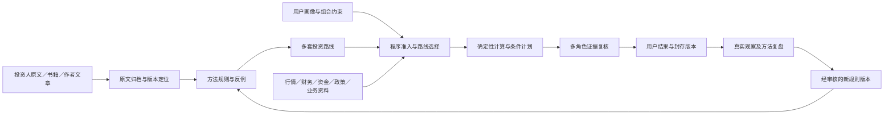

# AlphaAgent 跨行业投资知识与投资路线设计草案

设计日期：2026-10-15，Asia/Shanghai。2026-10-16 用户“开始吧”已授权按本方案开发；当前推进 K1，后续阶段仍按自测和用户页面验收交付。

## 1. 已确认的目标

本轮采用用户最新修正：主线是蒸馏投资人、书籍和财经作者的方法，形成 AlphaAgent 的跨行业研究规则及多套投资路线。行业资料作为解释变量和适用性约束，不以先深入某一个行业作为建设前提。

- 市场：首版 A 股，方法来源可参考全球投资体系。
- 周期：首版波段与中期；后续扩展短线、长期配置。旧下一交易日预测实验继续独立运行。
- 来源：由 Codex 筛选，不要求用户先提交书单、找专家或采购数据库。
- 路线：根据可投资资金、风险承受能力、可投入时间、持有周期、流动性要求及现有组合共同适配。
- 内容：选什么、看哪些指标、何时观察或入场、怎样控制仓位、何时退出、什么条件使判断失效。
- 2026-10-15 整理会话只交付方案；2026-10-16 已获开发授权，允许执行有界采集、代码、迁移和本地服务验收，不自动定时采集或交易。

## 2. 当前系统可复用基础与必须处理的边界

2026-10-15 只读源码核对：

- `decision/method_cards.json` 有 M01–M08 八张方法卡；不能据此声称八套完整交易策略已实现。
- `decision/knowledge_notes.json` 有巴菲特原信、预期投资公开介绍、French 五因子定义三条笔记；覆盖是公开段落，未读取相关整书。
- `decision/policy_sources.py` 定向处理两份政策来源；不是完整现行政策库。
- SQLite 保存运行元数据，现有内容寻址归档保存原文、请求、响应及封存输入。完成记录不能覆盖。
- `decision/routing.py` 当前业务角色主要是设备、制造、混合、未知，期限为一至三个月；不能直接宣称全行业、全周期方法适配完成。
- `decision/agents.py::COMMON` 禁止旧报告正文中的买卖指令和自由数字；保留这项旧约束。新增独立的条件计划合同，数字由工具填充，不能通过放松旧提示词来实现入场分析。
- `decision/contracts.py::ResearchRequest` 的旧期限为一至三个月，方法开关依赖旧行业开关。新增跨行业路线请求，不能扩大旧合同的接受范围而悄悄改变原报告含义。
- 现有行情、资金和财报来源可作输入，仍需逐项验证历史长度、公告可得时点、复权、指标及授权。Tushare 有 Token 不代表所有接口和资金历史都具备。
- 上轮回归有三项 MemoryError 未复验；新增代码发布前须恢复可重复的回归结果，不能把这些失败计为通过。

## 3. 三种建设方式与选择

建议采用“原文知识库＋结构化规则＋路线执行器”。向量检索以后按检索评测结果追加。

1. 全部转成 skills：写规则快，难处理来源版本、修改、条件冲突、适用性和历史复现，资料增长后维护成本高。
2. 全部做普通 RAG：查资料方便，模型容易只复述观点；仍缺资金容量、计算合同、入退场规则和可重复验证。
3. 采用建议方式：知识库回答“依据在哪里”，规则回答“怎样判断”，路线回答“对这个用户、这只股票和这个期限怎样组合”；保留现有受控工具及 Multi-agent 审核。

这里的“蒸馏”首先是有出处的知识提炼和规则整理，不是训练模型权重。首版不微调，不建立名人模拟人格或多数投票。

## 4. 知识内容如何组织

### 4.1 来源与原文层

保存作者、作品、版本／版次、原始地址、权利与读取范围、发表时间、首次取得时间、内容哈希、页码或字符位置。书目、目录、公开节选、取得的整书正文分别标记；目录和出版社介绍只能建立候选条目，不能替代方法正文。

来源状态为 `CATALOG_ONLY`、`EXCERPT_CAPTURED`、`FULL_TEXT_CAPTURED`、`UNAVAILABLE`。公开可读和允许再分发分别记录。平台登录限制、付费墙及原文无法核对的内容先保留候选身份，不进入执行规则。

### 4.2 方法规则层

一条规则只处理一个清楚的决策问题，至少保存：

- 规则 ID、版本、原作者主张、AlphaAgent 的归纳和二者对应关系。
- 适用市场、资产类型、期限、业务类型、市场环境和排除条件。
- 指标定义、单位、计算窗口、所需数据、可得时点和质量要求。
- 筛选、触发、持有、加减仓或退出中的职责；触发后允许什么输出。
- 反例、失败模式、与其他规则的冲突，以及如何解决。
- 来源定位、审核结果、参数出处、验证等级和使用记录。

区分三种参数：作者原始参数、本系统对 A 股的改写参数、已经经过验证的参数。改写阈值不得冒称原作者建议或最优参数。

审核状态 `DRAFT → REVIEWED → PUBLISHED → RETIRED`，独立记录执行状态 `REFERENCE_ONLY / RESEARCH_EXECUTABLE / BLOCKED_INPUTS` 和效果状态 `UNVALIDATED / PROSPECTIVE_OBSERVATION / VALIDATED_UNDER_DECLARED_PROTOCOL`。发表和计算通过不代表收益优势。

### 4.3 路线层

保留不同逻辑的多条路线，不把所有投资观点平均成一个综合分数。

- **趋势波段**：市场趋势、相对强弱、成交与流动性、波动和突破／回撤条件；强调买入条件、失败退出、持有及执行约束。
- **成长确认**：营收和利润增长质量、现金回收、估值要求、行业相对表现与价格确认；强调增长变化是否已有证据、是否被价格过度要求。
- **质量与估值中期**：持续盈利、资本效率、现金流、负债和估值敏感性；金融、周期及亏损企业使用适合其业务的指标，不能统一套 ROIC 或 PE。
- **事件与政策中期**：事件原文、政策适用性、业务敞口、经营传导、时间窗口与价格反应；事件存在、公司受益和价格因果分别核查。
- **因子与组合**：价值、质量、动量、低波、规模等定义及组合约束；先作为研究定义，正式收益比较沿用原 5.2 数据准入及独立核对门禁。
- **低换手配置**：分散、现金安排、再平衡、成本与持有纪律；ETF／多资产执行须另验数据合同，首版不承诺已接全。

首版交付前四条路线的结构与适用性判断。首个可用增量先完成趋势波段和质量／成长两条跨行业路线的真实运行；事件政策扩充及完整估值、因子组合、ETF 配置随后按数据准入建设。没有必要数据的完整方法只保留知识定义，不能包装为已执行结果。

### 4.4 市场、资金、政策、公司与行业层

这些内容为路线提供上下文和证据：行情趋势与市场宽度、波动与拥挤；分口径的资金流与成交；财报及公告；公司业务与同业可比性；政策条款及适用状态。行业标签参与适配，不把半导体标签作为通用路线的入口门槛。

实时、分钟、盘后日频分别管理。供应商大单估算、融资、ETF 份额不相加；供应商估算不解释为确定的机构身份或意图。

### 4.5 复盘层

保存签发时的来源、行情截止、方法及路线版本、用户约束、实际计算、反证、触发和失效条件、后续观察。原预测和原计划不可改写。复盘只产生新观察和候选规则版本，不能自动把某次盈利升级为有效方法。

## 5. 首批资料选择

以下为采集与审核候选，不是“已经整书读完或全部入库”的清单。本次网页核对只确认所列公开页面及其范围。

- **巴菲特／伯克希尔原信**：质量、增长与投入回报、价格与价值、能力范围和资金容量。已有 1992 年公开段落可复用，扩大覆盖仍需逐份归档。[原信](https://www.berkshirehathaway.com/letters/1992.html)
- **Howard Marks**：风险、周期、反身性边界、逆向与防守。优先官方备忘录；《The Most Important Thing》出版社目录与节选用于确定阅读范围。[官方备忘录](https://www.oaktreecapital.com/insights/memos)、[出版社](https://cup.columbia.edu/book/the-most-important-thing/9780231527095/)
- **Peter Lynch**：成长研究和公司分类。候选书《One Up On Wall Street》；出版社题录不作为已提炼规则的依据。[出版社](https://www.simonandschuster.com/books/One-Up-On-Wall-Street/Peter-Lynch/9780743200400)
- **William O’Neil／IBD**：成长、相对强弱、市场方向、入场条件与风险纪律。先读 IBD 实际公开材料；《How to Make Money in Stocks》完整体系按实际正文取得范围标记。[公开清单](https://get.investors.com/wp-content/uploads/2024/08/IBDD-How-to-buy-Stocks-infographic.pdf)、[出版社](https://www.mheducation.com/highered/mhp/product/how-make-money-stocks.html)
- **Mark Minervini**：候选书《Trade Like a Stock Market Wizard》，重点读选股、入退场和风险管理。当前核对出版社题录与目录，未取得完整正文，不引用营销中的收益承诺作为有效性证明。[出版社](https://www.mheducation.com/highered/mhp/product/trade-like-stock-market-wizard-how-achieve-super-performance-stocks-any-market.html)
- **Mauboussin／Rappaport**：价格隐含预期、经营变化和估值假设；沿用已核对的公开三步方法，完整反推估值另验输入。[作者方法介绍](https://www.expectationsinvesting.com/about)
- **Fama／French、AQR**：因子定义、价值与动量等研究，记录原市场和样本；不能将海外研究结果搬成 A 股收益。[French 定义](https://mba.tuck.dartmouth.edu/pages/faculty/ken.french/data_library/f-f_5_factors_2x3.html)、[AQR 研究](https://www.aqr.com/Insights/Research/Journal-Article/Value-and-Momentum-Everywhere)
- **Aswath Damodaran**：估值、现金流与假设敏感性，优先 NYU 作者公开课程和资料。[NYU 作者资料](https://pages.stern.nyu.edu/~adamodar/New_Home_Page/valuation/val.htm)
- **Morgan Housel／Collaborative Fund**：行为、风险承受与持有纪律；使用作者公开文章，《The Psychology of Money》按实际阅读范围另建版本。[作者文章目录](https://collabfund.com/blog/authors/morgan/)、[出版社](https://harriman.house/books/the-psychology-of-money/)

首批由上述作者／机构中选取至少十二份取得正文定位的资料，形成至少二十四条通过审核的规则；规则数量不能靠拆句、重复观点或书目记录凑数。未达到质量标准时报告缺口，不发布空壳目录。

财经博主采用同一审核合同：确认本人来源、保留发表时点和修改版本、区分方法与当时观点、记录利益关联及可核对依据、保留失败或相反案例。转载与同一观点的重复传播合并为同一来源族。首批公开作者内容以 Damodaran 和 Housel 为起点；中文平台作者在可核对原文与身份后纳入，不用粉丝数替代证据。

## 6. 资金体量怎样参与路线适配

收集可投资资金（不是总资产）、预留现金、单笔可承受损失、单股／行业暴露上限、最大可承受回撤、现金需求日期、可盯盘频率、持有周期、经验和持仓。用户可不提供金额；此时只输出一般路线适配，不给个性化金额与股数。

首版使用五万、五十万、五百万元作为三组功能测试画像。这些金额只用于检验成本、最小申报量、分散和容量约束，不是收益等级或强制路线分档。

确定性工具分别计算：按计划失效位置估算的风险数量上限、可用现金上限、单股／行业暴露上限、按成交额与参与率估计的流动性上限，再按具体证券的交易单位约束取整。计划失效位置不是保证成交价，T+1、跳空、涨跌停、停牌及冲击压力单独呈现；止损距离不能伪装成最大可能损失。

参与率、冲击和费用假设必须标记出处及校准状态。没有逐笔／盘口时不虚构盘口深度或精确冲击成本。不根据大单净流入直接推算可容纳资金。

现行市场制度从交易所取得并保存版本、生效和暂缓实施信息，不把所有板块的最小申报量或涨跌幅一律写死。方案核对到的[上交所 2026 年规则发布页](https://www.sse.com.cn/lawandrules/sselawsrules2025/stocks/exchange/c/c_20260424_10816482.shtml)同时提供暂缓实施条文，实施时须读取附件并另核深交所对应规则。

## 7. 从知识到一次股票分析

1. 解析用户的证券、研究问题、期限及可选投资画像；保存请求快照。
2. 用程序检查证券和业务身份、数据截止、指标可用性、交易限制及路线硬约束。
3. 从已发布规则中按市场、期限、资产类型、业务和环境筛选，检索相关原文与反例。
4. Planner 在准入候选中提出主路线和有限辅助规则；程序拒绝越权、缺输入或期限错配的选择。
5. 工具计算指标及条件是否满足；Analyst 解释证据与分歧，Verifier 检查来源、参数、风险和冲突，Writer 生成简洁结果。
6. 分别保存研究方向和条件计划。原日预测继续明确 UP／DOWN；中期方向沿用看多／看空；执行状态可以是等待触发、条件已满足或当前不适配，不能用“必须有方向”强行生成立即买入信号。
7. 封存全部输入和知识版本，人工触发后续观察；新数据产生新版本。

互相冲突的入场逻辑不能同时混用。中期价值路线的分批观察逻辑不能自动套用为趋势失败后的补仓依据；采用路线的退出合同约束该次计划。允许同一股票在不同期限有不同方向，解释对应期限和证据。

## 8. 数据库与模块安排

首版沿用本机 SQLite 和现有原文归档。关系表保存来源版本、规则、路线、审核、使用及观察；中文全文检索采用明确的中文切词／字符二元检索投影，先实测 SQLite FTS5 能力。英文词元单独处理。检索投影可重建，原文定位保持不变；不得宣称 SQLite 默认分词已解决中文召回。

拟建表族：`inv_quant_knowledge_document`、`inv_quant_knowledge_rule`、`inv_quant_knowledge_route`、`inv_quant_knowledge_review`、`inv_quant_knowledge_use`、`inv_quant_knowledge_observation`，以及可重建检索表。规则与路线版本使用联合唯一键和内容哈希；每份封存运行引用确切版本及哈希。

拟新增 `src/marketpulse/quant/knowledge/`，按合同、存储、资料取得、提炼审核、检索、特征计算、路线、条件计划、API 分文件。知识库接入与旧 `decision/knowledge.py` 的三条公开笔记通过版本适配完成，旧 JSON 与旧结果保持原义。

新增请求版本和专用路由，不更改旧 API 的默认值与语义。全文检索只提供资料，不能执行来源文本里的代码、工具指令或模型提示。写入／审核／发布只开放本机开发者操作入口；普通页面及其查询参数不能成为写入授权。

保留原 24 次模型调用、60,000 tokens、900 秒预算上限。提炼工作离线有界执行，研究时只取相关规则与原文，不每次重新读取整套书库。初始检索上限为十二个片段、主路线一条、辅助规则不超过三条；上下文剩余不足时减少片段，不能抬高既有预算。

不预先建设独立向量平台或知识图谱服务。后续通过固定中文检索样例比较关键词、混合检索的召回、错误和成本，再决定是否加向量索引；精确关系可先存关系表。

## 9. 用户与开发者展示

统一工作台新增可选的“我的投资约束”和“路线偏好”，不恢复一排功能 Tab。用户可以直接问“按我的资金和周期分析这只股票的波段条件”。未配置画像时仍可进行一般研究。

用户结果集中展示：明确方向、适配路线、三至五个关键指标、价格与触发条件图、支持理由、反证、失效位置及等待核查事项。个性化仓位须在用户完成画像且所需数据齐全后展示，并标明估算假设；不能默认为用户选定风险偏好。

开发者视图展示：来源读取范围、规则版本、作者与本系统参数区别、准入与禁用原因、计算、实际使用日志、复核及实验状态。库管理支持按方法族、市场、期限和审核状态检索。

## 10. 可靠性与验收

- 资料源首次获取失败可重试；只有通过审核且完整封存的版本可用于研究。非实时方法原文可复用已封存版本；政策与行情按新鲜度判断，不能用旧缓存冒充实时。
- 一条辅助路线缺输入不终止已有合格主路线。缺关键行情或身份输入时返回明确状态、原因和可重试操作，保留记录，不伪造计算或方向。
- 不依赖浏览器打开来声称持续采集历史。首版采用用户触发的有界取得和保存；任何定时采集、通知或自动交易另行授权。
- 来源、规则、阈值、计算、路线、触发和失效条件均可导出复算；升级版本后旧运行哈希不变。
- 功能验收：中文检索、原文定位、版本不可变、冲突识别、跨行业适配、资金容量和失败恢复。
- 效果验收：另设冻结协议、留出或前瞻观察、分市场与时期、含成本、完整失败记录及简单基线。现有供应商分钟数据未连续积累时，不能回填为已取得的历史资金证据。
- 沿用原 5.2 正式回测数据准入及独立全收益核对；数据未过门禁时只报告功能、机制和前瞻观察，不发布“验证盈利”或胜率。

首个用户可验收成果：至少十二份有正文定位的来源、二十四条审核规则、两条完成真实数据运行的跨行业路线；在不少于四个不同一级行业的真实股票上展示方法适配、指标、条件和反证，在三组资金测试画像下解释容量差异。以上是开发目标，目前未实施、未通过。
