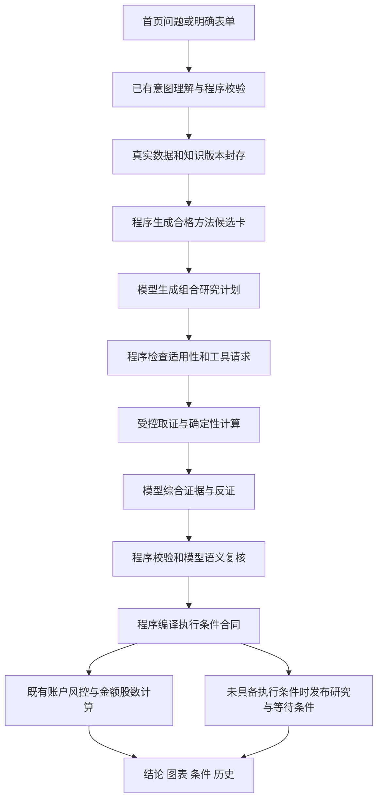

# AlphaAgent 方法自主组合与执行解耦：设计基线

日期：2026年10月20日。状态：方案讨论稿，尚未实现。本轮只新增设计和分阶段方案，不修改业务代码、正式知识、数据目录、服务或任务，不发起模型调用，不提交或推送。

本设计落实用户认可的方向：模型围绕问题自主选择、组合已发布方法；程序继续控制身份、数据、数值、交易约束和历史。配套[分阶段改造方案](../plans/2026-10-20-alphaagent-method-composition.md)给出模块、任务和验收顺序。

## 1. 当前边界与本次目标

核对工作区时，分支为`main`，HEAD为`e97d01014b96ee301ef41cb91127ec78f81ab1a7`，已有大量暂存改动。当前实现包括这些工作区改动，不能只按HEAD理解；本轮不改变分支和暂存区。后续执行前重新确认基线，不擅自清理、提交或推送。

| 当前实现 | 真实限制 | 改造目标 |
| --- | --- | --- |
| 正式知识快照有30条参考规则，均为`REFERENCE_ONLY / UNVALIDATED` | 有知识不等于已实现策略，也没有收益认证 | 保留原规则，增加版本化适用性与能力映射 |
| 标准研究绑定8条基础规则；深入研究每证券最多选3条方法 | 标准覆盖窄，深入选择没有明确组合职责 | 从完整的合格候选卡中选择主方法、反证、时机和风险方法 |
| Planner的`route_id`只允许趋势波段、质量成长 | 分析框架与执行模板耦合 | 新研究计划不要求先选这两种路线 |
| 资金计算依赖`trend_allocation`、`quality_allocation`及路线身份 | 不能给新风格随意套额度；未知路线不能落入quality分支 | 引入独立执行合同，继续受既有账户预算和全部适用风控约束 |
| 已有结构输出、复核、检查点、SQLite/CAS和评测底座 | 协议变动会影响旧任务恢复和核验 | 新协议显式分派，旧请求、角色、哈希和恢复继续按旧版本 |

30条规则的数量依据2026-10-20只读导出，不表示本轮重新发布或重新审核。来源见[知识清单](../../knowledge-export/2026-10-20/inventory.json)。

## 2. 三种路径与选择

1. 增加更多固定路线：初期改动直接，但新思想仍要不断绑定路线代码，不解决组合受限。
2. 让模型自由生成交易参数或程序：灵活，但难以保持确定性、费用边界和旧风控，不采用。
3. **采用：方法组合计划与执行合同分开。** 模型决定怎样研究，工具提供事实与可复算数值，程序决定是否具备执行条件、是否允许分配资金。两条旧路线继续作为兼容执行组件，不再垄断研究入口。

不以接入新Agent框架、向量数据库或增加角色数作为前置条件。首版沿用Vue 3、FastAPI、Pydantic、当前模型通道、SQLite和CAS；不添加运行依赖。

## 3. 目标链路

这是新协议目标，不是当前已经运行的链路。首页理解已有独立模型调用，必须纳入端到端成本；直接表单可以省略该步骤。没有通过复核的观点不能走图中的发布路径。

## 4. 方法候选：程序筛适用边界，模型做语义选择

新增旁挂的`MethodCapability`描述，不修改30条已发布规则的原始载荷、状态或引用。每条描述固定`rule_id`、`rule_version`、自身版本、允许作用、周期、行业/财报口径、必需数据能力、可选工具、证据依赖组和执行适配器清单。

区分四种输入状态：`AVAILABLE`已有封存证据；`FETCHABLE`有已注册且预算允许的取证能力；`UNAVAILABLE`当前无法取得；`EXCLUDED`未发布、周期或主体不适用。原文存在不等于财报附注已取得；估值快照存在不等于完成DCF或因子回归。

候选形成先做硬过滤，不先按两条路线过滤。当前规模仅30条，首版向模型提供全部适用的精简候选卡，不用关键词前几名偷偷代替方法选择；选择后才发送完整规则、反例、禁止推断和必要原文。无法满足必需数据的方法不能记为已完成应用，可记录为待核问题。

新增知识仍走已有候选、出处核验、审核和版本发布流程。未发布博主观点不能直接进入研究候选；新规则未配置能力映射时标记未适配，不能自动获得计算或交易权限。

## 5. 组合计划：替代先选路线，不叠加一次无效规划

新协议的首个研究模型步骤为`MethodPlanner`，合并新模式中Researcher选方法和Planner选路线的重复规划；旧模式继续原流程。职责名是建议协议名，不要求引入新的模型或服务。

每证券选择1—4个**不同**方法版本，每个有一个主作用：`PRIMARY`、`COUNTERCHECK`、`TIMING`、`RISK`。主方法恰好一个，其他作用可缺省；不得为凑四种作用选择不适配的方法。无论是否有独立反证方法，都必须提出反证问题与可推翻判断的条件。程序风控不依赖模型是否选了风险规则。

唯一的空方法例外是程序确认没有可用主方法，或允许补查后仍未取得必需输入：保存`NO_APPLICABLE_METHOD`及逐项原因，不强选规则。事实足够时仍可在原审核要求下给有限依据的方向、反证和观察事项，但明确未完成方法应用；事实不足则保留真实失败，不补造结论。模型不能在有合格候选时自行用空方法绕过必要核查。

结构化`CompositionPlan`至少保存：

- 固定证券、期限、资料截止、候选清单哈希与能力映射版本。
- 每项方法版本、作用、适配理由、要回答的问题、需要的证据与证伪条件。
- 方法之间的互补或冲突关系；同一价格序列、财报或来源支持的重复判断不能被当作独立多票。
- 受控工具请求及所解决的证据缺口；标准深度只用已有封存材料，深入深度才允许有限补查。
- 没有选用的相关候选及简短原因；只对程序提示的相关冲突/缺口项说明，不要求为30条逐条长篇输出。

当前可用外部能力仍只有原协议允许的估值快照与封存证据检索等已注册工具。新能力注册前不能请求任意URL、代码执行或声称已抓取金融专用指标。每任务最多两项不同工具请求，深入模式至多一次工具返回后的规划修订，防止每只股票各扩两次造成乘法放大。

分析和复核使用同一固定计划，新增`MethodUse`台账：每项方法记录`APPLIED`、`PARTIAL`或`NOT_APPLIED`，关联判断ID、真实证据ID、缺口与结论影响。引用了规则名不算应用成功。新线协议允许最多4个方法引用，必须与目前最多3项引用的旧WireOpinion隔离，不能截掉第四项或放宽旧合同。

## 6. 程序执行合同与风控边界

新`ExecutionEnvelope`由程序编译，模型仅能引用已批准的方法、事实和计算结果ID；禁止输出自由金额、股数、费率、风险比例、任意公式或新预算。合同区分：

- `OBSERVE_ONLY`：研究通过但暂不具备可计算或可验证的执行条件；输出明确方向、理由、反证与等待事项，不伪造价位和股数。
- `WAIT_CONDITION`：存在合法数值参考和条件，但触发事实未确认或条件不满足；只显示条件性试算，不当成当前可以买。
- `SIZABLE`：已注册的执行组件和必要输入齐备，再交给既有风险引擎核算；不等于下单或收益保证。

未知工具、跨证券或跨窗口绑定、无效风险距离、未确认政策资格、自由参数、缺预算映射均不能得到`SIZABLE`。内容合同本身不合法要拒绝并纠错，不能把错误输出改名为观察结论来绕过复核。

第一批适配器保持旧`TREND_SWING`、`QUALITY_GROWTH`计算结果等价。随后增加有限的`EVIDENCE_CONDITION_V1`组合能力：使用登记的观察条件和已批准数值引用，允许研究方法与执行组件不同名；首期只复用已有价格/风险参考组件，不因此声称实现完整估值定价、银行质量成长或因子选股策略。新增数值公式必须另行注册、复算和验证。

**预算映射是独立门禁。** 旧账户的trend/quality额度原值保留，不因新方法组合增加额度，也不能把未知类别按quality处理。新合同必须绑定已明确批准的预算桶；没有映射时不产生新增买入额度，允许发布观察结论。通用执行桶采用新账户协议、用户显式配置与独立版本，未配置额度为零，所有桶总额不超过原账户上限。不得自动挪用剩余现金或另一桶的闲置额度。

现金、总风险、单股、行业、适用的相关群、路线/预算桶、流动性、费用、最小交易单位、可卖数量及T+1等现有约束继续有效。多方法不是多份仓位；组合层按证券汇总，已有持仓不能重复扣算或被遗漏。账户原值不进入公开研究模型上下文。

## 7. 版本、恢复和发布

新请求显式使用`investment-research-v5`及`method_composition=method-composition-v1`；研究深度STANDARD/DEEP仍只控制补查和推理强度，不等于切换历史协议。具体字段和名称是本方案建议接口，尚未加入代码。

旧请求序列化默认不新增字段；旧哈希、旧执行合同、旧Writer规则及旧模型上下文照旧。新字段从本地计算请求中剥离或显式转换，不直接塞进`investment-plan-v1`。新任务封存计划、能力映射、工具、执行合同、风控及输出的版本引用；GC、导出和配套备份必须能遍历全部新增引用。

检查点复用要求证券、截止、知识、计划、工具、提示、输出合同和预算身份一致。协议不一致不复用。未知调用用量保留预留，恢复不重置预算；不承诺供应商严格只计费一次。

新模式先为开发者可选，再到用户自选。关闭开关只影响未来任务，新协议历史继续可读；未完成新任务按自身协议恢复。不能在失败时静默改成旧流程然后标成新方案成功，也不向旧任务追加新方法冒充原始判断。

## 8. 成本与效果验证原则

保留单投资研究24次真实模型调用、60000计费/预留Token、900秒的硬上限，不为增加方法扩额。正常新标准模式目标是规划、分析、复核3个逻辑步骤；深入最多增加一次规划修订。角色纠错、传输重试均计入真实调用和原预算，不能把逻辑步骤数当平台计费次数。明确预留分析、复核与必要纠错的余量，预算不足先停止补查，不省略核验。

候选只传短卡，选中后才展开必要正文；复核按引用发送足够证据，同时保留计划中的反证核查台账，避免只复核支持结论的选择性材料。不让Writer复制已批准文本，不额外调用模型给方法打装饰性分数。

评测先比较固定资料下的旧流程与新组合流程，再单独比较补查能力；先做小额实源验证，达到预登记完成率和预算边界后再扩样本。首页理解、失败、工具与可选评阅成本分别记录并计入端到端总量。未知费用不填零，费用估计与平台实扣分开。

对计量未知的调用同时报告已知用量下界和保留预留的预算上界；区间无法支持成本门槛时标为尚不能判断，不能只挑有usage且成功的样本宣布节省。收益和费用的不确定性都进入推广决定。

人工质量验收检查方法适用性、事实支持、反证、冲突处理、期限和条件正确性；不给方法数量或文章长度加分。同模型复评只能是辅助证据。下一交易日前瞻另立新协议，与现有10月19日登记协议分开，不补写过去预测，不混计失败、平盘、停牌和缺数。

小样本可以支持可用性和成本判断，不能证明收益。完整研究通过、知识准入与旧5.2回测准入是独立门禁。

## 9. 依据与交付边界

当前事实依据：[路线与参数](../../../src/marketpulse/quant/knowledge/routing.py)、[角色与路线限制](../../../src/marketpulse/quant/knowledge/research_agents.py)、[知识投影](../../../src/marketpulse/quant/knowledge/research_context.py)、[主动研究](../../../src/marketpulse/quant/knowledge/active_research.py)、[账户合同](../../../src/marketpulse/quant/knowledge/planning_contracts.py)、[资金核算](../../../src/marketpulse/quant/knowledge/playbook.py)、[研究版本与核验](../../../src/marketpulse/quant/knowledge/research_store.py)、[结构输出](../../../src/marketpulse/quant/knowledge/structured_contract.py)、[既有成本与效果记录](../../alphaagent-effectiveness-acceptance-2026-10-19.md)。

执行前仍需按配套方案完成各阶段自测和真实页面验收。本轮只交付文档；没有证据表明以上新设计已运行、已节省费用或已改善预测。
