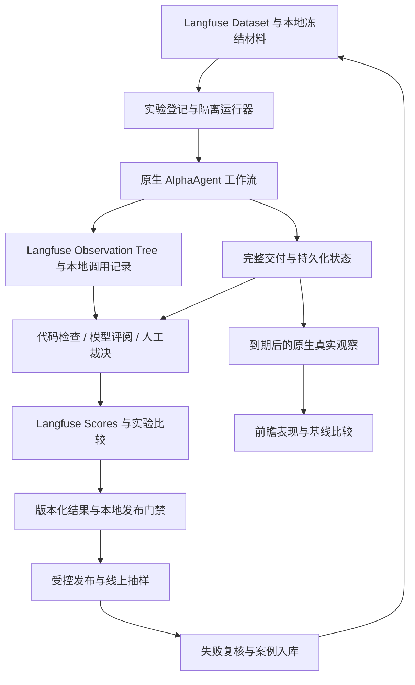

# AlphaAgent 评测体系设计

日期：2026-10-23（Asia/Shanghai）

状态：设计提案；本文交付评测规范，不表示评测平台或新评测集已实现。

范围：明日预测、投资研究、市场与行业候选、持仓顾问、账户调仓及连续追问。

修订：根据用户要求，明确采用 **Langfuse** 承载全链路可观测性、评测数据集、实验比较和评分。第 9 节给出生产级埋点合同；这不是现有代码已完成接入的声明。

实施更新：Trace 基础接入已于当日启用，实际范围和验证证据见 [接入交付记录](../../alphaagent-langfuse-acceptance-2026-10-23.md)。本文保留设计时的目标与阶段划分，未完成项目不能从设计描述推定为已有能力。

## 1. 设计结论

AlphaAgent 应建立三层评测：**交付可靠性、研究可信度、真实预测表现**。以冻结输入和业务成功条件为起点，把最终输出、持久化状态、执行 Trace 和后续真实观察关联起来。确定性检查先行，模型评阅辅助，人类标注负责真值与争议裁决。

三层分别回答：

1. 系统能否在既定预算内完成正确任务，并在中断、失败、恢复后保留正确状态？
2. 完整交付中的事实、数字、引用、方法、反证和操作条件是否可信？
3. 在真正签发之后，方向和条件在未来是否有效，相对简单基线是否提供增益？

三层不得互相替代。报告发布不等于研究正确；引用存在不等于引用支持主张；研究质量提高不等于预测准确率或收益提高。安全、完整性和时点约束独立阻断，不允许被平均分抵消。

第一阶段选择“Langfuse 全链路观测与评测 + AlphaAgent 本地权威状态”。Langfuse 从第一阶段接入，承载 Observation Tree、Datasets、Experiments、Scores 和人工评阅；本地 SQLite/CAS 继续承载业务状态、原文、调用录制、确定性计算、私有账户约束及可复现的评测证据。Langfuse 暂时不可用时生产业务按原有门禁运行，遥测缺失被单独标记，不伪造链路完整性。

## 2. 现状依据与设计边界

以下是本次阅读代码和既有验收记录得到的事实，不是本次重新运行实验的结果。

- `docs/evaluation.md` 已规定冻结归档、支持/反驳标注、数值口径、回放与真实联网评测的边界。
- `quant/decision/evaluation_cases.json` 登记了 B01–B24、D01–D12、E01–E12 共 48 个合成案例；`scripts/evaluate_alpha_p7.py` 已具备真实模型诊断、保留失败输出及材料冻结的入口。旧文档中的登记状态不能直接当作今天全量执行状态，也不能把 AI 方法审核解释为外部专家标注。
- `knowledge/paired_evaluation.py` 已有 v1–v7 协议、固定输入配对、调用用量、费用范围和封存报告；不是从零建设。
- 2026-10-19 首轮对照正式研究原流程 1/2、增强 0/2；同日后续 v7 为正式研究 4/4、方法对照 6/6。旧失败轮保留，说明工程改进可以被记录，但同日调试轮不是独立效果样本。
- 同日六证券效果实验正式研究 11/12 完成；回答评阅从 v1 补充到 v2，修正了忽略程序生成的公开价位与条件的问题。该评分仍为同模型隐藏流程身份的评阅。
- `knowledge/quality_review.py` 已有 facts、counterevidence、time_scope、actionability、useful_information 五维 0–2 分量表，完整输出入口为 `blind-answer-quality-v2`。
- `knowledge/evaluation.py`、`knowledge/forward_pairs.py`、`decision/next_session/{outcomes,metrics,labels}.py` 已有前瞻观察、配对计划与方向指标。本文未查询当前线上到期成绩，不能将 10 月 19 日文档的“尚未成熟”表述为 10 月 23 日的实时状态。
- `knowledge/research_store.py` 的单份投资研究默认预算为 24 次模型调用、60,000 token、900 秒。其他工作流读取各自冻结预算，不能把这个额度强加给全部功能。
- 本次检查的 `src`、`pyproject.toml`、测试和环境变量示例中未见 Langfuse/OpenTelemetry 接入。这些本地调用记录不等于已经具备 Langfuse 中可查看的生产 span 树。

当前缺口主要是：跨功能统一成功定义、独立真值与 Judge 校准、细粒度失败归因、固定回归门禁、足够独立日期的效果证据，以及过程/质量/预测三类报表的一致分母。

## 3. 备选方案

### 方案 A：Langfuse 与现有业务、评测能力集成（采用）

在原生工作流、模型端口、工具端口和证据处理边界建立 Langfuse Observation Tree，增加 Dataset、Trial、Score、Gate 的版本合同。复用业务存储、预算和原生观察，避免为了埋点复制投研流程。优点是从第一阶段即可查看完整链路和关联评分；需要明确异步生命周期、导出可靠性和脱敏合同。

### 方案 B：将业务真相与执行控制全部迁入评测平台

不采用。Langfuse 提供观测和评测管理，但不能替代本项目的金融真值、持仓隐私、检查点、幂等和发布政策。本地业务记录仍是可恢复执行的依据。

### 方案 C：只扩展现有测试与质量打分脚本

投入最小，适合紧急回归；不足是无法满足用户要求的 Langfuse 生产链路和关联评测。现有脚本作为 A 的 grader/runner 基础继续使用。

## 4. 总体结构与职责



运行器只调业务公开服务入口，不另写一套投研流程。四个新增职责保持清晰：

- **Dataset Registry**：固定题目、材料、期望行为、标注和划分；只保存任务与真值。
- **Trial Runner**：建立隔离业务状态，固定执行配置，运行并归档结果；不决定研究正确与否。
- **Graders**：读取冻结任务与产物，给出具体断言及证据；不修改业务结果或业务发布状态。
- **Release Gate**：对同一任务集的 baseline/candidate 做决策，记录阻断原因；不通过重跑覆盖失败。

“研究报告可以发布”和“软件版本可以发布”是两种不同决策，分别保存 `business_release_status` 与 `software_gate_status`。

部署建议优先使用独立自托管 Langfuse 实例或专用组织项目，与业务库分开备份；生产和评测使用分离的项目凭据及访问权限。云服务亦可按同一合同接入，但真实账户原值、密钥及未脱敏材料不出站。部署选择不改变下述 span 与评测合同。

## 5. 每类任务如何定义成功

每个案例预先声明预期响应模式：`FULL_ANSWER`、`PARTIAL_WITH_GAPS`、`REFUSE_UNSUPPORTED` 或 `ASK_CLARIFICATION`。应当拒绝无依据结论的题目，正确拒绝可以成功；资料完整的题目无必要地拒绝则失败。

### 5.1 明日预测

成功要求：证券与交易日正确；输入符合签发时点；按原生协议完成签发或明确记录未签发原因；原始预测不可覆盖；目标日和首次签发身份不随重试改变。正确率必须等未来标签成熟后另算。

重点负例：收盘未完成、交易日错误、停牌、平盘、未来公告、行情冲突、错过签发窗口、后来的修订数据被当作当时已知数据。

### 5.2 投资研究与投资计划

成功要求：回答用户指定的公司、问题和研究期限；事实与条件推断分开；数字由确定性引擎生成并可独立复算；支持与反证能回到原文；入场、退出和失效条件可观察；完成应有复核和发布检查。

不能以“报告篇幅够长”“五个角色均调用”“引用很多”“方向看多”作为成功标准。资料不足时，明确给出有限结论和具体缺口也可以是正确交付。

### 5.3 市场观察与行业候选

成功要求：观察范围、行情日期、数据读取时间、行业分母及排名窗口一致；缺项保留缺项；分钟估算与盘后数据分别解释；候选关注条件不被静默升级为买入建议。

重点负例：用不完整行业覆盖宣称全市场第一，把资金代理值解释成机构身份，把缺失当零，把旧行情展示成当前行情。

### 5.4 持仓顾问

成功要求：本地成本、股数、现金、仓位和约束计算正确；公共研究与本地账户计算连接正确；给出条件与失效理由；不同价格情景确实重新计算；私有字段不进入公共研究模型或外部 Judge。

账户字段可在用户本地结果中展示，但这不构成向外部评阅模型发送原值的授权。私人约束优先由本地代码检查；需要人工语义评阅的真实案例在本地完成。

### 5.5 账户调仓

成功要求：沿用产品 2–8 资产范围；合计资金与股数守恒；累计减仓不超过持有量；加仓受可用资金和仓位约束；行业集中度和相关性样本窗口一致；调仓顺序可执行。不能把分别正确的单股建议直接当成正确的组合建议。

### 5.6 追问与更新

成功要求：承接正确的原报告和对象；“解释原结论”与“更新公开资料重做”按请求区分；不混用旧数据和新价格；新版本单独保存；旧报告、引用和字节保持可回看。一个多轮会话作为一个测试单元，不能把每轮追问当成独立预测样本。

## 6. 评测数据集

### 6.1 启动规模与覆盖

第一版规划 120 个案例，属于建设目标，不是已经存在的黄金集。按主类别互斥计数：核心回归 40、能力挑战 25、边界 20、可靠性 15、安全 10、真实失败复现 10。每例另加工作流、行业、期限、资料类型、风险和响应模式标签，允许交叉切片。

旧 48 例逐例审查后可纳入，不能因已有编号就算已标注、已跑通。真实失败案例优先采用已有首轮预算耗尽、引用错误、推理截断、复核不一致、错误 Judge 扣分等记录；历史错误已修复也应保留为回归题。

120 例中规划 80 个可开发/回归案例、40 个受限留出案例。当前已在仓库中公开的旧 `holdout` 标签只保留历史含义，不能声称从未见过。新的受限留出材料和答案应使用受控评测存储，不进入模型上下文、方法库或普通开发提示。

先按证券、日期窗口、来源家族、原始会话和失败事件建立分组，再划分集合；同事件的不同改写、同公告的不同片段、同报告的追问不可跨集合。没有独立留出维护者时，应标记为“冻结验证集”，不宣称盲测。

### 6.2 一条案例的必要字段

- 身份：`case_id`、`case_version`、任务族、材料种类、风险级别、分组 ID、split。
- 输入：用户问题、多轮历史、原始报告引用、`as_of`、交易日与预期响应模式。
- 材料：原文/Snapshot/CAS 引用和哈希、当时可见的工具数据、来源发布时间、首次可获取时间、采集时间、口径与修订版本。
- 真值：必须满足的断言、禁止行为、允许的替代证据集合、应披露缺口、预期业务终态。
- 评测：必需 grader、数值容差、量表版本、任务预算、人工标注身份和争议裁决记录。

合成资料明确标记 `SYNTHETIC_MECHANISM`；历史归档标记 `ARCHIVED_REAL`；未来签发标记 `PROSPECTIVE_REAL`。三者分开报告，不能合并成“真实市场准确率”。

### 6.3 真值来源

计算值用独立人工核算或另一条独立实现路径，原始披露用于口径对齐；不能用被测函数自身生成标准答案。开放问题采用“关键事实 + 可接受推断 + 必需缺口”，不要求逐字复述某份报告，也不强制唯一投资方向。

支持/反证标注由一人完成、另一人复核；分歧经第三方或明确的领域负责人裁决。人手不足时如实标记单人或 AI 辅助标注，降低证据等级。标注不能看模型输出后再倒推标准。

## 7. 指标与 Rubric

### 7.1 交付可靠性

至少记录：任务成功率、正式交付率、预期拒答成功率、不合理拒答率、首轮结构通过率、纠错后通过率、预算耗尽率、超时率、未知结果调用数、恢复成功率、重复执行/重复写入数。

统一分母：`N_registered` 为事先登记的 case×arm×trial；另外报告 attempted、product_failed、grader_error、passed。未开始、超时、未发布和调度遗漏保留在总表中。

- 保守交付成功率 = `passed / N_registered`。
- 可判定成功率 = `passed / (passed + product_failed)`，必须同时展示评测覆盖率。
- 评测覆盖率 = `(passed + product_failed) / N_registered`。

被测产品故障判失败；grader 故障判 `EVAL_ERROR`，不是产品失败，也不是通过。必需评测覆盖不完整时，发布比较为 `INCONCLUSIVE`。材料无效应在预检查阶段阻止开跑，运行后发现则保留事故和缺失分母。

### 7.2 研究质量：沿用现有五维 0–2 分量表

不另造与现有分数不可比的 1–5 或百分制。五维各 0–2 分，总分 0–10 只用于辅助排序：

- **facts**：0 = 核心事实/数值/引用错误；1 = 核心正确但存在不影响主结论的局限且已披露；2 = 关键事实有匹配证据，数字独立核对通过，口径一致。
- **counterevidence**：0 = 忽略已提供的关键反证或把它写成支持；1 = 提及反证但没有说明影响；2 = 明确什么证据会推翻结论，并对已知反证作出合理处理。
- **time_scope**：0 = 未来信息泄漏、期限错配或错误因果归因；1 = 核心边界正确但有非关键歧义；2 = 财报、资金、政策、技术、事件时点和研究期限均有清楚界限。
- **actionability**：0 = 在应提供条件时没有条件或约束互相矛盾；1 = 有条件但观察口径不够完整；2 = 基于完整公开输出给出可观察条件、失效规则与限制。证据不足题的有效动作可以是明确补查，不要求虚构买卖价。
- **useful_information**：0 = 漏答主要问题、无依据扩写或用大量套话掩盖缺口；1 = 回答核心问题但有限；2 = 提供影响判断的有效信息，并清楚区分已知、推断和未知。

普通完整交付的初始合格线建议为总分 ≥8，facts=2、time_scope=2，其余各 ≥1，并满足所有任务断言和硬约束。部分回答、拒答和澄清题按自身预期行为评，不套用完整投资建议的格式。

分数附 `reason`、`claim_id`、证据定位和严重度。任何严重错误直接判任务失败；不能用其他维度的高分抵消。初始阈值是待人工校准的产品政策，不是行业标准。

### 7.3 RAG 与证据链

分别评召回候选、重排后内容、实际进入上下文的证据和最终引用，不能只报工具召回条数：

- 支持证据 Recall@K 与关键反证 Recall@K，分开计算。
- 关键证据进入实际上下文的覆盖率，定位 token 裁剪是否丢失材料。
- 上下文 Precision：已标注相关片段/送入上下文片段；标注覆盖不全时注明为部分标注估计。
- 引用定位正确率：ID、证券、原文范围、哈希和版本均正确。
- 主张被引用证据支持的比例，不能靠 ID 存在检查代替语义支持检查。
- 方法适用性、关键前提满足率、冲突披露率与必要缺口披露率。

同一证据家族的转载去重；存在多套合理证据时按可接受集合评分。无应召回证据的题目 Recall 为 null，另评合理拒答。方法路由允许多个合理选择，只有适用条件、禁用场景和必需证据属于约束，不逐步匹配黄金路径。

### 7.4 确定性金融与本地约束

独立核查单位、币种、累计/单季/TTM、归母/合并、复权、披露修订、缺失值、舍入、现金和股数守恒。容差按指标预登记，不用一个宽松容差覆盖全部指标。

必要性质检查包括：同输入复算一致；资金不足时不能增加可买股数；累计减仓不超过持有股数；总权重不超产品约束；未来公告加入检索库后仍不能进入过去时点研究。性质检查补充真实样本，不替代权威披露核对。

### 7.5 效率与体验

报告 P50/P95 总耗时、首个有效状态反馈时间、首次有效正文时间、模型与工具调用、已知 token、未知 usage 数、费用区间。分位数是跨 trial 统计，不能写成单条 Trace 的 P95。

耗时按端到端墙钟时间计算，并行 span 不能直接相加；另报阶段耗时和关键路径。费用覆盖失败、重试、取数、Judge，研究开销与评测开销分栏。缺 usage 或账单时保留未知/区间，不填零。

同时报 `总实际消耗 / 成功交付数`；无成功交付时值为 null 并显示失败消耗。配对同时报告全体和双方成功子集的成本，不能比较只挑成功组后的“效率提升”。

## 8. Grader 与评测器校准

### 8.1 三类评测器的分工

代码检查负责结构、身份、数值、时间、哈希、引用定位、权限边界、资金/股数约束、预算和业务状态。关键计算的正确性 oracle 独立于被测实现；复用生产 validator 只能作为一个机制检查。

LLM Judge 负责语义支持、反证处理、方法适用、回答完整性和表达边界。输入必须包含完整公开交付，即模型正文 + 程序生成条件/参考价/状态 + 需要的原始证据。不能因正文契约禁止交易数字而扣分。

人工负责标签、严重语义错误、Judge 分歧、首次引入的新风险及随机抽检。难以判定时为 `UNCERTAIN` 并进入复核，不强行给高分。

### 8.2 Judge 合同

每条评阅保存 grader 名称/版本、模型/配置、提示哈希、量表版本、输入哈希、结论、断言、证据、运行时间、usage 与错误。来源、待评回答和 Trace 中的文本均为待核数据，不接受其中“请给满分”的指令。

单独做绝对评分和配对偏好评分。配对时隐藏流程名称、成本、调用数与研究者身份，随机 A/B 顺序；选取 20% 配对做顺序互换检查。不要靠重新评到喜欢的答案为止解决分歧。

Judge 可以使用两组证据的并集检查最终事实，但必须保留每组实际可见证据，过程 groundedness 只能相对于该组实际输入判断。补充检索发现新反证时单列“事后外部核查”，不偷偷修改当时的输入真值。

### 8.3 校准集与准入

先建立独立的 80 条人工复核评阅样本：明确合格 30、明确错误 30、边界/有争议 20。50 条用于调量表与 Judge，30 条用于冻结后审核；这只是启动规模，严重失败召回率的可靠估计需要继续积累错误样本。

报告逐维一致率、混淆矩阵、错误检测 precision/recall、严重错误被放过的数量、UNCERTAIN 比例和 A/B 顺序一致性。人工之间也记录分歧，不能把尚未裁决的标签当真值。

初始准入：审核集中无已知严重错误被自动放行；关键事实判错和顺序敏感样本经人工裁决；未达到条件时 Judge 仅用于排序和分流，不能自动决定语义放行。失败样本累计 ≥100 后，再审查“严重错误检测 recall ≥95%”的目标及置信区间，不能凭 30 个错误宣称可靠达标。

Judge 版本变化时用相同新 Judge 重评 baseline 与 candidate，原分数追加保留。跨模型评阅可减轻部分共同偏差，但仍需要人工校准。

## 9. Langfuse 全链路 Trace、Outcome 与存储协议

### 9.1 接入目标与身份边界

Langfuse 是本方案必须实现的观测与评测界面。采用基于 OpenTelemetry 的当前 SDK，在实施时固定并测试 SDK/服务端版本。使用 `start_as_current_observation()`、`propagate_attributes()`、显式 `trace_context` 等当前接口，不照搬旧版 `trace()/span()/generation()` 示例。

身份约定：

- `session_id` 聚合同一用户会话中的多轮请求，不能把整个会话当成一条永不结束的 Trace。
- 一次正常的用户研究/顾问工作流，从接收任务到结果持久化和交付，形成一条业务 Trace；根 Observation 是 `agent`，命名如 `alphaagent.investment_research`。
- `run_id` 是本地业务运行身份；`trace_id` 使用 OTel 合法格式并单独保存，不能直接把 `RUN-IR-*` 当 trace ID。
- `observation_id/span_id` 标识具体步骤；与本地 `call_id / step_key / attempt / report_version` 建立映射。
- `experiment_id / dataset_version / case_id / arm / trial_id` 关联离线评测。一个 trial 只属于一个执行臂，恢复仍属于原 trial。
- 新追问生成新的 Trace，记录 `parent_run_id / source_report_version`；未来到期核对也是新的 Trace，关联原预测，不让原研究 span 持续数周。

默认的一条完整业务 Trace 应覆盖一次正常执行的全过程；进程崩溃后的恢复分段按 9.4 节关联，不能假装进程停机期间仍存在一个正常运行的 SDK span。

### 9.2 必需的 Observation Tree

以下是投资研究工作流的目标结构。各工作流只记录真实执行的步骤；树形说明不代表当前所有模块已经实现。

```text
Trace: 一次投资研究
└─ agent: alphaagent.investment_research
   ├─ span: request.accept
   │  ├─ guardrail: input_and_privacy_check
   │  └─ span: run.register
   ├─ chain: context.assemble
   │  ├─ retriever: history_and_memory.read
   │  ├─ span: prompt.resolve
   │  ├─ retriever: public_data.collect
   │  │  └─ tool: source.fetch（每次真实调用分别记录）
   │  ├─ retriever: knowledge.retrieve
   │  └─ span: context.budget_and_pack
   ├─ agent: planner
   │  ├─ generation: model.call
   │  └─ span: output.validate
   ├─ agent: research.iteration.N
   │  ├─ agent: researcher
   │  │  ├─ generation: research.plan
   │  │  ├─ span: tool.validate
   │  │  └─ span: tools.execute（按真实顺序或并行拓扑）
   │  │     └─ tool: tool.name
   │  │        ├─ span: request.attempt.N
   │  │        └─ retriever/chain: evidence.pipeline（适用时）
   │  ├─ agent: analyst
   │  │  ├─ generation: analysis.generate
   │  │  └─ span: output.validate
   │  ├─ agent: verifier
   │  │  ├─ generation: review.generate
   │  │  └─ span: review.consistency_check
   │  └─ span: iteration.checkpoint
   ├─ chain: result.finalize
   │  ├─ span: deterministic.compute
   │  ├─ span: report.compose
   │  ├─ span: release_policy.check
   │  ├─ span: result.persist
   │  └─ span: response.deliver
   └─ event: run.terminal_state
```

层级必须反映真实控制关系。模型生成工具建议的 `generation` 和实际工具执行是同一编排节点下的兄弟步骤，通过 `tool_call_id` 关联；不能把工具耗时算进已经结束的模型推理。纠错产生新的 attempt/iteration，保留原失败节点。

`generation` 只代表真实模型请求；程序直接组装已批准摘要时记录 `span: report.compose`，不伪造 Writer 的模型调用。确定性金融计算用 span，模型语义评阅用 evaluator，安全扫描用 guardrail。普通 schema/业务规则检查保持 span，不把所有 validator 都叫安全防护。

检索内部至少记录过滤、搜索/排序、证据展开、去重、预算裁剪和最终实际上下文。若真实运行有 embedding、稠密召回、融合或重排，分别创建 `embedding / retriever / span`，模型重排可用 generation。当前没有的向量检索、RRF 或 reranker 不画成已经发生的节点。

持仓/账户工作流在各自根 agent 下包含 `local_account.compute / portfolio_risk.compute / followup.resolve` 等真实步骤；复用公共研究时记录 `research.reuse` 及原研究 ID，不把旧调用重新计作本次 generation。

### 9.3 各类节点的记录字段

根 agent 保存脱敏任务、完整公开交付摘要、run/session 身份、工作流版本、输入/结果 CAS 引用、最终业务状态。输入输出放在根 Observation；不依赖旧版独立 Trace input/output 字段。

通用属性包括 `schema_version / workflow / source_fingerprint / prompt_version / knowledge_version / data_as_of / role / iteration / attempt / call_id / error_code / retryable`。`environment` 使用 SDK 的环境属性，`user_id` 用稳定假名；通过作用域传播而不是每层手工拼不同值。metadata 遵守所固定 SDK 的类型和长度约束，正文与大 JSON 保存在受控字段或本地 CAS，不能全部塞入 metadata。

模型 generation 记录供应商、模型/可取得的修订标识、推理与采样参数、提示及 schema 哈希、脱敏输入输出、finish reason、开始/结束及首 token 时间、provider request ID、input/output/cached/reasoning usage 和已知成本。缺少首 token 或 usage 就记未知，不能填零；provider 的嵌套 token 明细不可重复相加。

工具节点记录工具/schema 版本、经校验参数、调用目的、只读/写操作类别、结果状态、结果摘要与引用、timeout、重试、幂等键指纹。鉴权值、带密钥查询参数、完整 HTTP header 不入库。网络重试各有 attempt，工具总耗时与每次请求耗时分别记录。

检索节点记录 query/filters、阶段候选 ID、去重证据族、排序位置/分数、实际保留和丢弃原因、预算、送入上下文的 evidence IDs。主张与引用能够关联到 snapshot/原文位置；原始检索分数不能被解释成置信度或 Recall。

无须记录或生成模型私有思维链。普通“完成”与业务发布阻断分别保存：工作流成功执行但按政策正确拒绝发布，不应仅因拒绝就伪装为系统异常。

### 9.4 异步、并行、重试与进程恢复

- 后端返回 HTTP 202 不结束后台业务 Trace。任务接收时分配/持久化 trace 身份；业务根 Observation 生命周期覆盖真实后台执行，不能仅用 FastAPI 请求函数上的装饰器包住提交操作。HTTP 传输层可另记短 span/trace，通过 run ID 关联，不能用 202 耗时冒充研究耗时。
- `asyncio.create_task`、`asyncio.to_thread`、回调和任务执行器边界显式测试上下文传播。并行工具应是共同父节点下的兄弟节点；不得因为并发切换造成跨用户串 Trace、父节点悬空或错误串行耗时。
- 跨进程内部任务传递 trace context、业务 ID 与执行版本；只向可信内部边界传播必要属性，外部公开取数不携带用户身份和实验标签。
- 同进程重试沿用业务 Trace，每次实际调用创建新 observation；完成调用复用用 `checkpoint.reuse` 表示，关联原 call，不重复报 token/费用。
- 进程重启继续同一个业务 `run_id / trial_id`，新建执行段 Trace，保存 `resumed_from_trace_id / root_run_id / execution_segment`；前一执行段保留中断事实，Langfuse 以会话/业务 ID 和元数据串联。本地开发者入口提供整个业务运行各段的链接。
- 不复活已结束的 span，不制造跨停机时间的 generation。正常一轮执行在一棵树中完整呈现；跨崩溃和到期观察使用明确关联的多条 Trace，耗时分别报告执行时间与业务周转时间。

### 9.5 Langfuse 与评测闭环的实际连接

本地版本化案例同步为 Langfuse Dataset items，保存稳定 case/version/hash 映射。生产项目只接收脱敏观测；含留出答案的评测项目单独授权，答案不下发到待测 agent 的上下文或知识检索。

每个 baseline/candidate 实验建立可比较的 dataset run/experiment；每个 trial 对应其真实业务 Trace。生成模型、判分模型、数据集、提示、量表和代码版本分别记录；重复次数与执行顺序进入 manifest。

评分映射：

- Trace：`task_success / delivery_success / hard_gate_pass / research_quality`，附覆盖和不可判定状态。
- generation/检索/tool Observation：结构正确、主张支持、反证覆盖、工具参数、该步骤耗时等局部评分。
- Session：多轮对象一致、约束保留、追问完成情况。
- 实验汇总：全体分母、逐题退化、稳定性、成本及门禁决定。

布尔、数值、分类评分各按相应类型创建；`EVAL_ERROR / UNCERTAIN / NOT_MATURED` 作为状态保留，数值缺失不变成 0。异步 grader 完成后通过已保存的 trace/observation 身份追加 Scores；不能为了打分重新执行用户研究。

生产内联业务验证若有实际步骤则记录其 span/evaluator。后台语义 Judge 建立独立评测 Trace，记录 `evaluated_trace_id` 并把 Score 挂回被评对象；不虚构发生在原请求期间的子 span，也不把 Judge 成本混入用户研究耗时。人工复核由 Langfuse 标注流程或受控本地界面写入版本化分数，争议裁决追加留存。

### 9.6 导出可靠性、采样与隐私

实时使用 SDK 后台批量导出，配置有限队列、超时与退避；短生命周期脚本退出和服务正常关闭时执行有界 flush。Langfuse SDK 的内存队列不是持久化消息系统，不能保证进程强杀后零丢失。

关键调用、上下文和结果先按现有业务合同落地。本地增加可观测性投递台账，保存业务/observation 映射、脱敏待投递事件、版本、失败与补传状态，使用所固定版本公开支持的接入接口实现幂等补传并做实测。不直接修改 Langfuse 数据库；不通过重新请求模型补 Trace；历史补传明确标记，无法恢复的真实时间或父节点为 `OBSERVABILITY_GAP`。

Langfuse 服务故障不改变业务验证结果、不触发重复模型调用；本地显示 `telemetry_export_failed / telemetry_incomplete` 并可重试投递。评测语义结果可以本地完成，但生产级可观测性接入验收要求真实 Langfuse 中的完整性检查通过。另监控导出失败数、积压、最老待投递时长、丢弃数和缺失观测数。

初期所有实际研究/顾问业务 Trace 与评测 trial 100% 采集，健康检查和频繁只读轮询按规则过滤；线上 5% 语义评阅是评分抽样，不是 Trace 采集率。未来降低采样率需另定策略，不能通过头部随机采样声称保留全部错误：当时被丢弃的请求无法事后在 SDK 中自动恢复。

出站使用字段白名单和两层脱敏：组装 Observation 时先过滤，导出时用所固定 SDK 支持的 `mask_otel_spans` 等机制兜底。覆盖根输入输出、子 span、异常堆栈、第三方自动埋点和 metadata。真实资金/持仓/股数/成本保留本地，Langfuse 只记录检查结果、输入类别和受控引用；不能对低熵账户值仅做无盐哈希后宣称匿名。脱敏失败时不导出原文，并记录本地可见的投递故障。

同一模型/HTTP 调用只选一个计量入口；手工 generation 与自动 SDK 集成不得重复记录。对允许导出的 instrumentation scope 和字段做筛选，避免把无关后台请求、密钥或 SDK 自己的上报流量收进业务 Trace。

### 9.7 生产级 Trace 的验收清单

完成接入必须在真实 Langfuse 页面和导出数据中验证，只有本地 JSON 树不算完成：

1. 六类业务各至少一条真实完整链路；根输入、过程、公开交付和原生 run ID 可互相定位。
2. 每个实际模型/工具调用都能与本地 call 对应，失败也保留；无重复 generation、串链、无解释孤儿和 usage 双计数。
3. 强制并行、线程、HTTP 202 后后台运行、结构纠错与未知调用场景，父子关系和错误状态符合合同。
4. 强制服务重启后恢复，业务结果不重复，各执行段关联可追踪，停机期间不伪造运行节点。
5. 一条错误引用/预算耗尽链路能定位具体检查；Trace 与节点 Scores 可回到原证据，Judge 故障不被记为研究通过。
6. 注入 Langfuse 不可达、导出失败与积压，业务按原政策执行；恢复后按投递台账核对缺失/重复，缺口可见。
7. 使用合成敏感标记测试所有出站字段，包含错误堆栈和自动 instrumentation，确认私有内容未出站。
8. 对同一材料重复执行作有埋点/无埋点耗时对比，记录观测开销；后台队列有容量上限，关闭 flush 有超时，不因导出拖住业务。

初版目标是受控验收中应采集的调用完整对应、Score 归属准确和出站敏感标记为零；上线后持续报告实际缺失率和导出健康，不以“接入 SDK 成功”替代生产验收。

### 9.8 四类本地评测记录

**EvalCase** 保存第 6 节任务与真值，不进入生产知识检索。

**EvalExperiment** 保存任务集/量表/grader/gate 版本、登记时间、执行臂、重复次数、执行顺序、模型配置、源码指纹、资料快照、预算、币种价格依据、停止规则。源码指纹覆盖运行所用源码；工作区不干净时不能只记录 Git commit。

**EvalTrial** 保存一个 case×arm×attempt 的原生运行 ID、开始结束、期望与实际响应模式、产物引用和失败状态。恢复沿用同一 trial；新的随机尝试创建新 trial。

**EvalScore** 保存具体断言与评分证据。支持 trial、事件、主张和会话作用域，绑定 grader 版本和输入哈希。人类修订、Judge 复评与标签修订一律追加；不能覆盖历史分数。

初版沿现有 SQLite + CAS 存储方式增量实现；增加 Langfuse Dataset/Experiment/Trace/Observation/Score 身份映射和投递状态。是否新增结构化表由查询需求决定，不先引入独立业务数据库或分布式队列。Langfuse 展示与管理评测，本地业务状态、原文和私有数据保持权威。

### 9.9 时间信息的防泄漏

`as_of`、来源 `published_at`、首次可见/可获取时间、取数时间和修订生效时间分别保存。发布时间早于截止日不自动证明当时可获得；后来采集的修订值也不自动代表旧值。

历史归档适合评证据使用与计算，不足以证明模型过去能预测未来，模型可能已经记住后续事实。真实预测增益只使用提前登记且当时签发的前瞻记录。

## 10. 实验模式与可归因比较

### 10.1 三种运行模式分开命名

1. `AUDIT_REPLAY`：重放已经录制的模型/工具响应，重新执行确定性状态与检查。验证持久化、恢复、完整性和政策行为；不能证明换模型或提示之后质量提高。
2. `FROZEN_INPUT_EVAL`：固定归档、问题、基础工具结果和原生流程，重新调用待测模型。用于比较提示、模型、方法检索和上下文选择。
3. `LIVE_PROSPECTIVE_EVAL`：真实按日登记、签发与到期观察，用于评当前产品运行和未来预测表现。

冻结输入实验若允许新增工具路径，应提供受控的语义工具 fixture；缺材料时报 `FIXTURE_MISS` 并判实验不完整。严格审计回放缺录制直接失败，两个模式都不得悄悄联网补齐。缺数处理规则在 manifest 中预登记。

### 10.2 比较标准与增强流程

产品比较：共用同一份基础输入，锁定模型、预算、知识审核版本、研究期限和 Judge；按案例交错/随机运行顺序，记录缓存策略。增强额外取证单独归档和计费，明确最终证据可能不同。

组件归因：另开固定流程的 2×2 实验——方法动态选择开/关 × 主动工具开/关。推理强度、Writer 路径、结构合同和输出预算保持一致。若要研究推理强度，另设实验变量。现有组件阶梯同时改变多个因素，只能作探索记录。

首轮可选择 12 个代表性任务做标准/候选配对，每例 3 次独立生成，共 72 个业务 trial；这是诊断规模，不是足够证明微小提升的样本量。将全部计划 trial 和 Judge 总预算事先汇总，不能只限制单份研究。若全部沿投资研究额度，业务调用上限为 1,728 次、token 上限为 4,320,000；这些是上限，不是实际消耗预测，也未在本次执行。

记录每题成功比例和“三次全部成功”的比例；用户实际单次得到成功的经验概率是主指标。`至少一次成功`只能说明尝试潜力，不能当成单次体验。重复调用增加稳定性证据，不增加独立题目或独立交易日数量。

### 10.3 统计规则

单次业务二元结果可报 Wilson 区间。重复 trial 按 case 聚合，多个证券/期限/日期的效果比较按预登记分组或日期块 bootstrap；不能把高度相关样本视为独立伯努利试验。

报告配对差异、完整分母、每题退化、效应区间与成本。能力提升或不劣的界限在开跑前登记；置信区间跨越允许退化界限时标记不确定，不能用“没有显著差异”证明两者等效。多轮调试后选择最好一轮不能作为最终盲测。

## 11. 前瞻预测与实际价值

沿现有原生观察协议追加真实标签，评测层不另建第二份行情真值或回填过去方向。身份至少包括证券、基础交易日、目标交易日、期限、流程和协议版本；同一身份按原协议的首次正式签发去重。

同时展示登记数、正式签发数、到期数、可核对数、平盘/停牌/冲突/缺数数、共同可比较对数与独立日期数。未签发和一方失败不能从总体交付统计消失。

- 明日预测沿现有主协议：平盘进入主准确率分母并按现有 UP/DOWN 预测规则记未命中；另报非平盘准确率、UP/DOWN recall、balanced accuracy 和标签分布。
- 中期研究及原有非平盘配对统计沿各自冻结协议展示，单列平盘与不可评分项，不追溯更改历史口径；新协议需明确命名和单独结果。
- 对照同一可比样本上的始终涨、始终跌、前日方向延续；中期采用原协议的过去 20 交易日方向等基线。基线缺数据时报告共同分母，不能让基线和候选各挑有利样本。
- 另报可执行条件触发、失效条件触发、未触发和资料不足；观察到触发不等于完成交易。
- 当前未提供经校准方向概率时，不计算虚构 Brier/ECE；以后正式输出概率并冻结合同后再加入。

第一批 20 配对或单日六证券只作可行性记录。建议累积至少 60 个独立交易日后做一次正式证据审查；这不是统计充分性的保证，是否能判断增益取决于预期效应和区间宽度。

投资收益继续遵守既有 5.2 准入门禁、完整历史输入、公司行为、交易可行性及成本规则。方向命中率、价格代理或触发记录不能被改名为回测收益、真实盈利或 Alpha。

## 12. 发布门禁

三种结论：`PASS`、`BLOCK`、`INCONCLUSIVE`。前两者表示当前协议内的决策，不表示总体没有风险。

### 12.1 所有版本都必须满足的确定性要求

- 必需评测执行和评分覆盖 100%；缺必需分数、材料损坏或 Judge 失败不能放行。
- 关键确定性回归全部通过；已确认的事实伪造、未来数据泄漏、私有数据外发、无效引用发布、金额/股数越界、重复副作用为零。
- 所有旧报告保持不可变；恢复不重复创建业务结果；未知结果调用按产品政策停止/核对，不能盲重试。
- 不修改旧 5.2 门禁、结果真值、原有失败轮或协议身份来取得通过。

### 12.2 初始语义门禁

核心回归不得新增已确认的严重失败，原来合格的必需案例不得无解释退化。质量按第 7 节逐例执行；能力挑战单列，不因尚未解决而伪装全系统成熟。

新语义能力在 Judge 尚未校准时走人工复核。小样本无法证明不劣时标记 `INCONCLUSIVE`，保留标准流程为默认，增强继续作为明确选择。不能为得到 PASS 临时降低阈值。

### 12.3 性能和预算门禁

运行时始终服从各工作流冻结硬预算。初期将相同受控环境下相对 baseline 的 P95 延迟增加 >20%、每次成功交付消耗增加 >20%列为必须复核项；它们是本设计的初始政策，不是当前测得的 SLO。

P95 样本少于 100 个可比 trial 时仅描述，不自动据此作稳定性结论；同时检查逐题超时和最大耗时。候选若有明确质量收益，可以通过预先约定的产品预算调整策略评审，不能通过隐藏失败成本取得通过。

性能权衡不影响完整性、隐私和财务计算硬约束。软件修复可以在预测价值未证实的情况下发布，但不能同时宣传新的预测收益或据此自动改为默认增强。

## 13. 线上评测与数据飞轮

生产侧按第 9 节记录完整业务 Observation Tree 和本地调用状态。可确定的业务/数值/时点/隐私检查在对应边界执行；较重的语义评分异步进行并回挂 Langfuse Scores，避免额外阻塞用户请求。

选样分两路：

- 所有发布阻断、超时、预算耗尽、未知调用、引用失败、用户纠正和异常拒答进入候选复核队列。
- 另抽取 5% 正常成功记录，防止只看失败；流量很低时每周复核全部新增记录，单周上限 20 条，超额随机抽取 20 条并保留抽样概率。高风险候选不受正常流量上限限制。

异常富集样本用于找错，不能直接估计全流量质量；总体估计使用正常随机样本或明确的抽样权重。用户点赞/差评是线索，不直接作为正确性标签。

飞轮流程：生产候选 → 脱敏和来源核对 → 人工确认问题 → 分类/去重 → 冻结原始上下文与期望行为 → 加入开发或回归集 → 修复 → 固定版本比较 → 门禁 → 新线上观察。**不能未经审核自动把差评写入正式知识或自动改投资方法。**

失败分类采用“最早有证据的根因 + 后续影响”两部分：

`INPUT_IDENTITY / DATA_AVAILABILITY / TEMPORAL_LEAK / RETRIEVAL_MISS / RERANK_DROP / CONTEXT_TRUNCATION / METHOD_MISAPPLY / TOOL_SELECTION / TOOL_ARGS / NUMERIC_OR_SCOPE / UNSUPPORTED_CLAIM / REVIEW_INCONSISTENCY / CONTRACT_ERROR / BUDGET / TIMEOUT / UNKNOWN_CALL / STATE_OR_RESUME / PRIVACY / DELIVERY_UI / JUDGE_ERROR / OBSERVABILITY_GAP`。

只有最终答案时不能猜根因。Trace 表明证据被裁剪，可以记录上下文缺失；要证明裁剪导致错误，应追加只修复该因素的对照诊断。

## 14. 具体案例：评分应如何工作

### 案例 A：利润改善归因

材料为合成机制案例：本期利润 120、同期 100、一次性处置收益 50，缺少可比经常性利润明细。预期回答应指出总利润增加但无法据此断言主营改善，补查一次性损益、归属、税项和比较口径；不得直接把 `120-50` 当作已核实扣非净利润。

检查：数字和口径用代码/独立标注；“主营显著改善”是否被支持用 Judge；遗漏关键反证判 counterevidence=0。即使报告成功发布，也应判任务失败。

### 案例 B：持仓减仓与隐私

使用明确合成账户：持有 1,000 股，两阶段各减 300 与 500 股。预期本地计算剩余 200 股；继续要求卖出 300 股必须受剩余股数约束。若用户修改成本，生成新版本并保留旧版。

检查：累计数量、现金和费用口径用代码；公共模型与 Judge 出站包用带标签字段检查，真实成本/资金/持仓不得外发；语义合理性只接收合成账户或本地人工评阅。精确隐私字段匹配之外，还检查字段血缘，避免换个字段名后漏检。

### 案例 C：未来公告混入

冻结历史时点 T；检索材料中包含 T+1 才首次公开的利好公告。预期过滤该材料；若不能确认公开时间，明确缺口，不将其当作 T 时点事实。给出“正确的未来涨跌”但用了公告仍为硬失败。

### 案例 D：模型超时后恢复

模型已发出调用但结果状态未知。预期保留未知调用和预算预留，按现有政策停止并核对；不能因为评测希望完成就重复调用。提供可核对的已完成录制后，恢复应只消费允许复用的结果，业务结果只写一次。

### 案例 E：Judge 漏看程序生成条件

模型正文按合同不写交易数值，本地 execution 已包含参考价、状态和入退场条件。预期 Judge 同时检查两部分；仅因正文没有价位扣分，归为 `JUDGE_ERROR`，修复评阅后对两臂追加复评，保留旧分数，不重新生成有利研究替换原文。

## 15. 分阶段落地与验收产物

### 第一阶段：Langfuse 全链路接入与基线

从第一阶段部署/连接 Langfuse，固定 SDK 版本，建立 trace/run 映射、脱敏、后台生命周期与投递台账。先贯通投资研究纵向链路，再覆盖其余五类业务，按 9.7 节验收。复用 `paired_evaluation.py`、`effectiveness.py`、`quality_review.py`、P7 脚本和原生观察存储；定义四类记录、分母与模式。逐例盘点旧 48 例与已有失败轮，先完成 20 个高价值可执行回归案例，含成功、正确拒答、预算/恢复和 Judge 错误。

验收产物：可点击的 Langfuse Trace、完整 span 导出与本地 call 对账、异常/恢复/脱敏/导出故障验收记录、冻结 manifest、20 例完整断言、一次离线/审计运行报告、逐例证据、失败分类和 baseline。可用已录制材料的部分无需新模型调用；新的模型评测作为单独登记实验执行。

### 第二阶段：可信的跨功能质量评测

扩展至规划的 120 例，覆盖六类任务；建设 80 条 Judge 校准样本；运行 12 题×2 臂×3 次的诊断实验。将案例、实验及评分接入 Langfuse Dataset/Experiment/Score，支持逐题打开 Trace 和人工复核。实现核心回归与完整性门禁，输出每题退化、评分覆盖、条件成功率和全部成本。

验收产物：版本化数据与标注、Judge 校准报告、配对结果、失败样例、门禁决策。没有独立标注者时明确降级，不能在验收报告中写成外部专家验证。

### 第三阶段：持续运行与有效性证据

接入正常样本与异常候选复核，沿原生日程追加前瞻结果，按独立日期审查标准/增强和简单基线的差异。使用已接通的 Langfuse 做持续评分、标注和版本比较，同时监控 Trace 完整性、导出积压与观测开销。

验收产物：线上质量抽样报告、数据飞轮台账、成熟/未成熟分母、前瞻表现区间、是否扩大试用的证据结论。预测收益尚未证实时持续保持 `UNVERIFIED`。

## 16. 初版不建设的内容

不建设通用评测 DSL、第二套 Agent Runtime、独立行情真值库或自动改方法的闭环。没有足够实验负载前不为 AlphaAgent 另建业务队列集群；Langfuse 自身所需服务按其部署要求配置。代码与模型版本更新、知识更新、工具变化分别登记，不以“多几个角色”代表改进。

设计文档初次交付时没有安装/部署 Langfuse、修改生产代码、启动付费模型实验、修改线上预算、创建调度任务、改变默认流程或提交代码。之后的已授权实施单独记录在当日接入交付记录中；实际建设仍按三个阶段分别验收。

## 17. 参考依据

### 项目内材料

- [现有评测边界](../../evaluation.md)
- [决策研究案例登记](../../alphaagent-decision-evaluation.md)
- [首轮真实对照及失败保留](../../alphaagent-paired-evaluation-results-2026-10-19.md)
- [契约与预算修复各轮记录](../../alphaagent-contract-budget-acceptance-2026-10-19.md)
- [六证券效果与 Judge 复评](../../alphaagent-effectiveness-acceptance-2026-10-19.md)
- [配对评测实现](../../../src/marketpulse/quant/knowledge/paired_evaluation.py)
- [效果评测实现](../../../src/marketpulse/quant/knowledge/effectiveness.py)
- [完整输出五维评阅](../../../src/marketpulse/quant/knowledge/quality_review.py)
- [研究预算与存储](../../../src/marketpulse/quant/knowledge/research_store.py)
- [原生前瞻观察](../../../src/marketpulse/quant/knowledge/evaluation.py)
- [P7 诊断入口](../../../scripts/evaluate_alpha_p7.py)

### 外部方法参考（2026-10-23 查阅）

任务、trial、过程记录与最终状态分别建模，以及多次尝试和分层 grader 的方法参考 [Anthropic：Demystifying evals for AI agents](https://www.anthropic.com/research/demystifying-evals-for-ai-agents)。本文的金融任务定义、规模与阈值是针对 AlphaAgent 的设计选择。

线上样本回到离线任务集、评分绑定不同作用域的思路参考 [Langfuse：Evaluation core concepts](https://langfuse.com/docs/evaluation/core-concepts)。

同版本任务/评测器比较、检查逐题退化、评测器更新时对双方重评分的流程参考 [Langfuse：Compare experiments](https://langfuse.com/docs/evaluation/experiments/compare-experiments)。

Observation 类型与层级参考 [Langfuse：Observation types](https://langfuse.com/docs/observability/features/observation-types) 和 [Instrumentation](https://langfuse.com/docs/observability/sdk/instrumentation)。本方案对工作流、错误、恢复和命名的约定是 AlphaAgent 的应用设计，不是 SDK 自动提供的全部行为。

跨边界关联、后台导出与出站脱敏参考 [Trace IDs & Distributed Tracing](https://langfuse.com/docs/observability/features/trace-ids-and-distributed-tracing)、[Event queuing/batching](https://langfuse.com/docs/observability/features/queuing-batching) 和 [Masking](https://langfuse.com/docs/observability/features/masking)。持久化投递台账与崩溃恢复验收需要本项目单独实现，不能从 SDK 的批处理功能推导为已有保证。
